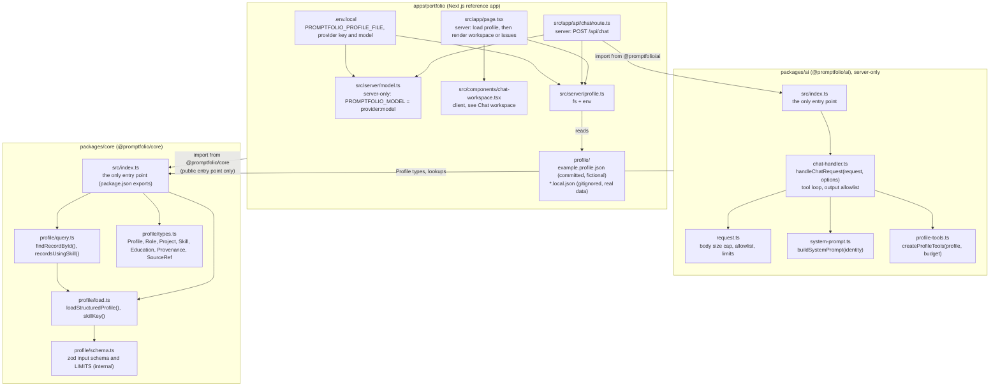
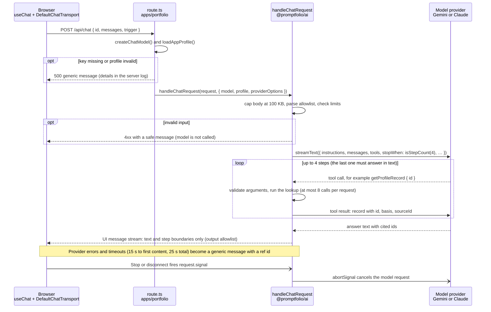
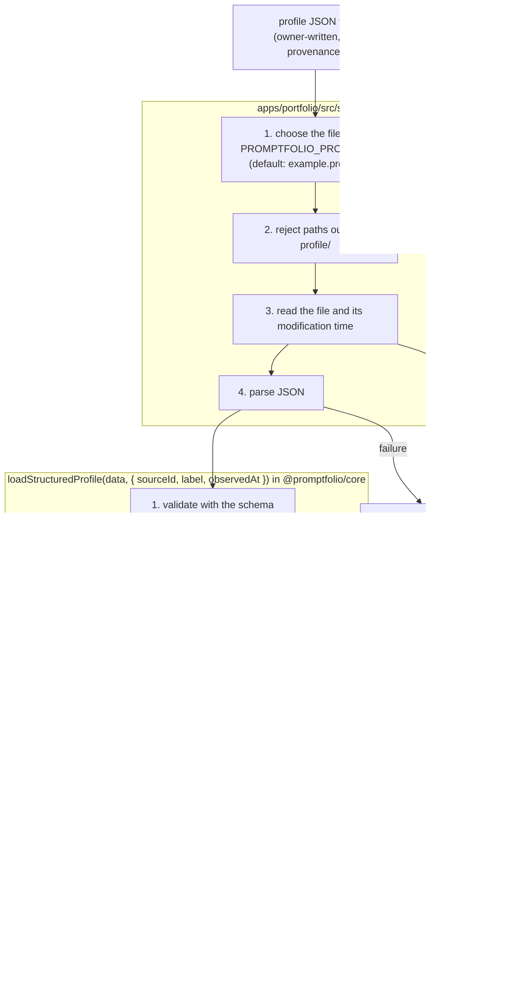
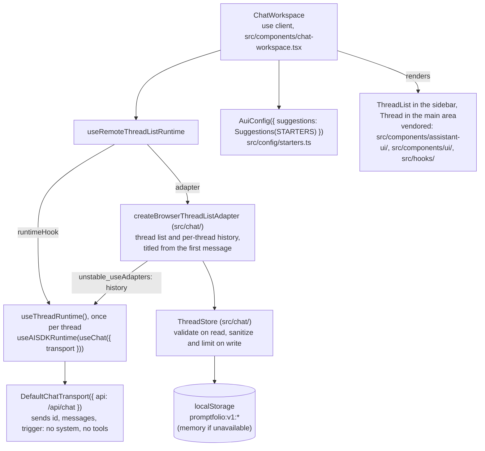
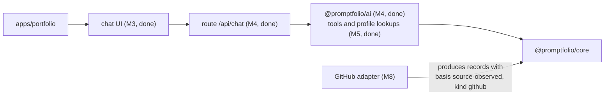

# Promptfolio architecture

A living overview of the current architecture. Update it when a milestone changes the structure.
Decisions and their rationale are recorded in [`docs/adr/`](adr/); milestone progress is tracked
in [`ROADMAP.md`](ROADMAP.md#status).

## Packages and dependency direction



`core` depends on zod only: no Node.js, browser, React, Next.js, or AI SDK code. `ai` depends on
`core`, zod, and the AI SDK (`ai`), but on no provider package: the app passes in a model.
Dependencies point only towards the packages; packages never import the app
([ADR 0002](adr/0002-library-first-monorepo-boundaries.md)).

## Chat request flow



The server owns the instructions and the tools: the client never sends a system prompt or tools,
and the handler would drop them if it did. Tool calls and results stay on the server; the browser
receives only the answer. See [tool calling](learning/tool-calling.md),
[validation at boundaries](learning/validation-at-boundaries.md), and
[server-side secrets](learning/server-side-secrets.md).

## Profile loading flow



## Chat workspace

The UI and thread state come from assistant-ui ([ADR 0007](adr/0007-chat-ui-assistant-ui.md));
Promptfolio code wires the runtime and supplies adapters and configuration.



`useChatRuntime` from `@assistant-ui/ai-sdk` would bundle the per-thread part, but it builds its
own thread list and cannot use the titled adapter, so the workspace composes `useChat` (AI SDK)
and `useAISDKRuntime` (assistant-ui) itself. Messages have `parts`; the browser only ever receives
text and step boundaries, because tool activity stays on the server (M5).

Conversations are saved only in the visitor's browser (M6): the server stores no history and still
validates every request, so saved history is as untrusted as typed history. The store keeps only
the shape the server accepts, validates what it reads back, and enforces thread, size, and 30-day
retention limits. See [browser persistence](learning/browser-persistence.md) and the
[M6 plan](plans/m6-browser-conversation-persistence.md).

## Canonical profile model

```
Profile
 ├─ schemaVersion: 1
 ├─ identity      { name, headline, summary, location?, provenance }
 ├─ links[]       { label, url, provenance }
 ├─ experience[]  { id, organization, title, start, end?, highlights[], skills[], provenance }
 ├─ projects[]    { id, name, description, roleId? → experience.id,
 │                  responsibilities[], outcomes[], links[], skills[] → skills.name, provenance }
 ├─ skills[]      { name (case-insensitive key), category?, provenance }
 ├─ education[]   { id, institution, credential, field?, start?, end?, provenance }
 └─ sources[]     { id, kind, label, url?, retrievedAt }

provenance = { sourceId → sources.id, basis: self-reported | source-observed | derived, observedAt }
```

Record ids are the arguments of tool lookups and the targets of citations; `basis` lets the
assistant say whose claim a fact is ([ADR 0005](adr/0005-profile-model-and-provenance.md)).

## Planned extensions



## Decision records

| ADR                                                   | Decision                                      | Status   |
| ----------------------------------------------------- | --------------------------------------------- | -------- |
| [0001](adr/0001-reference-app-framework.md)           | Next.js for the reference app; serverless     | Accepted |
| [0002](adr/0002-library-first-monorepo-boundaries.md) | Library-first monorepo and package boundaries | Accepted |
| [0003](adr/0003-ai-sdk-selection.md)                  | Vercel AI SDK v7                              | Accepted |
| [0004](adr/0004-biome-lint-and-format.md)             | Biome for linting and formatting              | Accepted |
| [0005](adr/0005-profile-model-and-provenance.md)      | Canonical profile model and provenance        | Accepted |
| [0006](adr/0006-profile-data-location.md)             | Profile data location in the reference app    | Accepted |
| [0007](adr/0007-chat-ui-assistant-ui.md)              | assistant-ui, Tailwind, and shadcn for chat   | Accepted |
