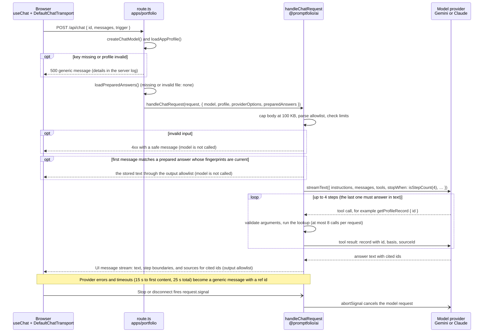
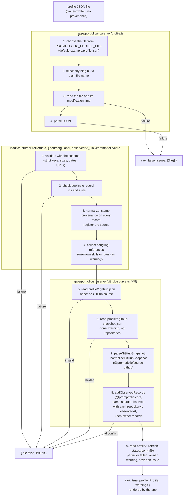
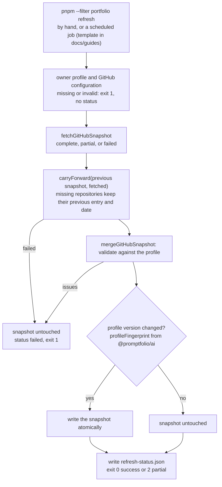
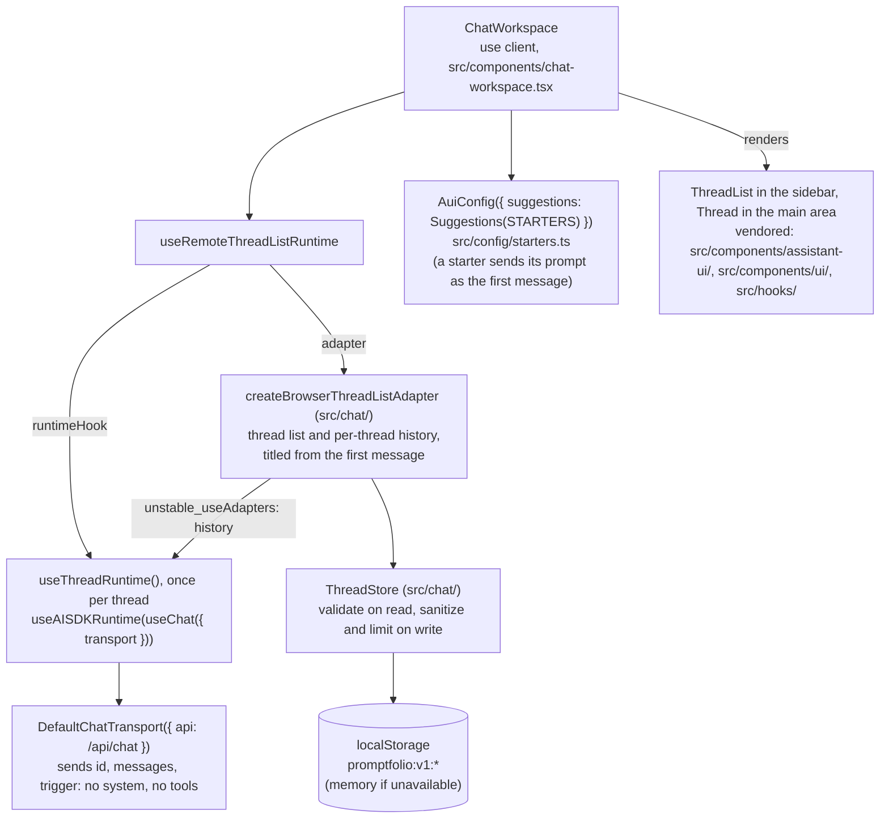
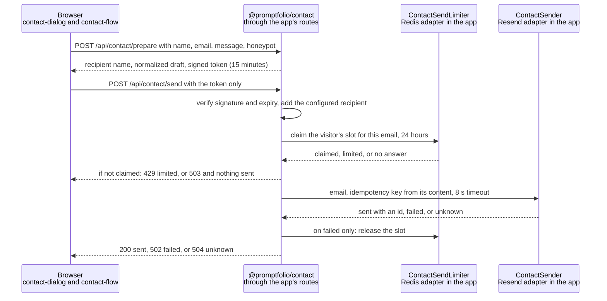
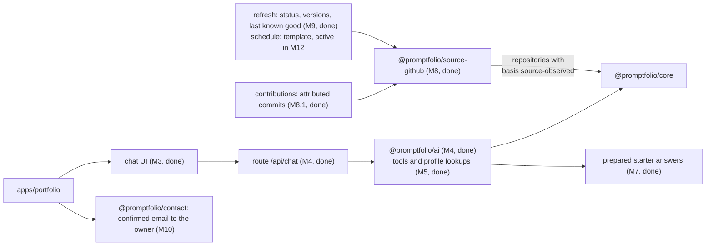

# Promptfolio architecture

A living overview of the current architecture. Update it when a milestone changes the structure.
Decisions and their rationale are recorded in [`docs/adr/`](adr/); milestone progress is tracked
in [`ROADMAP.md`](ROADMAP.md#status).

## Packages and dependency direction

`apps/minimal-consumer` (M12.1) is a second, test-backed consumer with no framework. It uses the same entry points as the reference app, and is left out of the diagram below.

```mermaid
flowchart TB
    subgraph app["apps/portfolio (Next.js reference app)"]
        direction TB
        env[".env.local<br/>PROMPTFOLIO_PROFILE_FILE, provider key and model,<br/>optional GITHUB_TOKEN (refresh command only),<br/>optional contact settings"]
        files["profile/<br/>example.profile.json (committed, fictional)<br/>*.local.json (gitignored, real data)<br/>*.answers.json (prepared starter answers)<br/>*.github.json and *.github-snapshot.json (GitHub source)<br/>*.refresh-status.json (last refresh, M9)"]
        page["src/app/page.tsx<br/>server: load profile, then render workspace or issues"]
        route["src/app/api/chat/route.ts<br/>server: POST /api/chat"]
        serverProfile["src/server/profile.ts<br/>fs + env"]
        serverGitHub["src/server/github-source.ts<br/>GitHub configuration and snapshot"]
        fetchScript["scripts/refresh.ts and src/server/refresh.ts<br/>owner-run or scheduled: pnpm --filter portfolio refresh"]
        serverModel["src/server/model.ts<br/>server-only: PROMPTFOLIO_MODEL = provider:model"]
        serverAnswers["src/server/prepared-answers.ts<br/>reads profile/*.answers.json"]
        contactRoutes["src/app/api/contact/prepare and send<br/>server: POST routes"]
        serverContact["src/server/contact.ts<br/>server-only: contact configuration,<br/>Resend and Redis adapters"]
        serverChatLimit["src/server/chat-limit.ts<br/>server-only: daily limits on live answers"]
        serverShared["src/server/redis.ts and visitor.ts<br/>server-only: the store's settings, visitor hash"]
        route --> serverChatLimit
        env --> serverChatLimit
        serverChatLimit --> serverShared
        serverContact --> serverShared
        contactRoutes --> serverContact
        env --> serverContact
        serverContact --> serverProfile
        page --> serverContact
        script["scripts/prepare-answers.ts<br/>owner-run: pnpm --filter portfolio prepare-answers"]
        workspace["src/components/chat-workspace.tsx<br/>client, see Chat workspace"]
        page --> serverProfile
        page --> workspace
        route --> serverProfile
        route --> serverModel
        route --> serverAnswers
        serverAnswers -- reads --> files
        script -- writes --> files
        env --> serverProfile
        env --> serverModel
        serverProfile -- reads --> files
        serverProfile --> serverGitHub
        serverGitHub -- reads --> files
        fetchScript -- "writes snapshot and status" --> files
    end

    subgraph ghpkg["packages/source-github (@promptfolio/source-github)"]
        direction TB
        ghIndex["src/index.ts<br/>the only entry point"]
        ghFetch["fetch.ts<br/>fetchGitHubSnapshot (the only I/O)"]
        ghSelect["select.ts<br/>pinned, then recent, capped by tier"]
        ghSnapshot["snapshot.ts<br/>response and snapshot schemas"]
        ghNormalize["normalize.ts<br/>normalizeGitHubSnapshot (pure)"]
        ghCarry["carry-forward.ts<br/>carryForward: per-repository last known good (pure)"]
        ghContributions["contributions.ts<br/>eligible commits, mirrors, caps (pure)"]
        ghIndex --> ghFetch
        ghIndex --> ghNormalize
        ghIndex --> ghCarry
        ghFetch --> ghContributions
        ghFetch --> ghSelect
        ghFetch --> ghSnapshot
        ghNormalize --> ghSnapshot
    end

    subgraph aipkg["packages/ai (@promptfolio/ai), server-only"]
        direction TB
        aiIndex["src/index.ts<br/>the only entry point"]
        handler["chat-handler.ts<br/>handleChatRequest(request, options)<br/>prepared answer or live turn"]
        turn["chat-turn.ts<br/>runChatTurn: tool loop, output allowlist"]
        prepared["prepared-answers.ts<br/>file schema, fingerprints,<br/>selection, generator"]
        request["request.ts<br/>body size cap, allowlist, limits"]
        prompt["system-prompt.ts<br/>buildSystemPrompt(identity)"]
        tools["profile-tools.ts<br/>createProfileTools(profile, budget)"]
        citations["citations.ts<br/>checks cited ids, builds sources from the profile"]
        aiIndex --> handler
        aiIndex --> prepared
        handler --> request
        handler --> prepared
        handler --> turn
        prepared --> turn
        turn --> prompt
        turn --> tools
    end

    subgraph contactpkg["packages/contact (@promptfolio/contact), server handlers"]
        direction TB
        contactIndex["src/index.ts<br/>the only entry point"]
        contactHandlers["handlers.ts<br/>handleContactPrepare, handleContactSend,<br/>ContactSender and ContactSendLimiter interfaces"]
        contactRequest["request.ts<br/>size cap, strict schemas, honeypot"]
        contactToken["token.ts<br/>signed confirmation token"]
        contactMessage["message.ts<br/>email text, idempotency key"]
        contactIndex --> contactHandlers
        contactHandlers --> contactRequest
        contactHandlers --> contactToken
        contactHandlers --> contactMessage
        contactToken --> contactRequest
    end

    subgraph core["packages/core (@promptfolio/core)"]
        direction TB
        index["src/index.ts<br/>the only entry point (package.json exports)"]
        load["profile/load.ts<br/>loadStructuredProfile(), skillKey()"]
        query["profile/query.ts<br/>findRecordById(), recordsUsingSkill()"]
        canonical["profile/canonical.ts<br/>canonicalProfileContent()"]
        observed["profile/observed.ts<br/>addObservedRecords()"]
        schema["profile/schema.ts<br/>zod input schema and LIMITS (internal)"]
        types["profile/types.ts<br/>Profile, Role, Project, Skill, Education,<br/>Repository, Provenance, SourceRef"]
        index --> load
        index --> query
        index --> canonical
        index --> observed
        index --> types
        observed --> schema
        load --> schema
        query --> load
    end

    app -- "import from @promptfolio/core<br/>(public entry point only)" --> index
    route -- "import from @promptfolio/ai" --> aiIndex
    contactRoutes -- "import from @promptfolio/contact" --> contactIndex
    script -- "generatePreparedAnswer" --> aiIndex
    aipkg -- "Profile types, lookups" --> index
    serverGitHub -- "parse, normalize" --> ghIndex
    fetchScript -- "fetchGitHubSnapshot, carryForward" --> ghIndex
    fetchScript -- "profileFingerprint" --> aiIndex
    ghpkg -- "ObservedRecords types" --> index
```



`core` depends on zod only: no Node.js, browser, React, Next.js, or AI SDK code. `ai` depends on
`core`, zod, and the AI SDK (`ai`), but on no provider package: the app passes in a model.
`contact` depends on zod only, and the app supplies its recipient, email provider, and store (M10).
`source-github` depends on `core` and zod and uses the global `fetch`; only the refresh command
calls it with the network, the app only parses and normalizes the snapshot file (M8).
The refresh command also uses its `carryForward` and `@promptfolio/ai`'s `profileFingerprint` (M9).
Dependencies point only towards the packages; packages never import the app
([ADR 0002](adr/0002-library-first-monorepo-boundaries.md)).

## Chat request flow



A prepared answer is used only for the first message of a conversation, on an exact question
match, when the profile content and the instructions are unchanged since it was generated;
otherwise the request is answered live (M7, [ADR 0008](adr/0008-prepared-answers-as-files.md),
[prepared answers and invalidation](learning/prepared-answers-and-invalidation.md)).

A live answer first takes one count from the daily limits, 30 per visitor and 200 for the site, held in
Redis. If the limit is reached the visitor gets a 429, and if it cannot be checked a 503; the model is not
called in either case (M11.1, [ADR 0013](adr/0013-chat-daily-limits.md)).

When an answer finishes, the server checks its cited ids against the records returned in that turn and
sends the sources as a separate `data-sources` chunk, built from the profile. The page draws them in their
own panel, saves them with the thread, and leaves them out when it sends the thread back (M11.2).

The server owns the instructions and the tools: the client never sends a system prompt or tools,
and the handler would drop them if it did. Tool calls and results stay on the server; the browser
receives only the answer. See [tool calling](learning/tool-calling.md),
[validation at boundaries](learning/validation-at-boundaries.md), and
[server-side secrets](learning/server-side-secrets.md).

## Profile loading flow



The snapshot is written only by `pnpm --filter portfolio refresh` (M8, extended in M9), which calls
GitHub and selects the owner's repositories automatically. Requests never call GitHub. See
[ADR 0009](adr/0009-github-source-as-fetched-snapshot.md) and
[source adapters and snapshots](learning/source-adapters-and-snapshots.md).

## Refresh flow



The profile version is the content fingerprint that prepared answers already carry, so a new
version makes them stale (answered live) until the owner regenerates them. A refresh that finds
nothing new writes only the status file, so a scheduled job commits nothing
([ADR 0010](adr/0010-refresh-status-and-content-versions.md),
[refresh status and last known good](learning/refresh-status-and-last-known-good.md),
[scheduled jobs](learning/scheduled-jobs.md)).

## Chat workspace

The UI and thread state come from assistant-ui ([ADR 0007](adr/0007-chat-ui-assistant-ui.md));
Promptfolio code wires the runtime and supplies adapters and configuration.



`useChatRuntime` from `@assistant-ui/ai-sdk` would bundle the per-thread part, but it builds its
own thread list and cannot use the titled adapter, so the workspace composes `useChat` (AI SDK)
and `useAISDKRuntime` (assistant-ui) itself. Messages have `parts`; the browser only ever receives
text, step boundaries, and sources, because tool activity stays on the server (M5).

Conversations are saved only in the visitor's browser (M6): the server stores no history and still
validates every request, so saved history is as untrusted as typed history. The store keeps only
the shape the server accepts, validates what it reads back, and enforces thread, size, and 30-day
retention limits. See [browser persistence](learning/browser-persistence.md) and the
[M6 plan](plans/m6-browser-conversation-persistence.md).

## Contact flow

A Contact button, shown only when the server has a complete configuration, opens a dialog (M10). The
model plays no part: it has no contact tool, and the routes call no model.



The owner's address stays in the server environment; the browser sees the owner's name. The server stores
no message: Redis holds only a keyed hash of the visitor's IP address and the email's hash, for 24 hours,
which limits a visitor to one email a day (M10.1). Duplicates are stopped by the provider's idempotency key
([ADR 0012](adr/0012-contact-workflow.md),
[contact confirmation and idempotency](learning/contact-confirmation-and-idempotency.md),
[abuse protection on serverless](learning/abuse-protection-on-serverless.md),
[setup guide](guides/contact-setup.md)).

## Canonical profile model

```
Profile
 ├─ schemaVersion: 1
 ├─ identity      { name, headline, summary, location?, provenance }
 ├─ links[]       { label, url, provenance }
 ├─ experience[]  { id, organization, title, start, end?, highlights[], skills[], provenance }
 ├─ projects[]    { id, name, description, roleId? → experience.id,
 │                  responsibilities[], outcomes[], links[], skills[] → skills.name, provenance }
 ├─ skills[]      { name (case-insensitive key), category?, provenance }
 ├─ education[]   { id, institution, credential, field?, start?, end?, provenance }
 ├─ repositories[] { id (source key, e.g. github.com/owner/name), name, fullName, url,
 │                  description?, homepage?, languages[{ name, percent }], topics[], fork,
 │                  archived, created?, lastActivity?, license?, readme?, provenance }
 ├─ contributions[] { id (source key, e.g. github.com/owner/name/commit/<hash>), title, url,
 │                  repositoryId, repository, repositoryUrl, repositoryDescription?, authored,
 │                  provenance }
 └─ sources[]     { id, kind, label, url?, retrievedAt }

provenance = { sourceId → sources.id, basis: self-reported | source-observed | derived, observedAt }
```

Record ids are the arguments of tool lookups and the targets of citations; `basis` lets the
assistant say whose claim a fact is ([ADR 0005](adr/0005-profile-model-and-provenance.md)). Ids
are slugs for records only the owner writes and source keys for records observed in a source; a
project with a repository's id is the owner's description of that repository, returned with it as
`ownerNotes` ([ADR 0009](adr/0009-github-source-as-fetched-snapshot.md)).

## Planned extensions



## Decision records

| ADR                                                   | Decision                                      | Status   |
| ----------------------------------------------------- | --------------------------------------------- | -------- |
| [0001](adr/0001-reference-app-framework.md)           | Next.js for the reference app; serverless     | Accepted |
| [0002](adr/0002-library-first-monorepo-boundaries.md) | Library-first monorepo and package boundaries | Accepted |
| [0003](adr/0003-ai-sdk-selection.md)                  | Vercel AI SDK v7                              | Accepted |
| [0004](adr/0004-biome-lint-and-format.md)             | Biome for linting and formatting              | Accepted |
| [0005](adr/0005-profile-model-and-provenance.md)      | Canonical profile model and provenance        | Accepted |
| [0006](adr/0006-profile-data-location.md)             | Profile data location in the reference app    | Accepted |
| [0007](adr/0007-chat-ui-assistant-ui.md)              | assistant-ui, Tailwind, and shadcn for chat   | Accepted |
| [0008](adr/0008-prepared-answers-as-files.md)         | Prepared starter answers as reviewed files    | Accepted |
| [0009](adr/0009-github-source-as-fetched-snapshot.md) | GitHub as a fetched snapshot, source-key ids  | Accepted |
| [0010](adr/0010-refresh-status-and-content-versions.md) | Refresh status, last known good, content versions | Accepted |
| [0011](adr/0011-contributions-as-attributed-commits.md) | Contributions as attributed commits | Accepted |
| [0012](adr/0012-contact-workflow.md) | Contact through a signed confirmation and a daily limit | Accepted |
