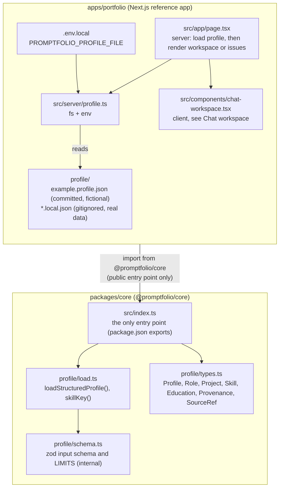
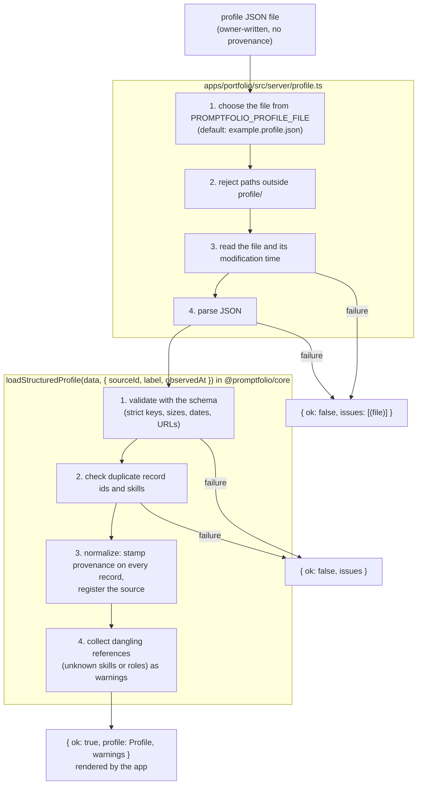
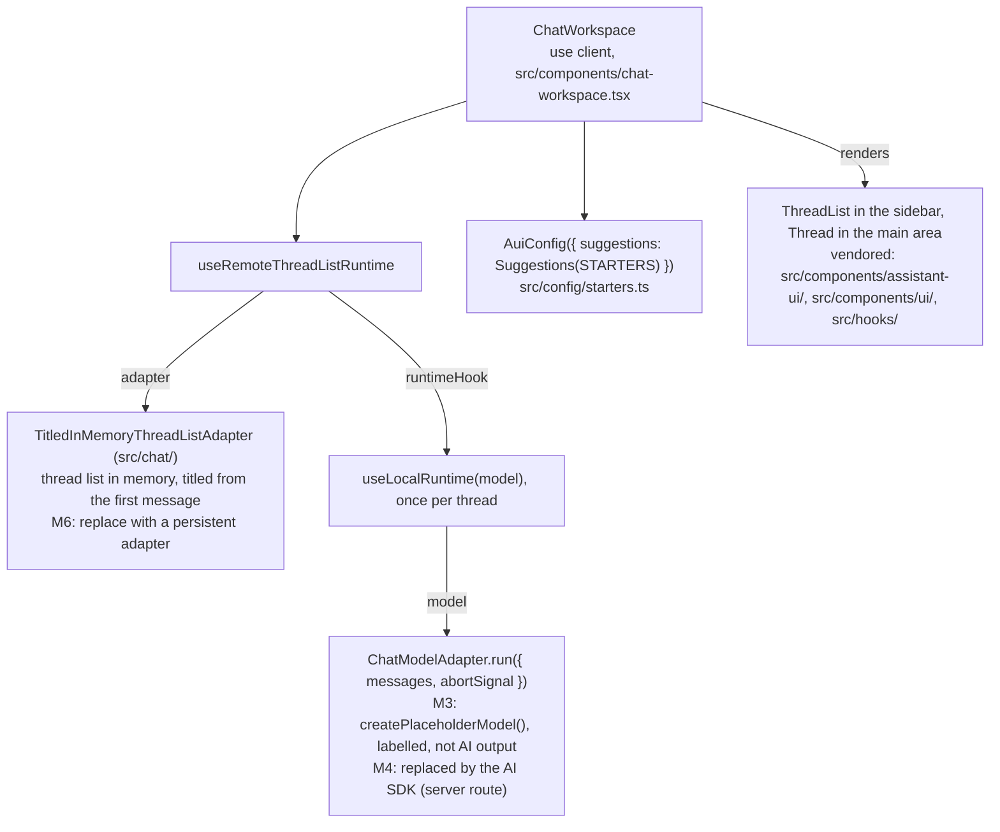
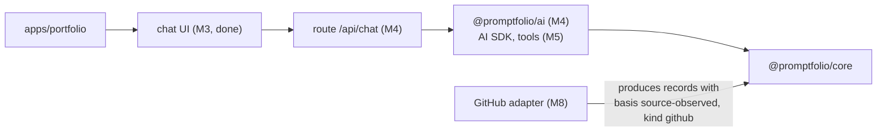

# Promptfolio architecture

A living overview of the current architecture. Update it when a milestone changes the structure.
Decisions and their rationale are recorded in [`docs/adr/`](adr/); milestone progress is tracked
in [`ROADMAP.md`](ROADMAP.md#status).

## Packages and dependency direction



`core` depends on zod only: no Node.js, browser, React, Next.js, or AI SDK code. Dependencies point
only towards `core`; packages never import the app
([ADR 0002](adr/0002-library-first-monorepo-boundaries.md)).

## Profile loading flow



## Chat workspace

The UI and thread state come from assistant-ui ([ADR 0007](adr/0007-chat-ui-assistant-ui.md));
Promptfolio code wires the runtime and supplies adapters and configuration.



Message shape: each message has `parts` (for example text, later tool calls), the same model the
AI SDK uses, so M4 can swap the placeholder model without changing the UI.

## Canonical profile model

```
Profile
 ├─ schemaVersion: 1
 ├─ identity      { name, headline, summary, location?, provenance }
 ├─ links[]       { label, url, provenance }
 ├─ experience[]  { id, organization, title, start, end?, highlights[], skills[], provenance }
 ├─ projects[]    { id, name, description, roleId? → experience.id,
 │                  responsibilities[], outcomes[], links[], skills[] → skills.name, provenance }
 ├─ skills[]      { name (case-insensitive key), category?, provenance }
 ├─ education[]   { id, institution, credential, field?, start?, end?, provenance }
 └─ sources[]     { id, kind, label, url?, retrievedAt }

provenance = { sourceId → sources.id, basis: self-reported | source-observed | derived, observedAt }
```

Record ids are the targets of future tool lookups and citations; `basis` lets the assistant say
whose claim a fact is ([ADR 0005](adr/0005-profile-model-and-provenance.md)).

## Planned extensions



## Decision records

| ADR                                                   | Decision                                      | Status   |
| ----------------------------------------------------- | --------------------------------------------- | -------- |
| [0001](adr/0001-reference-app-framework.md)           | Next.js for the reference app; serverless     | Accepted |
| [0002](adr/0002-library-first-monorepo-boundaries.md) | Library-first monorepo and package boundaries | Accepted |
| [0003](adr/0003-ai-sdk-selection.md)                  | Vercel AI SDK v7 (confirm at M4)              | Proposed |
| [0004](adr/0004-biome-lint-and-format.md)             | Biome for linting and formatting              | Accepted |
| [0005](adr/0005-profile-model-and-provenance.md)      | Canonical profile model and provenance        | Accepted |
| [0006](adr/0006-profile-data-location.md)             | Profile data location in the reference app    | Accepted |
| [0007](adr/0007-chat-ui-assistant-ui.md)              | assistant-ui, Tailwind, and shadcn for chat   | Accepted |
