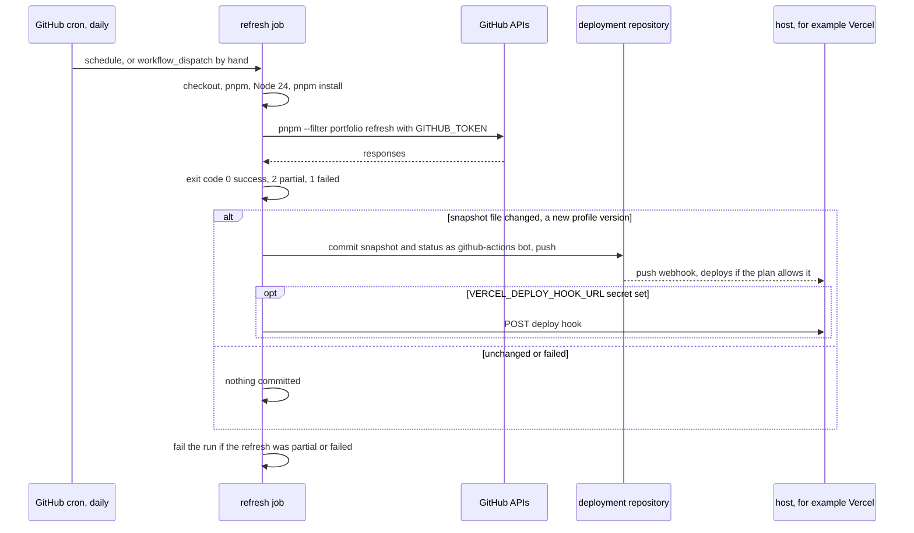

# Scheduled refresh with GitHub Actions

How to run `pnpm --filter portfolio refresh` every day in the repository that **deploys** a real
profile, and commit the GitHub data when the profile version changed.

> **Status:** template, not run. This reference repository has no active workflow: it has no
> remote, its example profile has no GitHub source, and it must stay independent of any real
> profile ([ADR 0006](../adr/0006-profile-data-location.md)). The workflow is activated and its
> first real run checked in the deployment repository (M12). Design and decisions:
> [M9 plan](../plans/m9-refresh-pipeline-and-versions.md#scheduling-decision-6),
> [ADR 0010](../adr/0010-refresh-status-and-content-versions.md).

## What the job does



The refresh rewrites the snapshot only when the profile version (its content fingerprint)
changed, so "the snapshot file changed" is the commit condition. A run that finds nothing new
commits nothing and does not redeploy.

## The workflow file

Save as `.github/workflows/refresh-profile.yml` in the deployment repository. It assumes the
same layout as this repository (`apps/portfolio`) and profile files whose names do **not** end in
`.local.json`: in the deployment repository the profile data is meant to be committed.

```yaml
name: Refresh profile sources

on:
  schedule:
    # 04:17 UTC daily. Off the hour: runs at the start of an hour are delayed most.
    - cron: "17 4 * * *"
  workflow_dispatch:

# Everything not listed is "none". contents: write lets the job push the snapshot.
permissions:
  contents: write

# One refresh at a time, so two runs never push over each other.
concurrency:
  group: refresh-profile

jobs:
  refresh:
    runs-on: ubuntu-latest
    timeout-minutes: 10
    env:
      PROMPTFOLIO_PROFILE_FILE: ${{ vars.PROMPTFOLIO_PROFILE_FILE }}
      VERCEL_DEPLOY_HOOK_URL: ${{ secrets.VERCEL_DEPLOY_HOOK_URL }}
    steps:
      - uses: actions/checkout@v7
      - uses: pnpm/action-setup@v6 # pnpm version from packageManager in package.json
      - uses: actions/setup-node@v7
        with:
          node-version: 24
          cache: pnpm
      - run: pnpm install

      - id: refresh
        name: Refresh
        run: pnpm --filter portfolio refresh
        continue-on-error: true # commit a partial result (exit 2) before failing the run
        env:
          GITHUB_TOKEN: ${{ secrets.GITHUB_TOKEN }}

      - id: commit
        name: Commit a new profile version
        run: |
          base="apps/portfolio/profile/${PROMPTFOLIO_PROFILE_FILE%.json}"
          git add -- "$base.github-snapshot.json"
          if git diff --cached --quiet; then
            echo "Profile version unchanged: nothing to commit."
            exit 0
          fi
          git add -- "$base.refresh-status.json"
          git config user.name "github-actions[bot]"
          git config user.email "41898282+github-actions[bot]@users.noreply.github.com"
          git commit -m "chore(data): refresh profile sources"
          git push
          echo "pushed=true" >> "$GITHUB_OUTPUT"

      # Optional: start a deployment even if the host ignores pushes by the bot.
      - name: Deploy hook
        if: steps.commit.outputs.pushed == 'true' && env.VERCEL_DEPLOY_HOOK_URL != ''
        run: curl --fail --silent --show-error -X POST "$VERCEL_DEPLOY_HOOK_URL" > /dev/null

      # Optional, off by default: regenerate prepared answers with a model key secret.
      # Commits model output without the owner's review (see "Prepared answers" below).
      # - name: Prepare answers
      #   if: steps.commit.outputs.pushed == 'true'
      #   run: pnpm --filter portfolio prepare-answers
      #   env:
      #     PROMPTFOLIO_MODEL: ${{ vars.PROMPTFOLIO_MODEL }}
      #     GOOGLE_GENERATIVE_AI_API_KEY: ${{ secrets.GOOGLE_GENERATIVE_AI_API_KEY }}

      - name: Report a partial or failed refresh
        if: steps.refresh.outcome == 'failure'
        run: |
          echo "The refresh was partial (exit 2) or failed (exit 1); see the Refresh step."
          exit 1
```

## Setup checklist (in the deployment repository)

1. Commit the profile, its `.github.json`, and a first snapshot from a local
   `pnpm --filter portfolio refresh`.
2. Repository variable `PROMPTFOLIO_PROFILE_FILE` (Settings, Secrets and variables, Actions,
   Variables), for example `profile.json`.
3. Settings, Actions, General, Workflow permissions: the job asks for `contents: write`; an
   organization may restrict it.
4. Optional secret `VERCEL_DEPLOY_HOOK_URL` (Vercel project, Settings, Git, Deploy Hooks).
5. Run it once by hand (Actions, the workflow, Run workflow) and read the Refresh step's output.

## Facts this relies on

Checked in the official documentation on 2026-10-30; recheck when activating.

| Fact | Consequence | Source |
| ---- | ----------- | ------ |
| Scheduled workflows run on the default branch, at most every 5 minutes, in UTC by default, and can be delayed under load (queued jobs may be dropped) | A daily run at an odd minute; a missed day is caught up the next day | [Events that trigger workflows: schedule](https://docs.github.com/en/actions/reference/workflows-and-actions/events-that-trigger-workflows#schedule) |
| In a **public** repository, scheduled workflows are disabled after 60 days without repository activity | Only matters for a public deployment repository; whether the job's own commits count is not stated, so after a quiet stretch re-enable the workflow | same page |
| Events caused by `GITHUB_TOKEN` create no new workflow runs, except `workflow_dispatch` and `repository_dispatch` | The job's push does not start CI or a deploy workflow in GitHub Actions | [GITHUB_TOKEN](https://docs.github.com/en/actions/concepts/security/github_token) |
| `GITHUB_TOKEN` allows 1,000 REST requests per hour per repository | One run needs at most about 43 | [REST rate limits](https://docs.github.com/en/rest/using-the-rest-api/rate-limits-for-the-rest-api) |
| Declaring `permissions` sets every unlisted permission to `none`; `concurrency` allows one run per group | Least privilege, no overlapping pushes | [Workflow syntax](https://docs.github.com/en/actions/reference/workflows-and-actions/workflow-syntax) |
| Vercel for GitHub deploys every push by default (through its GitHub App, not a GitHub workflow) | The bot's push can deploy | [Vercel for GitHub](https://vercel.com/docs/git/vercel-for-github) |
| On a Hobby team with a **private** repository, only the account owner can trigger deployments; the docs do not say how bot commits are treated | The push may not deploy: use the deploy hook | [Why aren't commits triggering deployments](https://vercel.com/kb/guide/why-aren-t-commits-triggering-deployments-on-vercel) |
| A deploy hook is a secret URL that deploys a chosen branch on `GET` or `POST`, 60 per hour per project | Store it as a secret; anyone with it can deploy | [Deploy Hooks](https://vercel.com/docs/deploy-hooks) |
| `actions/checkout@v7`, `pnpm/action-setup@v6` (reads `packageManager`, does not install Node), `actions/setup-node@v7` (`cache: pnpm`) | Action versions in the template | their READMEs on GitHub |

**Not verified, check in the first run:** whether `GITHUB_TOKEN` can read a user's pinned
repositories through GraphQL (the refresh reports `unauthorized` for the pinned query if not);
whether the host deploys the bot's push.

## Prepared answers

A new profile version makes prepared answers stale; starters are then answered live until they
are regenerated. The refresh says how many still belong to the current version. Regeneration is
**not** part of the job by default: prepared answers are reviewed files
([ADR 0008](../adr/0008-prepared-answers-as-files.md)), it needs a model key secret, and free
model tiers limit requests per minute and per day. The usual loop: the job commits new data,
the owner pulls, runs `pnpm --filter portfolio prepare-answers`, reviews, and commits.
