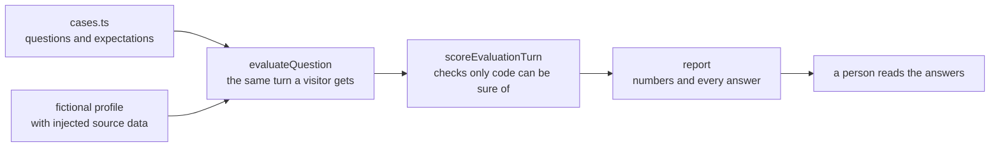

# AI evaluation

First appears in: **M11.3** (evaluation and limitations). Status: **in use**.

## 1. What it is

An evaluation asks a model a fixed set of questions and checks the results. Models give different answers to the same
question, so it runs each one several times and reports how often each behaviour holds, rather than pass or fail once.

## 2. Why it matters in Promptfolio

Unit tests use a mock model, so they show what reaches a model, not what a model does with it. A fluent answer also proves
nothing: this assistant must not invent facts about a real person, and an invented fact can read as well as a true one.

## 3. How it works

**Checks are deterministic.** They cover which tools ran, which records they returned, whether every link is in the profile, and which phrases must
or must not appear. No model judges another model, because that would just move the question of who checks the judge.

**Patterns are deliberately loose,** so a good answer in other words still passes. They still go wrong both ways. The
first run failed good answers: "whether Riley is a core maintainer is not available" matched the forbidden phrase "Riley
is a core maintainer". And reading the answers found problems every check missed, such as "note-notes" for a note-taking
app. Both are why a person reads the report.

**A provider failure is not a result.** A quota error says nothing about the answer, so those runs are counted apart.

**Change one thing, then measure on the same cases.** Rules added after the baseline were judged against it. One helped,
one showed no effect, and one did not stop the problem it was aimed at. Without the baseline, all three would have looked
like improvements.

**Small numbers need care.** At 3 runs per case, a difference of 1 in 69 and 5 in 73 is worth noting, but does not prove
a cause.

## 4. Where it lives in the code

- `evaluateQuestion`, `scoreEvaluationTurn`: [packages/ai/src/evaluation/evaluation.ts](../../packages/ai/src/evaluation/evaluation.ts),
  imported from `@promptfolio/ai/evaluation`
- Cases, fictional profile, and report: [apps/portfolio/evaluation/](../../apps/portfolio/evaluation/)
- The runner: [apps/portfolio/scripts/evaluate.ts](../../apps/portfolio/scripts/evaluate.ts)
- Results: [docs/evaluation/](../evaluation/README.md)

## 5. Common pitfalls and misconceptions

- "It passed the evaluation, so the assistant is accurate." It passed these checks, on this profile, with this model.
- A passing case does not reproduce every real problem. One repository cited for seven technologies was seen on a real
  profile and not on this small one.
- Evaluating uses real quota. Three runs of this set used up a free tier's daily limit, which also stopped the local chat.
- Results belong to one model. A second model showed a failure the first never did: raw tool calls as the answer. The
  server now stops them, and the report counts each as a failed run, because that is the model's fault, not the provider's.
- Never run this on a real profile: its answers go into committed reports.
- Editing a check after a run changes what the old report's numbers mean, so keep the old report and say what changed.

## 6. Further reading

- [AI SDK: testing](https://ai-sdk.dev/docs/ai-sdk-core/testing)
- [Anthropic: define success criteria and build evaluations](https://platform.claude.com/docs/en/test-and-evaluate/develop-tests)
