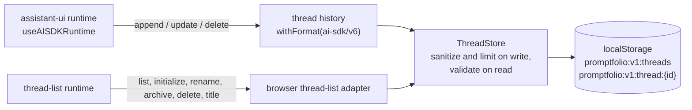

# Browser persistence

First appears in: **M6** (conversation persistence). Status: **in use**.

## 1. What it is

Saving data in the visitor's own browser so it survives a reload or a later visit. Promptfolio
uses `localStorage`: a synchronous key-value store of strings, about 5 million characters per
origin, kept per browser profile and shared by all tabs of that origin. It is never sent to the
server by itself (unlike cookies), and it can be unavailable: private windows may start empty and
forget it, browsers can block it, and a full quota makes writes throw `QuotaExceededError`.

## 2. Why it matters in Promptfolio

Visitors can come back to a conversation without accounts, cookies, or a database. The server
(serverless, [ADR 0001](../adr/0001-reference-app-framework.md)) stays stateless and stores no
visitor's history, so there is nothing on the server to leak between visitors: isolation comes
from the browser (one origin's storage is invisible to other sites, browsers, and devices).

What it does **not** do: make history trustworthy. A saved conversation is as untrusted as a typed
one. The server validates every request exactly as before ([validation at
boundaries](validation-at-boundaries.md)), and tool results are still never sent to the browser,
so they are never saved ([tool calling](tool-calling.md)).

## 3. How it works

- **Two adapters, one store.** The thread-list adapter knows which threads exist; the history
  adapter (one per thread, returned from `unstable_useAdapters`) knows their messages. Both write
  through `ThreadStore`.
- **Minimal data.** Only `id`, `parentId`, `role` (`user` or `assistant`), and `text` and
  `step-start` parts, and since M11.2 an answer's checked sources, are written: the same shape the server accepts. Metadata, provider fields,
  and any other part type are dropped before writing.
- **Validated on read.** Anything read back may be malformed, old, oversized, or edited by hand,
  by an extension, or by script on the same origin. zod schemas check it; invalid entries are
  dropped, and so is a message whose parent was not accepted before it. Nothing is thrown.
- **Versioned keys.** The `promptfolio:v1:` prefix lets a later format ignore or migrate this one.
  Keys of other versions and other apps are never read or removed.
- **Limits and retention in code** ([storage-limits.ts](../../apps/portfolio/src/chat/threads/storage-limits.ts)):
  20 threads (the least recently used is removed), 30 days without a new message, 60 messages
  per thread, 16,000 characters per message, and 200,000 characters per thread. A write over a
  limit is skipped with a warning (no content in it); the conversation goes on in memory.
- **Fallback.** If storage cannot be written (server rendering, blocked, full), memory storage is
  used: threads are forgotten on reload, as before M6.

## 4. Where it lives in the code

- Store, schemas, limits, retention: [apps/portfolio/src/chat/threads/thread-store.ts](../../apps/portfolio/src/chat/threads/thread-store.ts),
  [storage-limits.ts](../../apps/portfolio/src/chat/threads/storage-limits.ts)
- assistant-ui adapters: [apps/portfolio/src/chat/threads/browser-thread-list-adapter.ts](../../apps/portfolio/src/chat/threads/browser-thread-list-adapter.ts)
- `localStorage` or memory: [apps/portfolio/src/chat/threads/browser-storage.ts](../../apps/portfolio/src/chat/threads/browser-storage.ts)
- Wiring and the "saved only in this browser" notice: [apps/portfolio/src/components/chat/chat-workspace.tsx](../../apps/portfolio/src/components/chat/chat-workspace.tsx)
- Tests: [thread-store.test.ts](../../apps/portfolio/src/chat/threads/thread-store.test.ts),
  [browser-thread-list-adapter.test.ts](../../apps/portfolio/src/chat/threads/browser-thread-list-adapter.test.ts),
  and [restored-thread.test.ts](../../apps/portfolio/src/chat/threads/restored-thread.test.ts) (a restored
  thread passes the server's validation)
- Plan and decisions: [M6 plan](../plans/m6-browser-conversation-persistence.md)

## 5. Common pitfalls and misconceptions

- "Saved in the browser" is not "private to the visitor": everyone using the same browser profile
  sees the same conversations, and any script on the origin can read them. Never put secrets in
  `localStorage` ([server-side secrets](server-side-secrets.md)).
- Encrypting it would not help: the key would have to live in the same browser.
- Stored data written by our own code is still untrusted when read back. Types from `JSON.parse`
  are compile-time only.
- Two open tabs can overwrite each other's thread list (the last write wins). Every call reads
  storage afresh, which narrows this to real races, but does not remove it.
- Next.js renders client components on the server first, where `window` does not exist. Storage
  is opened in a `useState` initializer that falls back to memory on the server; the browser runs
  its own initializer during hydration.
- A saved answer is shown as it was. If the profile changes later, old answers are not updated;
  new answers are looked up again.
- Saved assistant text counts against the server's 20,000-character limit for the conversation when
  the thread is continued. Since M11.1 the 4,000-character limit per message applies only to visitor
  messages, because a long live answer used to make every follow-up in its thread fail.

## 6. Further reading

- [MDN: Window.localStorage](https://developer.mozilla.org/en-US/docs/Web/API/Window/localStorage)
- [MDN: Storage quotas and eviction criteria](https://developer.mozilla.org/en-US/docs/Web/API/Storage_API/Storage_quotas_and_eviction_criteria)
- [assistant-ui documentation](https://www.assistant-ui.com/docs)
