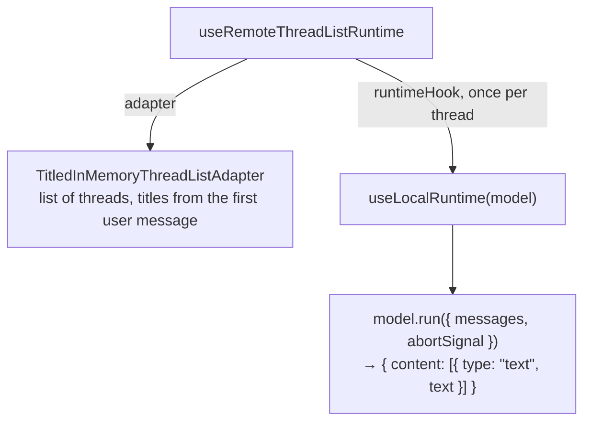

# Chat runtime and threads

First appears in: **M3** (application shell). Status: **in use** with a placeholder model.

## 1. What it is

A chat runtime is the state machine behind a chat UI: it holds the messages of a conversation
(a *thread*), sends them to a model, tracks running/error/cancelled states, and supports retry.
Promptfolio uses assistant-ui's runtime; our code supplies the model adapter and the thread-list
adapter.

## 2. Why it matters in Promptfolio

It separates three things that change on different schedules:

- the UI (vendored assistant-ui components),
- *where threads are stored* (in memory now, persistent in M6),
- *who answers* (a placeholder now, a real model in M4).

Each can be replaced without touching the others.

## 3. How it works

A message has `parts` (text now; tool calls later). On each turn the runtime passes the *whole*
thread to `run`, not just the newest message. `abortSignal` fires when the user presses stop.

The placeholder model echoes the question with a "not AI output" label. Sending `/fail` fails once
and succeeds on retry, to exercise the error state.

## 4. Where it lives in the code

- Runtime wiring: [apps/portfolio/src/components/chat-workspace.tsx](../../apps/portfolio/src/components/chat-workspace.tsx)
- Placeholder model: [apps/portfolio/src/chat/placeholder-model.ts](../../apps/portfolio/src/chat/placeholder-model.ts)
- Thread list and titles: [apps/portfolio/src/chat/thread-list-adapter.ts](../../apps/portfolio/src/chat/thread-list-adapter.ts)
- Starters: [apps/portfolio/src/config/starters.ts](../../apps/portfolio/src/config/starters.ts)
- Tests: [placeholder-model.test.ts](../../apps/portfolio/src/chat/placeholder-model.test.ts),
  [thread-list-adapter.test.ts](../../apps/portfolio/src/chat/thread-list-adapter.test.ts)
- Decision: [ADR 0007](../adr/0007-chat-ui-assistant-ui.md)
- Real model behind the runtime: **planned** (M4). Persistent threads: **planned** (M6)

## 5. Common pitfalls and misconceptions

- Threads live in the browser's memory and disappear on reload. That is intended until M6, not a
  bug.
- The runtime is client code. Anything it sends to a server (messages, and potentially a system
  prompt or tools) is untrusted input there.
- The thread-list adapter must be created once (`useState(() => new …)`); recreating it on each
  render resets all threads.
- A starter is just a pre-filled first message, not a cached answer. Cached starter answers are
  **planned** for M7.

## 6. Further reading

- [assistant-ui documentation](https://www.assistant-ui.com/docs)
- [MDN: AbortSignal](https://developer.mozilla.org/en-US/docs/Web/API/AbortSignal)
