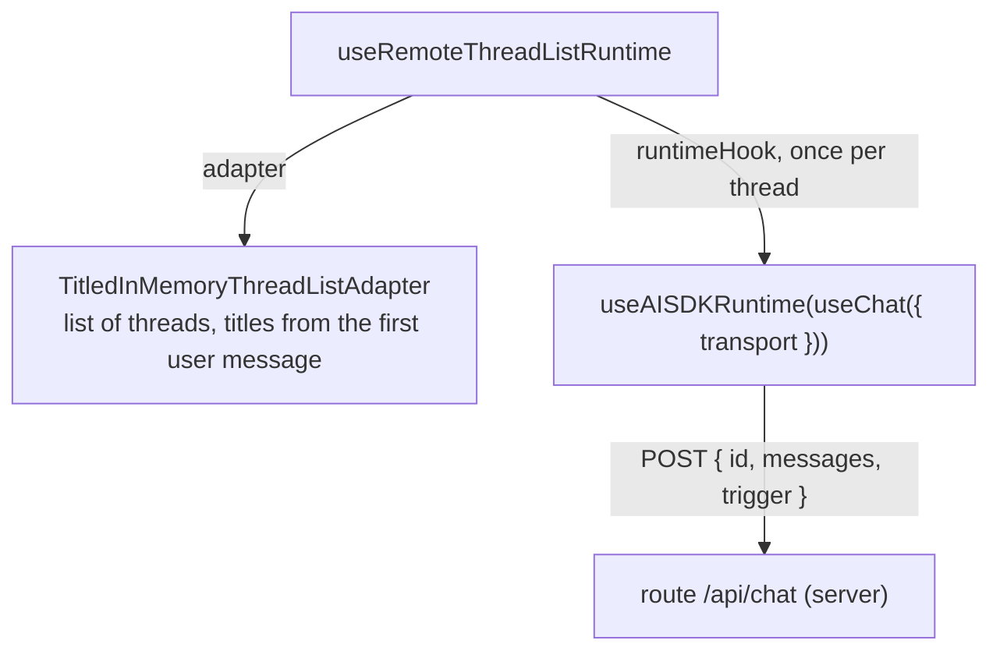

# Chat runtime and threads

First appears in: **M3** (application shell); model connected in M4. Status: **in use**.

## 1. What it is

A chat runtime is the state machine behind a chat UI: it holds the messages of a conversation
(a *thread*), sends them to a model, tracks running/error/cancelled states, and supports retry.
Promptfolio uses assistant-ui's thread-list runtime with an AI SDK chat per thread; our code
supplies the thread-list adapter and the transport to our server route.

## 2. Why it matters in Promptfolio

It separates three things that change on different schedules:

- the UI (vendored assistant-ui components),
- *where threads are stored* (in memory now, persistent in M6),
- *who answers* (a placeholder in M3, a real model behind `/api/chat` since M4).

Each can be replaced without touching the others.

## 3. How it works

`useChat` (AI SDK) owns one conversation's state and talks to the server; `useAISDKRuntime`
(assistant-ui) adapts it to the runtime the UI components read. A message has `parts` (text now;
tool calls in M5). On each turn the whole thread is sent, not just the newest message. Stop aborts
the request, which the server passes on to the provider.

assistant-ui's `useChatRuntime` bundles these two hooks, but it creates its own thread list and
cannot use our titled adapter, so the workspace composes them itself. The transport is the AI SDK's
`DefaultChatTransport`, not assistant-ui's `AssistantChatTransport`, which would also send a
`system` prompt and `tools` from the browser.

## 4. Where it lives in the code

- Runtime wiring and transport: [apps/portfolio/src/components/chat-workspace.tsx](../../apps/portfolio/src/components/chat-workspace.tsx)
- Thread list and titles: [apps/portfolio/src/chat/thread-list-adapter.ts](../../apps/portfolio/src/chat/thread-list-adapter.ts)
- Starters: [apps/portfolio/src/config/starters.ts](../../apps/portfolio/src/config/starters.ts)
- Tests: [thread-list-adapter.test.ts](../../apps/portfolio/src/chat/thread-list-adapter.test.ts)
- Decisions: [ADR 0007](../adr/0007-chat-ui-assistant-ui.md), [ADR 0003](../adr/0003-ai-sdk-selection.md)
- Persistent threads: **planned** (M6)

## 5. Common pitfalls and misconceptions

- Threads live in the browser's memory and disappear on reload. That is intended until M6, not a
  bug.
- The runtime is client code. Anything it sends to a server, including earlier "assistant"
  messages, is untrusted input there: a visitor can edit the history before sending it.
- The thread-list adapter must be created once (`useState(() => new …)`); recreating it on each
  render resets all threads.
- A starter is just a pre-filled first message, not a cached answer. Cached starter answers are
  **planned** for M7.

## 6. Further reading

- [assistant-ui documentation](https://www.assistant-ui.com/docs)
- [MDN: AbortSignal](https://developer.mozilla.org/en-US/docs/Web/API/AbortSignal)
