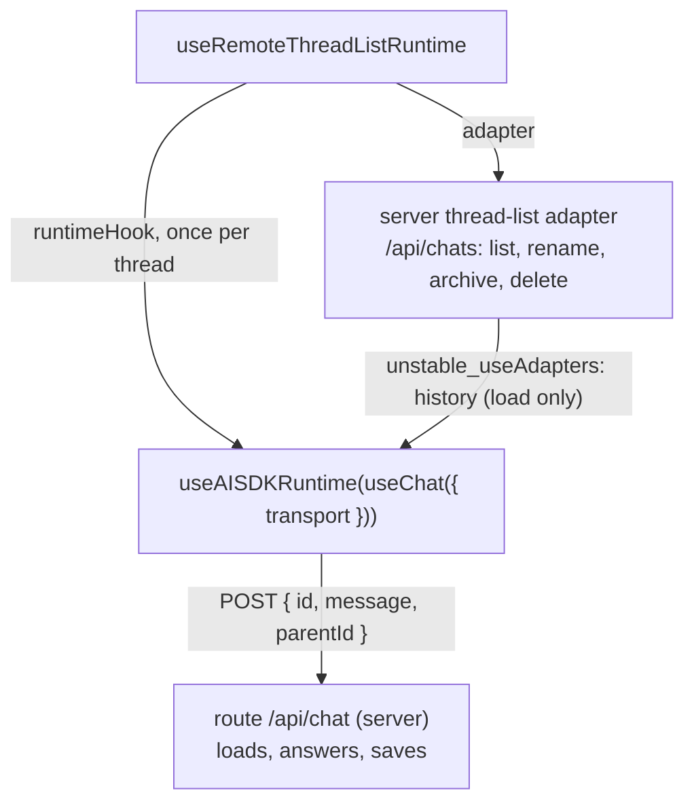

# Chat runtime and threads

First appears in: **M3** (application shell); model connected in M4; threads saved in the browser
in M6, on the server since M18.2. Status: **in use**.

## 1. What it is

A chat runtime is the state machine behind a chat UI: it holds the messages of a conversation
(a *thread*), sends them to a model, tracks running/error/cancelled states, and supports retry.
Promptfolio uses assistant-ui's thread-list runtime with an AI SDK chat per thread; our code
supplies the thread-list adapter, the per-thread history adapter, and the transport to our
server route.

## 2. Why it matters in Promptfolio

It separates three things that change on different schedules:

- the UI (vendored assistant-ui components),
- *where threads are stored* (the browser's `localStorage` in M6, the server since M18.2),
- *who answers* (a placeholder in M3, a real model behind `/api/chat` since M4).

Each can be replaced without touching the others.

## 3. How it works

`useChat` (AI SDK) owns one conversation's state and talks to the server; `useAISDKRuntime`
(assistant-ui) adapts it to the runtime the UI components read. A message has `parts`; the browser
only ever receives text and `step-start` parts, because tool activity stays on the server (M5).
Since M18.2 each turn sends only the newest message and the id of the one it follows, because the
server holds the conversation ([server-side history](server-side-history.md)). The transport takes
the thread's id from the thread list item, not from `useChat`, whose own id is random. Stop aborts
the request, which the server passes on to the provider.

assistant-ui's `useChatRuntime` bundles these two hooks, but it creates its own thread list and
cannot use our adapter, so the workspace composes them itself. The transport is the AI SDK's
`DefaultChatTransport`, not assistant-ui's `AssistantChatTransport`, which would also send a
`system` prompt and `tools` from the browser.

The adapter has two jobs. As a *thread-list adapter* it lists, creates, renames, archives,
deletes, and titles threads through `/api/chats`. Through `unstable_useAdapters` it also returns a
*history adapter* for each mounted thread; `useAISDKRuntime` reads it from context, calls
`withFormat` with the AI SDK storage format, and loads the thread's messages when it opens. Its
`append` and `update` do nothing, because the chat route saves each turn itself.

## 4. Where it lives in the code

- Runtime wiring and transport: [apps/portfolio/src/components/chat/chat-workspace.tsx](../../apps/portfolio/src/components/chat/chat-workspace.tsx)
- Thread list, history adapter, and transport: [apps/portfolio/src/chat/threads/server-thread-list-adapter.ts](../../apps/portfolio/src/chat/threads/server-thread-list-adapter.ts)
- Titles: [apps/portfolio/src/chat/threads/thread-title.ts](../../apps/portfolio/src/chat/threads/thread-title.ts)
- Saved threads: [apps/portfolio/src/server/chat/history.ts](../../apps/portfolio/src/server/chat/history.ts)
- Tests: [thread-title.test.ts](../../apps/portfolio/src/chat/threads/thread-title.test.ts),
  [server-thread-list-adapter.test.ts](../../apps/portfolio/src/chat/threads/server-thread-list-adapter.test.ts),
  [history.test.ts](../../apps/portfolio/src/server/chat/history.test.ts)
- Decisions: [ADR 0007](../adr/0007-chat-ui-assistant-ui.md), [ADR 0003](../adr/0003-ai-sdk-selection.md)

## 5. Common pitfalls and misconceptions

- Threads belong to this browser's owner cookie. Another browser, device, or private window
  starts empty, and clearing cookies loses access to them.
- The runtime is client code. Anything it sends to a server is untrusted input there, which is why
  the server now keeps the history instead of accepting it from the browser.
- assistant-ui asks for a title while the first answer is still streaming, before the server has
  saved the conversation, so the server titles a conversation itself when it first saves it.
- The thread-list adapter must be created once (`useState(() => …)`); recreating it on each
  render reloads the list and drops cached threads.
- `unstable_useAdapters` and `withFormat` are experimental assistant-ui APIs; check the adapter
  tests and a reload in the browser after upgrading assistant-ui.
- The welcome screen had fixed starters until M12.5. Since M12.10 a model writes them at build time ([generated starter questions](generated-starter-questions.md)), and a click appends an ordinary message.

## 6. Further reading

- [assistant-ui documentation](https://www.assistant-ui.com/docs)
- [MDN: AbortSignal](https://developer.mozilla.org/en-US/docs/Web/API/AbortSignal)
