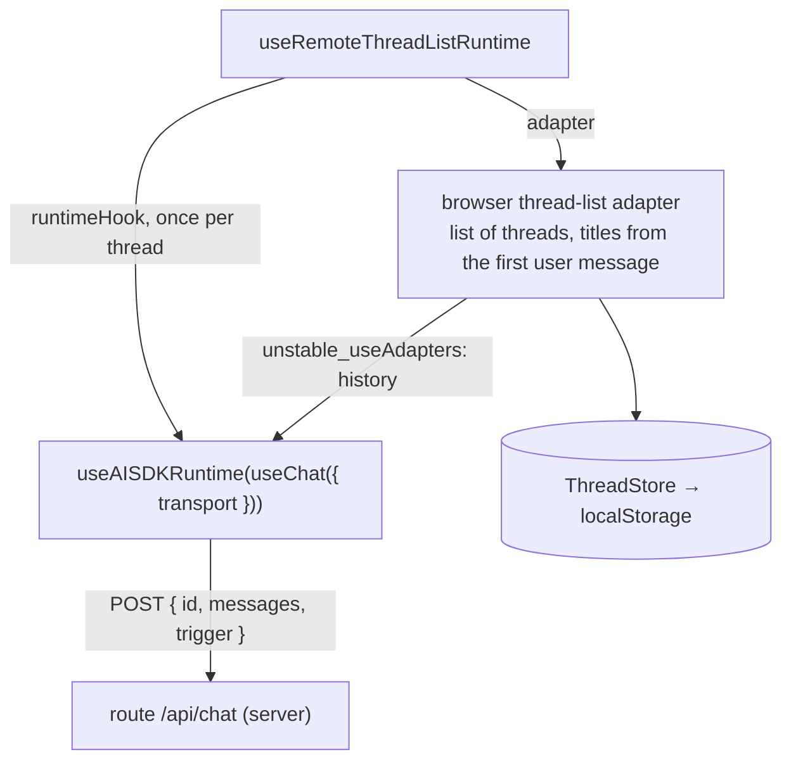

# Chat runtime and threads

First appears in: **M3** (application shell); model connected in M4; threads saved in the browser
since M6. Status: **in use**.

## 1. What it is

A chat runtime is the state machine behind a chat UI: it holds the messages of a conversation
(a *thread*), sends them to a model, tracks running/error/cancelled states, and supports retry.
Promptfolio uses assistant-ui's thread-list runtime with an AI SDK chat per thread; our code
supplies the thread-list adapter, the per-thread history adapter, and the transport to our
server route.

## 2. Why it matters in Promptfolio

It separates three things that change on different schedules:

- the UI (vendored assistant-ui components),
- *where threads are stored* (in this browser's `localStorage` since M6),
- *who answers* (a placeholder in M3, a real model behind `/api/chat` since M4).

Each can be replaced without touching the others.

## 3. How it works

`useChat` (AI SDK) owns one conversation's state and talks to the server; `useAISDKRuntime`
(assistant-ui) adapts it to the runtime the UI components read. A message has `parts`; the browser
only ever receives text, `step-start`, and `data-sources` parts (the sources panel, from M11.2, which the transport removes again before sending a thread back), because tool activity stays on the server (M5). On each turn the whole thread is sent, not just the newest message. Stop aborts
the request, which the server passes on to the provider.

assistant-ui's `useChatRuntime` bundles these two hooks, but it creates its own thread list and
cannot use our titled adapter, so the workspace composes them itself. The transport is the AI SDK's
`DefaultChatTransport`, not assistant-ui's `AssistantChatTransport`, which would also send a
`system` prompt and `tools` from the browser.

The adapter has two jobs (M6). As a *thread-list adapter* it lists, creates, renames, archives,
deletes, and titles threads. Through `unstable_useAdapters` it also returns a *history adapter*
for each mounted thread; `useAISDKRuntime` reads it from context, calls `withFormat` with the AI
SDK storage format, loads the thread's messages when it opens, and appends or updates each
message once it settles. Both write through one `ThreadStore`; see
[browser persistence](browser-persistence.md).

## 4. Where it lives in the code

- Runtime wiring and transport: [apps/portfolio/src/components/chat-workspace.tsx](../../apps/portfolio/src/components/chat-workspace.tsx)
- Thread list and history adapters: [apps/portfolio/src/chat/browser-thread-list-adapter.ts](../../apps/portfolio/src/chat/browser-thread-list-adapter.ts)
- Titles: [apps/portfolio/src/chat/thread-title.ts](../../apps/portfolio/src/chat/thread-title.ts)
- Saved threads: [apps/portfolio/src/chat/thread-store.ts](../../apps/portfolio/src/chat/thread-store.ts)
- Starters: [apps/portfolio/src/config/starters.ts](../../apps/portfolio/src/config/starters.ts)
- Tests: [thread-title.test.ts](../../apps/portfolio/src/chat/thread-title.test.ts),
  [browser-thread-list-adapter.test.ts](../../apps/portfolio/src/chat/browser-thread-list-adapter.test.ts),
  [thread-store.test.ts](../../apps/portfolio/src/chat/thread-store.test.ts)
- Decisions: [ADR 0007](../adr/0007-chat-ui-assistant-ui.md), [ADR 0003](../adr/0003-ai-sdk-selection.md)

## 5. Common pitfalls and misconceptions

- Threads are saved only in this browser. Another browser, device, or private window starts
  empty, and when storage is blocked threads disappear on reload, as before M6.
- The runtime is client code. Anything it sends to a server, including earlier "assistant"
  messages, is untrusted input there: a visitor can edit the history before sending it.
- The thread-list adapter must be created once (`useState(() => …)`); recreating it on each
  render reloads the list and drops cached threads.
- `unstable_useAdapters` and `withFormat` are experimental assistant-ui APIs; check the adapter
  tests and a reload in the browser after upgrading assistant-ui.
- A starter is still a real first message; the browser does not know about prepared answers.
  Since M7 the server answers it from a prepared answer when one is current for the profile, and
  live otherwise; see [prepared answers and invalidation](prepared-answers-and-invalidation.md).

## 6. Further reading

- [assistant-ui documentation](https://www.assistant-ui.com/docs)
- [MDN: AbortSignal](https://developer.mozilla.org/en-US/docs/Web/API/AbortSignal)
