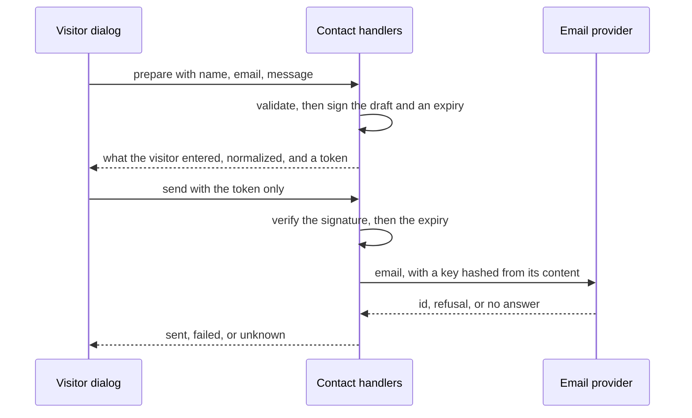

# Contact confirmation and idempotency

First appears in: **M10** (contact workflow). Status: **in use**.

## 1. What it is

**Confirmation** means an action with consequences happens only after the person has seen exactly what
it will do. **Idempotency** means doing something twice has the same effect as doing it once.

## 2. Why it matters in Promptfolio

An email cannot be recalled. A prompt saying "ask before sending" enforces nothing, because model output
is untrusted, so the rule has to live in code. And on a network, a repeat is normal: a double click, or a
retry after a timeout whose request actually arrived.

## 3. How it works

**The token holds the content.** It is `payload.signature`, where the signature is an HMAC of the payload
using a secret only the server has. Changing one character invalidates it, so `send` needs no stored draft
and accepts nothing else. No request field can reach `to`, `from`, or the subject.

**The review shows the visitor's content, not the whole email.** The subject and the notes around the
message are fixed text written for the owner ("Sam wrote to you"), which only confuses the person who wrote
it. `prepare` returns the name, address, and message as they will be used, and those notes stay on the server.

**Signed is not encrypted.** Anyone holding the token can read it. That is fine here, because it holds only
what the visitor typed, and it never holds the owner's address.

**What this proves, and what it does not.** It proves the content passed `prepare` unchanged and recently.
It cannot prove a person read it: a script can call both routes. It protects against model output and
altered requests, not against someone deliberately automating the form
([abuse protection](abuse-protection-on-serverless.md)).

**A key from the content, not a random one.** A random key per token would send twice when a visitor
prepares the same text again. Hashing `from`, `to`, reply address, subject, and body means the same email
always has the same key, and Resend returns the original result for 24 hours without sending again. The
[daily limit](abuse-protection-on-serverless.md) relies on the same key to let a retry of one email through
while blocking a different one.

**Three outcomes, because "not sent" can be untrue.** After a timeout the request may have arrived, so
"failed" could be false, and "sent" certainly could be. `unknown` says so, and a retry is safe because of
the key. Only `sent` gives a success response, and in the browser
[`confirmContact`](../../apps/portfolio/src/chat/contact-flow.ts) treats anything it cannot read as `unknown`.

## 4. Where it lives in the code

- Token: [packages/contact/src/token.ts](../../packages/contact/src/token.ts)
- Key and email text: [packages/contact/src/message.ts](../../packages/contact/src/message.ts)
- Handlers and outcomes: [packages/contact/src/handlers.ts](../../packages/contact/src/handlers.ts), tested
  in [handlers.test.ts](../../packages/contact/src/handlers.test.ts)
- Provider answers to outcomes: [apps/portfolio/src/server/contact.ts](../../apps/portfolio/src/server/contact.ts)
- Dialog states: [apps/portfolio/src/chat/contact-flow.ts](../../apps/portfolio/src/chat/contact-flow.ts)
- Decision: [ADR 0012](../adr/0012-contact-workflow.md)

## 5. Common pitfalls and misconceptions

- "`confirmed: true` is a confirmation." Any client can send it.
- "A disabled button stops double submits." It stops ordinary double clicks, not a retry or a replay.
- "The provider said OK, so it was delivered." It accepted the email. Delivery can still fail later.
- "A timeout means it failed." It means there was no answer.
- Not awaiting the send: a serverless host may pause work still running after the response, so the email
  could be lost while the visitor was told it was sent.

## 6. Further reading

- [Resend: idempotency keys](https://resend.com/docs/dashboard/emails/idempotency-keys)
- [MDN: SubtleCrypto.sign](https://developer.mozilla.org/en-US/docs/Web/API/SubtleCrypto/sign)
- [Vercel: can I use SMTP with Vercel?](https://vercel.com/kb/guide/serverless-functions-and-smtp)
