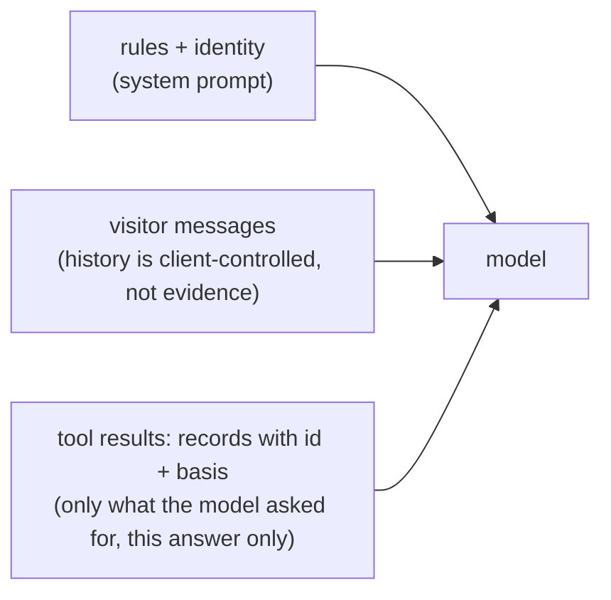

# Context selection

First appears in: **M4** (first AI integration). Status: **in use** (option A, plus tools from M5).

## 1. What it is

Context selection is deciding **what the model is told** before it answers: which facts go into
the request, and through which channel (system prompt, conversation, or tool results). The model
knows nothing about the owner except what the request contains.

## 2. Why it matters in Promptfolio

"Evidence over invention" depends on it. What the model is given decides what it can answer, what
it might blend or exaggerate, and whether an answer can be traced back to a record and its basis.
The spec's principle is to provide only the context needed.

## 3. How it works

M4 compared two options for the fictional owner Jordan:

| | A: identity only (chosen) | B: whole profile |
| --- | --- | --- |
| System prompt | Name, headline, summary (self-reported) + "say when something isn't provided" | Every role, project, skill, and school |
| "What projects has Jordan built?" | "I don't have information about Jordan's projects yet." | "Jordan built a service catalog at Globex…" |
| Cost on Haiku | Tiny | Also small (about $0.001 per request) |

B gives better answers today, but A was chosen for four reasons:

1. **Invention is easy to spot.** Under A the model knows three facts, so any project, company, or
   skill it mentions is invented. Under B, "Jordan led a team of 8 at Acme" has to be checked
   sentence by sentence against the JSON. M4 tests abstention, which needs the data to be missing.
2. **Provenance survives.** B turns records into fluent prose and drops the `basis` labels, so a
   self-reported skill reads like a verified fact. With tools (M5), each answer traces to a record
   id and basis, which makes citations possible.
3. **Untrusted text stays out of the system prompt.** From M8, sources such as GitHub READMEs are
   untrusted. The system prompt carries the most authority, so it holds only our rules and the
   owner's identity; source data arrives as tool results.
4. **A clear before and after.** M4 abstains on projects; M5 answers with sources.

From M5 the model gets three channels, each with a different level of trust:

Tools keep the context small: a question about one project fetches a summary list and then one
record, not the whole profile. The model chooses what to look up, but the code decides what can
be looked up and how often (see [tool calling](tool-calling.md)).

## 4. Where it lives in the code

- System prompt built from `profile.identity` only:
  [packages/ai/src/system-prompt.ts](../../packages/ai/src/system-prompt.ts)
- Profile lookup tools: [packages/ai/src/profile-tools.ts](../../packages/ai/src/profile-tools.ts)
- The decision and its alternatives: [M4 plan, Decisions](../plans/m4-first-ai-integration.md#decisions)
- Identity and provenance types: [packages/core/src/profile/types.ts](../../packages/core/src/profile/types.ts)

## 5. Common pitfalls and misconceptions

- "More context means more accurate answers." More context also means more to blend, paraphrase,
  and misattribute, and fewer clear signals when the model invents something.
- "B is rejected because it is expensive." For a small profile it is cheap; the reasons are
  traceability and trust, not cost.
- "A fluent, detailed answer is a correct one." Fluency is not evidence; check claims against
  records.
- Putting untrusted source text in the system prompt gives it the same authority as your rules.

## 6. Further reading

- [AI SDK: prompts (system, messages)](https://ai-sdk.dev/docs/foundations/prompts)
- [AI SDK: tool calling](https://ai-sdk.dev/docs/ai-sdk-core/tools-and-tool-calling)
- [Anthropic: reduce hallucinations](https://docs.claude.com/en/docs/test-and-evaluate/strengthen-guardrails/reduce-hallucinations)
