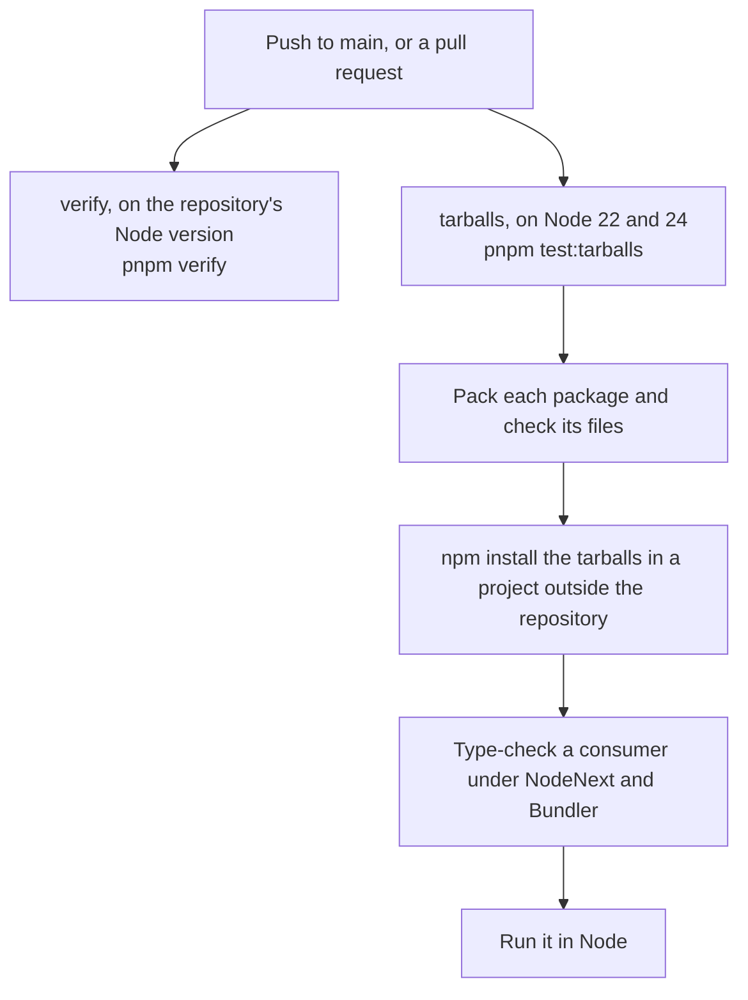

# Continuous integration

First appears in: **M13.4**. Status: **in use**.

## 1. What it is

Continuous integration runs the project's checks on a clean machine for every push and pull request, so a result does not
depend on what happens to be on one developer's computer.

## 2. Why it matters in Promptfolio

`pnpm verify` only protected the code when someone remembered to run it. And it cannot see the failure this project actually
had: every workspace test passed while a published install could not load.

## 3. How it works

- **Two jobs, because they answer two questions.** `verify` asks whether the code is right. `tarballs` asks whether what a
  consumer installs works.
- **Node 22 and 24 are what the manifests promise.** `engines` says `>=22`, so each is tested.
- **`skipLibCheck` is off in the consumer,** because it would otherwise skip the very declarations this checks.
- **`npm`, not pnpm, installs the tarballs,** because a pnpm install inside this repository could quietly use the workspace.
- **A check has to be able to fail.** Pointing a published entry at `src` made this test fail with `ERR_MODULE_NOT_FOUND`.
- **No secrets and no model calls.** The workflow has read-only access, and the evaluation stays a manual step because it
  spends free quota.

## 4. Where it lives in the code

- The workflow: [.github/workflows/ci.yml](../../.github/workflows/ci.yml)
- The tarball test: [scripts/test-tarballs.mjs](../../scripts/test-tarballs.mjs), and its
  [consumer](../../scripts/tarball-consumer/consumer.ts)

## 5. Common pitfalls and misconceptions

- **Passing tests on one version say little about another.** A range in `engines` is a claim, so test its ends.
- **A green run shows only what the checks look at.** Model answers and live GitHub calls are not covered.
- **A workflow is code that cannot be tested until it runs on the host.** A pull request is the first real test of a change to it.

## 6. Further reading

- [GitHub Actions: workflow syntax](https://docs.github.com/en/actions/reference/workflows-and-actions/workflow-syntax)
- [pnpm: continuous integration](https://pnpm.io/continuous-integration)
