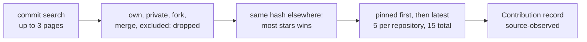

# Contributions and evidence

First appears in: **M8.1** (GitHub contributions). Status: **in use**.

## 1. What it is

A **contribution** is a commit GitHub attributes to the profile owner on the default branch of someone
else's public repository. The point of the concept is asking what a piece of public data actually
shows before stating anything from it.

| Data | What it shows | What it does not show |
| ---- | ------------- | ---------------------- |
| A pin | The owner likes or highlights a repository | Any work on it |
| A fork | The owner copied a repository | Any work on it |
| An attributed commit | GitHub links this commit to the account by its author email | Its size or importance, a role, or proof of authorship: anyone can set that email |

## 2. Why it matters in Promptfolio

"Has this person worked on open source?" is a common question, and the model is ready to overstate
the answer. Merged pull requests alone would miss projects that take changes through their own review
system, so commits are the evidence ([ADR 0011](../adr/0011-contributions-as-attributed-commits.md)).

## 3. How it works

- **A query is a request, not a guarantee.** `is:public` asks GitHub to filter, and the code still drops
  anything whose own `private` flag is not `false`. The same goes for the owner and merge qualifiers.
- **Mirrors are not flagged.** A mirror can have `fork: false` and the same commits. Equal hashes show
  it, and stars pick the original; they are read for this and never stored.
- **A bounded list is not a history.** The prompt says the list holds recent ones only, so "not listed"
  must not become "never contributed".
- **What is left out matters.** No sizes, counts, or stars (they invite claims about importance), and
  no author name or email (private data, not needed).
- **The owner stays in control.** `excludeContributionsTo` hides a repository, and a project whose id is
  `github.com/<owner>/<name>` is their own description of the work, returned as `ownerNotes`.
- **Failure keeps what was known.** If the search fails, all earlier entries stay with their dates and
  the run is partial ([last known good](refresh-status-and-last-known-good.md)).

## 4. Where it lives in the code

- Choosing commits (pure): [packages/source-github/src/selection/contributions.ts](../../packages/source-github/src/selection/contributions.ts)
- The search: [packages/source-github/src/fetch/fetch-contributions.ts](../../packages/source-github/src/fetch/fetch-contributions.ts) (`fetchContributions`)
- Mapping: [normalize.ts](../../packages/source-github/src/snapshot/normalize.ts); keeping earlier entries:
  [carry-forward.ts](../../packages/source-github/src/snapshot/carry-forward.ts)
- The record and lookup: [types.ts](../../packages/core/src/profile/types.ts),
  [observed.ts](../../packages/core/src/profile/observed.ts), [query.ts](../../packages/core/src/profile/query.ts)
- The section and the rule: [profile-tools.ts](../../packages/ai/src/grounding/profile-tools.ts),
  [system-prompt.ts](../../packages/ai/src/chat/system-prompt.ts)

## 5. Common pitfalls and misconceptions

- "A pinned famous repository means they contributed." It does not, and it makes no record here.
- "Commits by the owner prove they wrote it." GitHub matches an email anyone can put in a commit.
- "Many commits means large work." Counts are left out for this reason; a typo fix is also a commit.
- Commits with an email not linked to the account are not found, and only default branches are searched.
- Reading 300 commits is a limit: one very active repository can push older work elsewhere out of reach.
- Titles are written on GitHub: they are untrusted data, cleaned and capped, only in tool results.

## 6. Further reading

- [GitHub: searching commits](https://docs.github.com/en/search-github/searching-on-github/searching-commits)
- [GitHub REST API: search](https://docs.github.com/en/rest/search/search)
