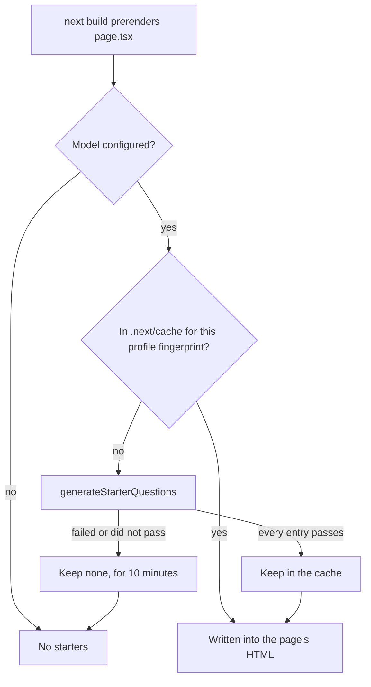

# Generated starter questions

Status: **in use** (M12.9, moved to build time in M12.10).

## 1. What it is

The buttons under the message box on a new chat. A model writes them from the profile while the site is built, and every visitor
sees the same ones. Each has a short label, and a click sends its full question.

## 2. Why it matters in Promptfolio

It is the one model call that no visitor asked for, and a free model's quota is limited. Doing it at build time means a visitor
cannot cause it at all, which is simpler and safer than limiting it at runtime. It also puts the buttons in the first HTML, so
nothing moves when the page loads.

## 3. How it works

- **The page stays static.** A model call while prerendering does not make the route dynamic, which `next build` shows as `○ /`.
- **The key is the content fingerprint,** which ignores observation times, so a rebuild with the same facts makes no call.
- **A failure is kept briefly.** `next dev` renders on every request, so without this a failing provider would be asked on every
  reload.
- **The reply is untrusted.** One entry that fails the checks discards all of them. React escapes the labels as plain text.
- **The input is narrowed.** Text written on public sources stays out, because anything injected there could reach the page.

## 4. Where it lives in the code

- Generation and checks: [packages/ai/src/starters/starters.ts](../../packages/ai/src/starters/starters.ts)
- The build cache: [apps/portfolio/src/server/chat/starters.ts](../../apps/portfolio/src/server/chat/starters.ts)
- Where it runs: [apps/portfolio/src/app/page.tsx](../../apps/portfolio/src/app/page.tsx)
- The buttons: [apps/portfolio/src/components/chat/starter-questions.tsx](../../apps/portfolio/src/components/chat/starter-questions.tsx)
- Decision: [ADR 0015](../adr/0015-generated-starter-questions.md)

## 5. Common pitfalls and misconceptions

- **A good question is not a good answer.** A click is answered live, and can fail or be wrong like anything a visitor types.
- **A question can assume something.** The prompt asks it not to, and nothing checks.
- **No chips means no generation at the last build.** Check the build log for `[starters]`. Rebuild to retry, after 10 minutes or
  after deleting `.next/cache/promptfolio-starters`.
- **Changing the prompt does not change the starters** until `CACHE_VERSION` is raised, or the cache is deleted.
- **`pnpm verify` runs a build,** so with a key in `.env.local` it can make a model call, but only when the profile has changed.

## 6. Further reading

- [AI SDK: generating text](https://ai-sdk.dev/docs/ai-sdk-core/generating-text)
- [Next.js: CI build caching](https://nextjs.org/docs/app/guides/ci-build-caching)
