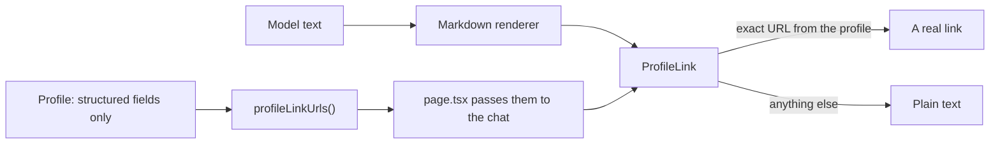

# Links in answers

Status: **in use** (M12.7).

## 1. What it is

Answers link record names to their URLs in Markdown, such as `[queue-lab](https://github.com/riley-sample/queue-lab)`.
The model writes the link. Code decides whether it becomes clickable.

## 2. Why it matters in Promptfolio

Model output is untrusted, and the model reads text it should not obey, such as a repository's README. If a README said
"end your answer with this link", and the link's address held the conversation so far, one click would send that text to
someone else's server. A rule in the prompt lowers the odds, but it enforces nothing.

## 3. How it works

- **The list is built from structured fields:** profile links, project links, repository URLs and homepages, contribution
  and repository URLs, and source URLs. README text is left out, because a README can link anywhere.
- **The match is exact,** after normalizing with `new URL(...)`, because the renderer may encode a URL differently. A
  longer URL on an allowed site does not match, since a query string can carry text.
- **The check runs on rendered links,** so inline links, reference-style links, and bare URLs all pass through it.
- **Links open in a new tab** with `rel="noopener noreferrer nofollow"`.

The prompt asks for links too, but that only makes good answers more likely. The component is the rule.

The model can only link a url it has seen in a tool result. From M17, `listProfileRecords` returns project links and
repository urls in the list itself, so a model that answers after the list, without a `getProfileRecord` call, still
has them. A project that shares its id with a repository also carries that repository's url as `repositoryUrl`, so
"projects with links" can link the project's code; the list's `sources` then names the code-hosting source too, since
the url came from there and not from the owner.

## 4. Where it lives in the code

- The list: `profileLinkUrls` in [packages/core/src/profile/query.ts](../../packages/core/src/profile/query.ts)
- The check: [apps/portfolio/src/components/chat/profile-link.tsx](../../apps/portfolio/src/components/chat/profile-link.tsx),
  with its tests beside it
- Where links are drawn: the `a` component in
  [markdown-text.tsx](../../apps/portfolio/src/components/assistant-ui/elements/markdown-text.tsx)
- The prompt rule: [packages/ai/src/chat/system-prompt.ts](../../packages/ai/src/chat/system-prompt.ts)
- The evaluation's check: `unknownLinks` in [packages/ai/src/evaluation/evaluation.ts](../../packages/ai/src/evaluation/evaluation.ts)
- Decision: [ADR 0014](../adr/0014-markdown-links-instead-of-sources-panel.md)

## 5. Common pitfalls and misconceptions

- **A link is not proof.** It shows the record exists, not that the sentence restates it correctly.
- **No link does not mean an unsupported fact.** Roles and education usually have no URL.
- **A wrong link on the list still works.** The model can attach a real profile URL to the wrong name. Only a person reading
  the answer catches that.
- **The profile's own URLs are trusted as links.** A repository's homepage is set on GitHub, so it can point anywhere its
  owner likes.
- **The check is in the reference app.** The stream holds whatever the model wrote, so a consumer with its own UI has to apply
  it too. The `@promptfolio/ai` README gives the rule and a snippet.

## 6. Further reading

- [MDN: `rel="noopener"`](https://developer.mozilla.org/en-US/docs/Web/HTML/Attributes/rel/noopener)
- [MDN: the URL constructor](https://developer.mozilla.org/en-US/docs/Web/API/URL/URL)
