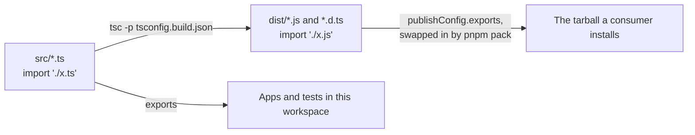

# Package exports and builds

First appears in: **M13.3**. Status: **in use**.

## 1. What it is

`exports` in `package.json` says which files a package's name points to. A build turns TypeScript source into the JavaScript
and declaration files that those entries can point to once the package is installed elsewhere.

## 2. Why it matters in Promptfolio

The packages are the product, so they must work outside this repository. Before M13.3, every test passed and a published
install could not load: `exports` pointed at TypeScript source, which only this workspace can run.

## 3. How it works

- **Each package has one `tsconfig.build.json`,** on top of its `tsconfig.json` and the root's shared build options. Tests
  are excluded.
- **`pnpm -r build` follows dependencies,** so `core` builds before the packages that use its declarations.
- **`files: ["dist"]` is an allowlist.** npm always adds `package.json`, `README`, and `LICENSE` from the package's folder.
- **`private: true` stays until the publishing milestone,** so nobody can publish by accident. `pnpm pack` still works.

## 4. Where it lives in the code

- Shared build options: [tsconfig.build.json](../../tsconfig.build.json)
- A package's build and exports: [packages/ai/tsconfig.build.json](../../packages/ai/tsconfig.build.json),
  [packages/ai/package.json](../../packages/ai/package.json)
- The decision: [ADR 0016](../adr/0016-package-builds-with-tsc.md)

## 5. Common pitfalls and misconceptions

- **Passing workspace tests say nothing about the tarball.** The workspace never loads `dist`, so `pnpm test:tarballs` installs
  the packed tarballs in a separate project (M13.4).
- **A stale `dist` can hide a missing file,** which is why the build deletes it first.
- **`types` comes first in each `exports` entry,** because conditions are read in order and the first match wins.
- **Publishing is `pnpm publish`, not `npm publish`.** Only pnpm rewrites `workspace:*`, `catalog:`, and `publishConfig.exports`.

## 6. Further reading

- [Node.js: package entry points](https://nodejs.org/api/packages.html#package-entry-points)
- [TypeScript: rewriteRelativeImportExtensions](https://www.typescriptlang.org/tsconfig/#rewriteRelativeImportExtensions)
- [pnpm: publishConfig](https://pnpm.io/package_json#publishconfig)
