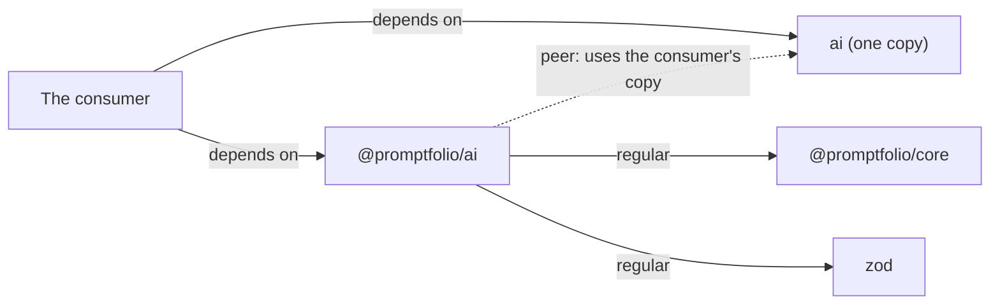

# Peer dependencies

First appears in: **M13.1**. Status: **in use**.

## 1. What it is

A regular dependency says "install this for me". A peer dependency says "the project using me provides this, and we
share its copy".

## 2. Why it matters in Promptfolio

`@promptfolio/ai` and its consumer pass AI SDK things between them: the consumer creates a `LanguageModel` and hands it
over, and reads a UI message stream that the package returns. If each had its own copy of `ai`, those would be two versions
that happen to look alike, and a mismatch could appear as a confusing type error or a stream the browser misreads.

## 3. How it works

The rule here: a heavy dependency that a consumer certainly depends on directly is a peer.

- **`ai` is a peer.** No consumer can use the package without it. It is also in `devDependencies`, because a peer is not
  installed for the package's own tests.
- **`zod` is regular.** A consumer of `core` or `source-github` never touches it. `ai` accepts zod 3 or 4 and these
  packages use zod 4, so a regular dependency lets a consumer on zod 3 still install them.
- **`@promptfolio/core` is regular.** It is small and passes plain data, so a duplicate copy does no harm.

## 4. Where it lives in the code

- [packages/ai/package.json](../../packages/ai/package.json): `peerDependencies`, `devDependencies`
- The catalog that sets the range: [pnpm-workspace.yaml](../../pnpm-workspace.yaml)
- What crosses the boundary: `model` in [chat-turn.ts](../../packages/ai/src/chat/chat-turn.ts)

## 5. Common pitfalls and misconceptions

- **A peer is a promise, not an install.** Forgetting `devDependencies` breaks the package's own tests. Package managers
  differ on whether they add peers for the consumer, so the README says to install it.
- **A wide range is a claim you must test.** The range says which versions work, and only the versions CI runs are known to.
- **Not every shared dependency should be a peer.** Each one is a requirement on every consumer, so it has to earn that.
- **Supporting one SDK is a decision here,** not an accident. A second SDK is a separate piece of work.

## 6. Further reading

- [npm: peerDependencies](https://docs.npmjs.com/cli/v11/configuring-npm/package-json#peerdependencies)
- [pnpm: auto-install-peers](https://pnpm.io/settings#autoinstallpeers)
