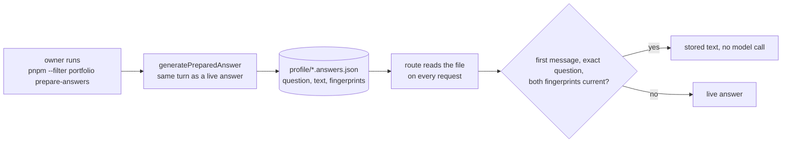

# Prepared answers and cache invalidation

First appears in: **M7** (seeded conversations and cache behavior). Status: **in use**.

## 1. What it is

A **prepared answer** is an answer computed ahead of time and stored, then served instead of
computing it again. It is a cache entry, and like every cache it needs two things:

- a **key** that selects the entry (here: the exact question text);
- a **validity check** that decides whether the entry may still be used (here: fingerprints of
  everything that determined the answer).

**Invalidation** is what happens when the check fails. In Promptfolio it is *fail-safe*: an
invalid entry is never served and never causes an error; the request is simply answered live.

## 2. Why it matters in Promptfolio

Almost every visitor clicks a starter, and the correct answer to "Summarize the work experience."
is the same for all of them. A live answer costs 2 to 3 model calls and several seconds; a
prepared one costs nothing. The spec allows this only if a prepared answer can never knowingly
contradict newer profile data, so the validity check is the part that matters.

Serverless hosting ([ADR 0001](../adr/0001-reference-app-framework.md)) rules out an in-memory
cache, and a hosted cache service would add a secret and a component. Instead, the answers are a
reviewed file deployed with the profile ([ADR 0008](../adr/0008-prepared-answers-as-files.md)).

## 3. How it works

- **Content fingerprints.** A fingerprint is `sha256:` plus the SHA-256 hash of a stable
  serialization. Equal content gives an equal fingerprint, and any change gives a different one,
  so no version counter or database is needed.
- **Canonical serialization.** `canonicalProfileContent` sorts object keys (so the result does not
  depend on how the profile was built), keeps array order (record order is content), and leaves
  out `observedAt` and `retrievedAt`. Those record *when* data was read: today they are the
  profile file's modification time, which changes on every save and checkout without any fact
  changing.
- **Two dependencies.** The profile fingerprint covers the facts; the instructions fingerprint
  covers the system prompt and each tool's name, description, and input schema. Changing either
  sends every starter live until the script is rerun. The model is recorded but not part of the
  key: a different model does not make facts stale.
- **A recorded live answer.** The generator runs the same turn as `handleChatRequest` and stores
  what the visitor stream would have contained. It accepts an answer only if the turn finished
  normally, the text is at most 4,000 characters (the server's per-message limit, which also
  applies when the answer comes back in a follow-up), and every cited `[id]` was returned by a tool
  in that turn.
- **A stream without a model.** A hit is sent as the chunks of a one-step text answer through the
  same `forVisitor` filter, so the browser and its saved threads cannot tell the difference.

GitHub data (M8) is part of the profile content. A refetch that finds the same data only changes
`retrievedAt`, which the fingerprint ignores, so answers stay current; any changed README excerpt,
description, topic, language share, license, or month of last push invalidates every prepared
answer. That is why the adapter keeps dates by month and leaves out star counts.

**The fingerprint is the profile version (M9).** No counter is kept anywhere: the profile
fingerprint *is* the version id, and an answer belongs to the version in its `profileFingerprint`.
`pnpm --filter portfolio refresh` prints the version before and after, records it in the refresh
status, and says how many prepared answers belong to the new version. It does not regenerate
them: prepared answers are reviewed files, regeneration needs a model key, and free tiers limit
requests. Until the owner reruns `prepare-answers`, stale starters are answered live, which is
slower but never wrong.

## 4. Where it lives in the code

- Canonical content: [packages/core/src/profile/canonical.ts](../../packages/core/src/profile/canonical.ts)
- File schema, fingerprints, selection, the stream, the generator:
  [packages/ai/src/prepared-answers.ts](../../packages/ai/src/prepared-answers.ts), tested in
  [prepared-answers.test.ts](../../packages/ai/src/prepared-answers.test.ts)
- The shared turn used by both paths: [packages/ai/src/chat-turn.ts](../../packages/ai/src/chat-turn.ts);
  the hit-or-live decision: [chat-handler.ts](../../packages/ai/src/chat-handler.ts)
- Reading the file: [apps/portfolio/src/server/prepared-answers.ts](../../apps/portfolio/src/server/prepared-answers.ts);
  the owner's script: [apps/portfolio/scripts/prepare-answers.ts](../../apps/portfolio/scripts/prepare-answers.ts)
- Design and decisions: [M7 plan](../plans/m7-prepared-starter-answers.md)
- The version check after a refresh: [apps/portfolio/src/server/refresh.ts](../../apps/portfolio/src/server/refresh.ts)
  (`profileFingerprint`, exported by `@promptfolio/ai`)

## 5. Common pitfalls and misconceptions

- "A cache needs an expiry time." A time to live only guesses when data changes. A content
  fingerprint knows: the answer is valid exactly as long as its inputs are unchanged, however old.
- Fingerprinting too much. Including observation timestamps would invalidate every answer on
  every checkout, and on every refresh that finds the same data.
- Fingerprinting too little. Dependencies are not only the records an answer used: "there is no
  open-source work in the profile" depends on records that are *absent*. That is why the whole
  profile is one dependency.
- Forgetting the instructions. A changed system prompt can change what a correct answer looks
  like even when no fact changed.
- "Stale means wrong, so a miss is an error." Here a miss costs one live answer, never
  correctness, and the visitor sees no difference.
- "The gate accepted it, so it is correct." The citation gate checks ids, and an answer that cites
  nothing passes. M8.1's first regeneration produced a false "no open-source work" answer that passed.
  Reading the file before committing is part of the design.
- Treating the file as trusted because the owner wrote it. It is parsed with a schema like any
  input; an invalid file means "no prepared answers".
- Saved threads are not invalidated: a conversation saved in a browser before a profile change
  still shows the answer it received then (as for any saved answer, see
  [browser persistence](browser-persistence.md)).
- A prepared answer that happens to quote an observation date shows the date from when it was
  generated.

## 6. Further reading

- [MDN: SubtleCrypto.digest()](https://developer.mozilla.org/en-US/docs/Web/API/SubtleCrypto/digest)
- [AI SDK: stream protocols](https://ai-sdk.dev/docs/ai-sdk-ui/stream-protocol)
- [HTTP caching (MDN)](https://developer.mozilla.org/en-US/docs/Web/HTTP/Guides/Caching), for the
  general ideas of keys, validation, and freshness
