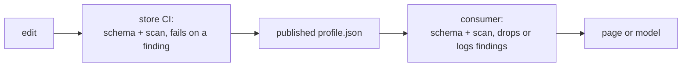

# Private-data checks

First appears in: **M22** (remote profile helpers). Status: **in use**.

## 1. What it is

Making sure a profile holds nothing its owner would not publish, such as a phone number or a personal email address. Two
mechanisms work together: an **allowlist** (the schema accepts only known fields, and none of them is for contact details) and
a **scan** of the text for anything that looks like contact details anyway.

## 2. Why it matters in Promptfolio

Everything in a profile is public ([ADR 0005](../adr/0005-profile-model-and-provenance.md)): a site renders it, and the chat
sends it to a model provider, which on a free tier may keep it. Once the profile lives in a store edited from several devices,
and possibly copied from a resume, a pasted phone number is an easy mistake, and a published one is hard to take back.

## 3. How it works

- **The schema is the allowlist.** `loadStructuredProfile` rejects unknown keys, so a `phone` field never loads. It cannot see
  inside free text: a summary may say anything.
- **The scan covers free text.** `findContactDetails` walks every string in the raw data, including keys the schema would
  reject, and reports emails, `mailto:` and `tel:` links, and runs of 10 to 15 digits (the length of a phone number, longer
  than dates and short ids). Links are scanned too, since a messaging URL can carry a number.
- **It reports; the caller decides.** The store's CI fails on any finding. A consumer can run it again as a second line of
  defence, in case the store's checks were bypassed, and leave the flagged text out.
- **Private details live elsewhere.** A resume builder adds them from its own local configuration when printing, so they never
  enter the store.

## 4. Where it lives in the code

- The scan: [packages/core/src/profile/contact-details.ts](../../packages/core/src/profile/contact-details.ts)
  (`findContactDetails`) and its tests
- The allowlist: [packages/core/src/profile/schema.ts](../../packages/core/src/profile/schema.ts) (strict objects)

## 5. Common pitfalls and misconceptions

- **A heuristic is not a guarantee.** A number written as words, or split across fields, is missed; a 10-digit order number or
  a list of years such as "2021 2022 2023" is reported. It narrows the risk; the owner still decides what is published.
- **Scanning only a validated profile.** An invalid file gives no profile to scan, yet the store may still hold or serve the raw
  file. Scanning the raw data reports every finding even when validation fails.
- **Checking only in CI.** CI runs after a push, so the text is already in the repository's history. Checking before saving (in
  the editor or resume builder) keeps it out; a private repository limits who sees a mistake.
- **Redacting instead of reporting.** Silently removing text changes what the owner wrote. Report it with its path, so the owner
  fixes the source.

## 6. Further reading

- [ITU-T E.164](https://www.itu.int/rec/T-REC-E.164) (the international phone number plan, at most 15 digits)
