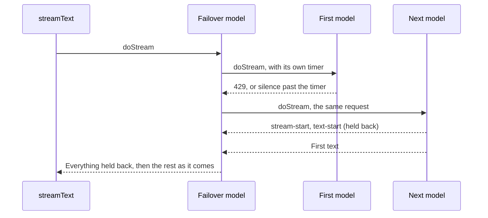

# Provider failover

First appears in: **M14**. Status: **in use**.

## 1. What it is

Failover moves to another model when the one in use fails. Here it happens inside a model call, so the rest of the code sees one
model that happened to work.

## 2. Why it matters in Promptfolio

Free and cheap models fail often: 11 of 95 attempts on the chosen model hit a rate limit or a timeout. A visitor sees "could not
answer" and has used up a turn, even when another provider is fine.

## 3. How it works



- **Holding back is what makes this possible.** Parts are kept until the first real content, because nothing has reached the visitor
  and it can still change its mind. After that, the stream passes straight through.
- **What counts as content:** non-blank text, or a tool call. Not thinking, because a model can think until its token limit and
  write nothing.
- **Why each attempt has its own signal.** The SDK's `firstChunkMs` aborts the whole call, which would stop the next model too. So
  an attempt's timer aborts only that attempt, and the overall limit is raised to leave room. The app sets
  8 seconds per attempt, plus the usual 15 for the last model.
- **Even the last model has a timer.** The SDK's first-chunk limit did not fire for a connection that never responded, so without
  this a hung model holds the visitor until the limit on the whole reply. That was found the hard way, in a real test with five
  questions at once.
- **Why it stays on the model that worked.** One turn makes several model calls. Going back to a failing provider wastes a timer on
  every step, and mixing providers risks one refusing another's tool history.
- **Mixed history did work in a real check,** between `gpt-4o-mini` and Ling, in both directions. Gemini's own tool signatures are
  not covered, because Gemini was timing out that day with or without the wrapper.

```sh
PROMPTFOLIO_MODEL=gateway:openai/gpt-4o-mini,google:gemini-3.5-flash-lite
```

## 4. Where it lives in the code

- The wrapper: [packages/ai/src/chat/failover.ts](../../packages/ai/src/chat/failover.ts), and its tests beside it
- Reading the list: [apps/portfolio/src/server/chat/model.ts](../../apps/portfolio/src/server/chat/model.ts)
- The decision: [ADR 0017](../adr/0017-provider-failover-before-first-content.md)

## 5. Common pitfalls and misconceptions

- **It does not rescue an answer that has started.** A timeout or token limit partway through still ends that answer. For long
  answers, raise `limits.maxOutputTokens`.
- **A fallback is another company reading the conversation.** Its training and data terms apply, which is why a list is always
  written out and never built from whichever keys are set.
- **It can hide a dead provider.** Answers keep working, so read the `[failover]` lines in the log. `continuing with <label>`
  names the model that answered; the `finished` line's `model` is the provider's own id, or every label when it reports none.
- **Fallbacks on one host can share its limits.** AI Gateway advertised 5 requests a minute per model, and one question takes at
  least 2 calls. A few questions at once used up two gateway models within seconds, so keep one fallback on another host.
- **Check that a fallback actually works.** A hanging last model turned rate limits into 55-second failures. Try each entry alone first.
- **Evaluate each model.** A chain's quality is its worst member's on the turns that reach it. The evaluation uses only the first.
- **A retry and a fallback multiply.** With both, one failure can run the whole list twice, so a list uses `maxRetries: 0`.

## 6. Further reading

- [AI SDK: language model middleware](https://ai-sdk.dev/docs/ai-sdk-core/middleware)
- [MDN: AbortSignal.any()](https://developer.mozilla.org/en-US/docs/Web/API/AbortSignal/any_static)
