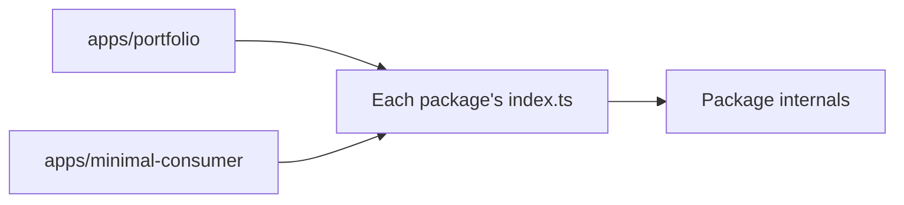

# Public API and a second consumer

First appears in: **M12.1**. Status: **in use**.

## 1. What it is

A package's public API is what its `index.ts` exports. A second consumer is another piece of code that uses only that
API, which tests whether the packages really stand apart from the app they grew up with.

## 2. Why it matters in Promptfolio

The packages are the product and the reference app is their first consumer. Code that sits beside its only caller can
depend on it without anyone noticing. Promptfolio checks this in two ways:

- A **second profile** needs no code at all, only `PROMPTFOLIO_PROFILE_FILE`.
- A **minimal consumer** has no Next.js, no reference-app code, and its own data, and runs in `pnpm verify`.

## 3. How it works

- `exports` in each `package.json` lists only `.`, so importing an internal file fails.
- A test in `core` and in `source-github` lists the runtime exports, so adding one is a visible decision.
- The consumer supplies what the packages deliberately leave open: a model, a limiter, an email sender, and a way to
  identify a visitor. Each is an interface or a callback, so no package names a provider or store.
- **What M12.1 changed.** `mergeGitHubSnapshot` moved to `source-github`, because every consumer needs it. Its refresh
  in the consumer takes about 10 lines. Files, status, and reporting stay in each app. Exports nothing outside a
  package used were removed. Types that appear in a public signature stay.

## 4. Where it lives in the code

- [`apps/minimal-consumer/src/consumer.ts`](../../apps/minimal-consumer/src/consumer.ts) and its test
- [`apps/portfolio/profile/second.profile.json`](../../apps/portfolio/profile/second.profile.json) and
  [`second-profile.test.ts`](../../apps/portfolio/src/server/second-profile.test.ts)
- Each package's `src/index.ts` and `README.md`

## 5. Common pitfalls and misconceptions

- **A consumer in the same workspace is not an outside consumer.** The packages are private and export TypeScript
  source, so they cannot be installed elsewhere until they get a compiled build and are published.
- **Passing here does not mean a good experience for everyone.** The second profile loads and renders, but the
  starters are code and assume an engineer ("Open-source work").
- **The UI is not covered.** The chat components, thread store, and citation markers live in the reference app. A
  consumer with its own UI writes those itself.
- **Exporting for a test is not a reason to keep an export,** unless the test checks that app and package agree, as
  `citedIds` does.

## 6. Further reading

- [Node.js: package entry points](https://nodejs.org/api/packages.html#package-entry-points)
- [pnpm: workspaces](https://pnpm.io/workspaces)
