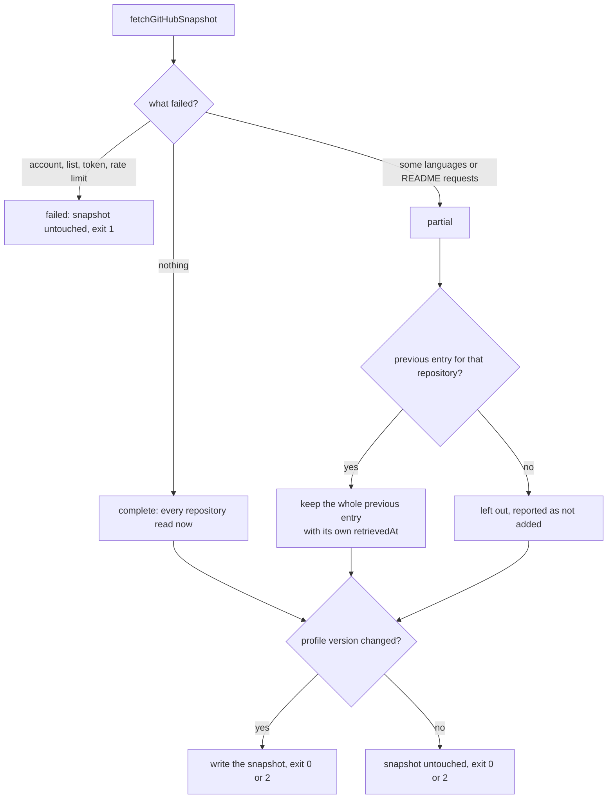

# Refresh status and last known good

First appears in: **M9** (refresh pipeline and profile versions). Status: **in use**.

## 1. What it is

A **refresh** updates data that comes from an outside source. Three ideas keep it safe:

- **Last known good:** when a source cannot be read, keep the most recent data that *was* read
  successfully, labelled with when it was read, instead of erasing it or pretending it is new.
- **Refresh status:** a record of the attempt itself (when, what happened, what was kept), stored
  apart from the data. The data says what the source showed; the status says how the last
  attempt to update it went.
- **Idempotence:** running the refresh again with nothing new changes no data file.

## 2. Why it matters in Promptfolio

GitHub data reaches visitors through the model, which repeats dates and facts with confidence.
If a refresh silently dropped repositories after a timeout, the assistant would say they do not
exist; if it stamped old data with today's date, it would present stale facts as current. Spec
3.4 asks to tell success, partial failure, and previous known-good data apart, and the app is
serverless, so the status cannot live in memory ([ADR 0001](../adr/0001-reference-app-framework.md)).
Decisions: [ADR 0010](../adr/0010-refresh-status-and-content-versions.md).

## 3. How it works

- **Whole entries, own dates.** A carried repository keeps all of its previous fields, not just
  the part that failed: combining today's description with last week's README would put two
  observation times in one record. Each repository has its own `retrievedAt` in the snapshot
  (format version 2), which becomes the record's `observedAt`, so tool results say how old each
  fact is.
- **Selection still comes from the new run.** A repository that was deleted, renamed, or made
  private disappears: that is a real change, not a failure.
- **No previous data, no carry-over.** A partial first run fails rather than writing an
  incomplete snapshot.
- **Contributions (M8.1) succeed or fail as a whole.** On failure all earlier entries stay with their
  dates, `contributionsKept` is true, and the run is partial. The repositories still update.
- **Status file.** `profile/<profile>.refresh-status.json`, written on every run that got as far
  as fetching: `lastAttemptAt`, `outcome` (success, partial, failed), `lastSuccessAt`,
  `snapshotWritten`, `versionChanged`, `carriedOver`, `notAdded`, sanitized `errors`, and the
  `profileVersion`. The app logs an owner warning when it says partial or failed. It never fails
  the profile load, and visitors never see it.
- **Exit codes** for a scheduled job: 0 success, 2 partial (written, but not all current),
  1 failed (nothing written).
- **Write only on a new version.** The snapshot is rewritten only when the content fingerprint
  changes. A run that finds nothing new leaves the data byte-for-byte unchanged, so a job can
  decide whether to commit with `git diff`. Side effect: dates in the snapshot mean "first
  observed in this form" and can be older than the last check; that understates freshness and
  never overstates it.

## 4. Where it lives in the code

- Carrying entries over: [packages/source-github/src/carry-forward.ts](../../packages/source-github/src/carry-forward.ts)
- Partial results from the fetcher: [packages/source-github/src/fetch.ts](../../packages/source-github/src/fetch.ts);
  snapshot version 2: [snapshot.ts](../../packages/source-github/src/snapshot.ts)
- Per-repository `observedAt`: [packages/core/src/profile/observed.ts](../../packages/core/src/profile/observed.ts)
- The refresh itself: [apps/portfolio/src/server/refresh.ts](../../apps/portfolio/src/server/refresh.ts);
  the status file: [refresh-status.ts](../../apps/portfolio/src/server/refresh-status.ts);
  the command: [apps/portfolio/scripts/refresh.ts](../../apps/portfolio/scripts/refresh.ts)
- Tests: [carry-forward.test.ts](../../packages/source-github/src/carry-forward.test.ts),
  [refresh.test.ts](../../apps/portfolio/src/server/refresh.test.ts)

## 5. Common pitfalls and misconceptions

- "A failed refresh should show an error to visitors." Visitors need correct dates, not
  operational messages; the owner needs the failure. Keep them apart.
- Writing partial data as if it were complete silently deletes what could not be read.
- Refreshing the timestamp of data you did not read again overstates freshness, the one
  direction that misleads.
- Rewriting files that did not change (a new `retrievedAt` every run) makes every run look like
  a change: a commit and a deployment per day for nothing.
- Treating the status file as trusted because the command wrote it: it is parsed with a schema
  like any other file.
- There is no maximum age for a carried entry: a repository that fails every day keeps its old
  date until it is read again or no longer selected.

## 6. Further reading

- [GitHub REST API: best practices](https://docs.github.com/en/rest/using-the-rest-api/best-practices-for-using-the-rest-api)
- [Node.js: fsPromises.rename()](https://nodejs.org/api/fs.html#fspromisesrenameoldpath-newpath)
