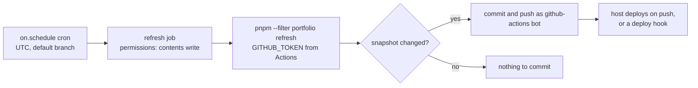

# Scheduled jobs

First appears in: **M9** (refresh pipeline and profile versions). Status: **planned** (a
template exists; it runs only in the deployment repository, M12.3, not started).

## 1. What it is

A **scheduled job** runs a command on a timer (cron) without anyone starting it. A serverless app
has no process that stays up between requests, so something outside it has to wake up, do the
work, and hand the result over. Here that is a GitHub Actions workflow with an `on.schedule`
trigger that runs `pnpm --filter portfolio refresh` and commits the result.

## 2. Why it matters in Promptfolio

GitHub data should stay current without the owner remembering to refresh it, but visitors must
never wait for GitHub ([ADR 0009](../adr/0009-github-source-as-fetched-snapshot.md)). A daily
job in the deployment repository refreshes the snapshot and commits it when the profile version
changed; the host then deploys the new files. The data stays a reviewed, versioned file, and no
database or extra service is needed ([ADR 0010](../adr/0010-refresh-status-and-content-versions.md)).

## 3. How it works

- **Cron in Actions.** Five fields, UTC by default, only on the default branch, at most every
  5 minutes. Runs can be delayed under load, worst at the start of each hour, so the template
  uses 04:17. `workflow_dispatch` adds a "Run workflow" button for manual runs.
- **The 60-day rule.** In a *public* repository GitHub disables scheduled workflows after 60 days
  without repository activity. A private deployment repository is not affected.
- **`GITHUB_TOKEN`.** Created for each run, limited to the repository and to the permissions the
  workflow declares (`contents: write` to push; everything else becomes `none`). Its REST limit
  is 1,000 requests per hour per repository; a refresh needs about 43, plus its commit searches, which have their own limit.
- **No loops.** Events caused by `GITHUB_TOKEN` (such as the job's own push) start no other
  workflow runs, except `workflow_dispatch` and `repository_dispatch`. CI does not run on the
  bot's commit, and a deploy done by another workflow would not run either.
- **Reaching the host.** Vercel deploys pushes through its GitHub App, not a workflow, so the
  rule above does not stop it. But on a Hobby team with a private repository only the account
  owner can trigger deployments, and how bot commits are treated is not documented. A deploy
  hook (a secret URL that starts a deployment) sidesteps the question.
- **Idempotent job, simple condition.** The refresh rewrites the snapshot only for a new profile
  version, so "the snapshot file changed" is the whole commit condition.
- **Failures are visible.** A partial or failed refresh fails the run after committing what can
  be committed; GitHub then reports the failed run to the owner.

## 4. Where it lives in the code

- The template and setup checklist: [docs/guides/scheduled-refresh.md](../guides/scheduled-refresh.md)
- The command it runs: [apps/portfolio/scripts/refresh.ts](../../apps/portfolio/scripts/refresh.ts)
- Not in this repository: `.github/workflows/` (**planned** for the deployment repository, M12.3, not started).
  This repository has no remote, and its example profile has no GitHub source.

## 5. Common pitfalls and misconceptions

- "The schedule runs exactly on time." It can be delayed or dropped under load; a daily job
  should be correct whenever it runs.
- "The job's push will run CI." Pushes made with `GITHUB_TOKEN` start no other workflows.
- "Any push deploys." Hosts can restrict who may trigger a deployment, and a bot is not the
  account owner.
- Giving the job more permissions than it needs, or a personal token when the built-in one is
  enough.
- Committing a status file on every run: a commit and a deployment per day for no data change.
- Putting a deploy hook URL in the workflow file: it is a credential.
- "A serverless app needs a cron job to refresh." Visitor requests can trigger it instead, after
  the response: see [background work after the response](background-work-after-response.md).

## 6. Further reading

- [GitHub: events that trigger workflows (schedule)](https://docs.github.com/en/actions/reference/workflows-and-actions/events-that-trigger-workflows#schedule)
- [GitHub: GITHUB_TOKEN](https://docs.github.com/en/actions/concepts/security/github_token)
- [GitHub: workflow syntax (permissions, concurrency)](https://docs.github.com/en/actions/reference/workflows-and-actions/workflow-syntax)
- [Vercel for GitHub](https://vercel.com/docs/git/vercel-for-github)
- [Vercel: Deploy Hooks](https://vercel.com/docs/deploy-hooks)
