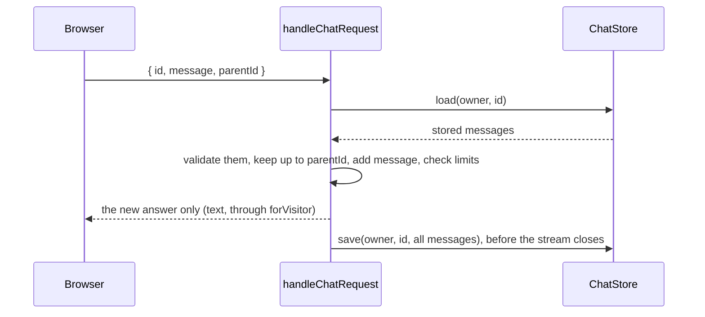

# Server-side conversation history

First appears in: **M18.1** (library) and **M18.2** (reference app). Status: **in use**.

## 1. What it is

The server keeps each conversation, and the browser sends only the new question. Each turn, the server loads the stored
messages, adds the question, runs the model, and saves the result, the answer included. This is the AI SDK's
[message persistence](https://ai-sdk.dev/docs/ai-sdk-ui/chatbot-message-persistence) pattern.

## 2. Why it matters in Promptfolio

- **History stops being visitor input.** When the browser sent the whole conversation, a visitor could write an earlier
  "answer" claiming an award, and the model often repeated it as a fact ([the M15 run](../evaluation/README.md)). A prompt rule
  could only ask the model not to. Now the browser cannot send an answer at all: the request holds one user message, as text.
- **The model keeps its lookups.** Tool calls and results are saved with the answer and sent to the model on later turns. Before,
  they never reached the browser, so a follow-up started with no tool context and had to look everything up again.
- **The server now holds visitors' conversations,** so it has to keep them apart and decide how long to keep them.

## 3. How it works

- **Ownership by key.** The application's `identifyOwner` names whose conversations a request may use (for example a random id
  in an `HttpOnly` cookie), and every store call takes it. A conversation is stored under the owner and the chat id together, so
  another visitor's chat id finds nothing. There is no separate "may this visitor read it" check to forget.
- **`parentId` instead of the whole list.** The browser names the message the new one follows. A new question names the last
  message; an edited question or a regenerated answer names an earlier one, and what followed it is replaced. The AI SDK's own
  `trigger` and `messageId` fields cannot say this for assistant-ui's edits, which send a new message with no `messageId`. The
  idea is assistant-ui's own: its history adapter stores each message with a `parentId`.
- **Stored data is checked again.** The server wrote it, but it outlives the code that wrote it, so `validateUIMessages` checks it
  against the current tools. A conversation that no longer fits starts again from the question.
- **Saved after the filters.** The answer is built from the stream after the raw-tool-call filter, so text the visitor never saw
  is not saved either, and before `forVisitor`, so tool calls and results are kept for the model.
- **The visitor's view.** `loadVisitorChat` returns a stored conversation with text only, the same as the live stream shows.

## 4. Where it lives in the code

- Store interface, `parentId` handling, the visitor's view, the memory store:
  [packages/ai/src/chat/history.ts](../../packages/ai/src/chat/history.ts)
- The request shape: [packages/ai/src/chat/request.ts](../../packages/ai/src/chat/request.ts)
- Load, check, and save around a turn: [packages/ai/src/chat/chat-handler.ts](../../packages/ai/src/chat/chat-handler.ts) and
  `persisted` in [chat-turn.ts](../../packages/ai/src/chat/chat-turn.ts)
- The reference app's Redis store, owner cookie, and retention:
  [apps/portfolio/src/server/chat/history.ts](../../apps/portfolio/src/server/chat/history.ts); its routes in
  [api/chat](../../apps/portfolio/src/app/api/chat/route.ts) and [api/chats](../../apps/portfolio/src/app/api/chats/route.ts);
  the browser's side in [server-thread-list-adapter.ts](../../apps/portfolio/src/chat/threads/server-thread-list-adapter.ts)

## 5. Common pitfalls and misconceptions

- **A chat id is not a secret.** The browser makes it and shows it. Only the owner keeps conversations apart, so it must be
  random and unguessable, and never logged.
- **The store keeps one branch.** After an edit, the replaced messages are gone; the open tab can still show the old branch until
  a reload.
- **A failed save breaks the next turn.** The visitor has the answer, but the store does not, so a follow-up to it names an
  unknown `parentId` and gets 409.
- **More history is more tokens.** Earlier tool results are sent to the model again every turn. `maxMessages` and
  `maxTotalChars` count the stored history, but `maxTotalChars` counts text only, not tool results.
- **A stopped reply is saved as far as it got.** Stop also cancels the model, as before; it is not left running in the
  background to finish.
- **Each list read must expire what retention dropped.** Redis expires the conversation's key, but
  not its entry in the visitor's list, so the reference app drops old entries whenever it reads
  the list.
- **The validator keeps calls to removed tools.** The AI SDK turns a finished call to a tool that no longer exists into a dynamic
  tool part instead of rejecting it; only arguments or results that no longer match a tool fail.

## 6. Further reading

- [AI SDK: chatbot message persistence](https://ai-sdk.dev/docs/ai-sdk-ui/chatbot-message-persistence)
- [AI SDK: transport](https://ai-sdk.dev/docs/ai-sdk-ui/transport)
- [assistant-ui: adapters](https://www.assistant-ui.com/docs/runtimes/concepts/adapters)
