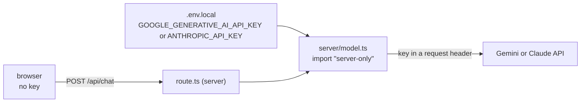

# Server-side secrets

First appears in: **M4** (first AI integration). Status: **in use**.

## 1. What it is

A secret, such as a model provider's API key, must only exist where visitors cannot read it. In a
web app, everything sent to the browser (JavaScript bundles, HTML, network responses) is public.
So the browser calls our own server route, and only the server holds the key and calls the
provider.

## 2. Why it matters in Promptfolio

Anyone with the key can run up the owner's bill or use the account for other purposes. The spec
and `CLAUDE.md` require that provider credentials never appear in client bundles. Promptfolio is
meant to be cloned and deployed by others, so the safe setup has to be the default, not something
each owner configures.

## 3. How it works

Three layers keep the key on the server:

1. **Where it is read.** Only `src/server/model.ts` reads the provider keys
   (`GOOGLE_GENERATIVE_AI_API_KEY`, `ANTHROPIC_API_KEY`), inside a request handler. Next.js
   inlines only variables prefixed `NEXT_PUBLIC_` into client code; these are not.
2. **What may import it.** `model.ts` starts with `import "server-only"`, so if a client component
   ever imports it, the build fails instead of shipping the module to the browser.
3. **What leaves the server.** Provider errors can contain request details. Visitors get a generic
   message with a reference id; the full error stays in the server log.

The key is checked per request, not at startup, so the app builds and renders without one (for
example in CI or for someone only trying the UI).

M4 verified layer 1 by building with a fake sentinel key and searching the build output: zero
matches in `.next/static` (client) or anywhere in `.next`. A positive control (the default model
id) was found in the server output, confirming the search reached it.

## 4. Where it lives in the code

- Reading the key: [apps/portfolio/src/server/model.ts](../../apps/portfolio/src/server/model.ts),
  tested in [model.test.ts](../../apps/portfolio/src/server/model.test.ts)
- The route: [apps/portfolio/src/app/api/chat/route.ts](../../apps/portfolio/src/app/api/chat/route.ts)
- Generic error messages: [packages/ai/src/chat-handler.ts](../../packages/ai/src/chat-handler.ts)
  (`genericErrorMessage`), with leak tests in [chat-handler.test.ts](../../packages/ai/src/chat-handler.test.ts)
- Example configuration: [apps/portfolio/.env.example](../../apps/portfolio/.env.example)

## 5. Common pitfalls and misconceptions

- "The key is in an environment variable, so it is safe." Only if client code never reads it. A
  `NEXT_PUBLIC_` prefix, or passing the value as a prop to a client component, publishes it.
- "Nobody will find it in a minified bundle." Bundles are public files; searching them is trivial.
- Echoing provider errors to the visitor can leak request details, account information, or
  quota state.
- A server route without rate limiting still lets anyone spend the owner's money through it. Set a
  spend limit with the provider, and do not deploy publicly before rate limiting (M11).

## 6. Further reading

- [Next.js: environment variables](https://nextjs.org/docs/app/guides/environment-variables)
- [Next.js: keeping server-only code out of the client](https://nextjs.org/docs/app/getting-started/server-and-client-components#preventing-environment-poisoning)
