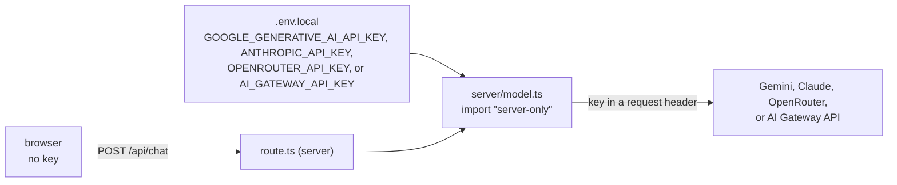

# Server-side secrets

First appears in: **M4** (first AI integration). Status: **in use**.

## 1. What it is

A secret, such as a model provider's API key, must only exist where visitors cannot read it. In a
web app, everything sent to the browser (JavaScript bundles, HTML, network responses) is public.
So the browser calls our own server route, and only the server holds the key and calls the
provider.

## 2. Why it matters in Promptfolio

Anyone with the key can run up the owner's bill or use the account for other purposes. The spec
and `CLAUDE.md` require that provider credentials never appear in client bundles. Promptfolio is
meant to be cloned and deployed by others, so the safe setup has to be the default, not something
each owner configures.

## 3. How it works

Three layers keep the key on the server:

1. **Where it is read.** Only `src/server/model.ts` reads the provider keys
   (`GOOGLE_GENERATIVE_AI_API_KEY`, `ANTHROPIC_API_KEY`, since M7.1 `OPENROUTER_API_KEY`, and
   since M7.2 `AI_GATEWAY_API_KEY`), inside a request handler. Next.js
   inlines only variables prefixed `NEXT_PUBLIC_` into client code; these are not. The gateway
   key is passed to `createGateway` explicitly, so the adapter never falls back to an ambient
   `VERCEL_OIDC_TOKEN`.
2. **What may import it.** `model.ts` starts with `import "server-only"`, so if a client component
   ever imports it, the build fails instead of shipping the module to the browser.
3. **What leaves the server.** Provider errors can contain request details. Visitors get a generic
   message with a reference id, and since M11.1 the log keeps only the error's type, status, retry
   flag, and attempt count. An `APICallError` carries the whole request, which includes the
   visitor's conversation, and the provider's response, so the error itself stays out of the log.

The key is checked per request, not at startup, so the app builds and renders without one (for
example in CI or for someone only trying the UI).

M4 verified layer 1 by building with a fake sentinel key and searching the build output: zero
matches in `.next/static` (client) or anywhere in `.next`. A positive control (the default model
id) was found in the server output, confirming the search reached it.

`GITHUB_TOKEN` (M8) is optional and read only by the refresh command (`pnpm --filter portfolio
refresh`, named `fetch-github` in M8), which passes it to `fetchGitHubSnapshot` as an argument. The
running app never reads it and never calls GitHub, so a deployment does not need it. Error
messages, the refresh status file, and the command output never contain it.

In the scheduled job (M9 template, [docs/guides/scheduled-refresh.md](../guides/scheduled-refresh.md))
GitHub Actions supplies `GITHUB_TOKEN` itself, limited to the permissions the workflow declares
(`contents: write`); no personal token is stored. A Vercel deploy hook URL is a secret too: anyone
who has it can start a deployment, so it lives in a repository secret, never in the workflow file.
A model key is needed in the job only if regenerating prepared answers is turned on (off by
default).

M10 adds four secrets, read only in `src/server/contact.ts`, which is also `server-only`:
`RESEND_API_KEY`, `CONTACT_TOKEN_SECRET`, `UPSTASH_REDIS_REST_TOKEN` (from M10.1), and `CONTACT_TO_EMAIL`.
The address is not a credential, but it is private ([ADR 0005](../adr/0005-profile-model-and-provenance.md)). The page passes the browser only a
boolean, `contactEnabled`, and the review shows the owner's name. Provider error messages stay out of
responses and logs; only the error's name is logged.

M11.1 adds `VISITOR_HASH_SECRET`, read only in `src/server/chat-limit.ts`. The Redis settings moved to
`src/server/redis.ts`, and the visitor hash to `src/server/visitor.ts`, both `server-only`. The sentinel check was
rerun with these secrets and found none in `.next`.

## 4. Where it lives in the code

- Reading the key: [apps/portfolio/src/server/model.ts](../../apps/portfolio/src/server/model.ts),
  tested in [model.test.ts](../../apps/portfolio/src/server/model.test.ts)
- Contact configuration: [apps/portfolio/src/server/contact.ts](../../apps/portfolio/src/server/contact.ts),
  leak tests in [packages/contact/src/handlers.test.ts](../../packages/contact/src/handlers.test.ts)
- The route: [apps/portfolio/src/app/api/chat/route.ts](../../apps/portfolio/src/app/api/chat/route.ts)
- Generic error messages: [packages/ai/src/chat-turn.ts](../../packages/ai/src/chat-turn.ts)
  (`genericErrorMessage`), with leak tests in [chat-handler.test.ts](../../packages/ai/src/chat-handler.test.ts)
- Example configuration: [apps/portfolio/.env.example](../../apps/portfolio/.env.example)
- The GitHub token: [apps/portfolio/scripts/refresh.ts](../../apps/portfolio/scripts/refresh.ts),
  leak tests in [apps/portfolio/src/server/refresh.test.ts](../../apps/portfolio/src/server/refresh.test.ts) and [packages/source-github/src/fetch.test.ts](../../packages/source-github/src/fetch.test.ts)

## 5. Common pitfalls and misconceptions

- "The key is in an environment variable, so it is safe." Only if client code never reads it. A
  `NEXT_PUBLIC_` prefix, or passing the value as a prop to a client component, publishes it.
- "Nobody will find it in a minified bundle." Bundles are public files; searching them is trivial.
- Echoing provider errors to the visitor can leak request details, account information, or
  quota state.
- A server route without rate limiting still lets anyone spend the owner's money through it. See
  [abuse protection](abuse-protection-on-serverless.md), and set a spend limit with the provider too.
- "Errors in the log are safe because only the owner reads them." Logs are kept and copied. An error
  object can hold a visitor's whole conversation, so log what diagnosis needs and no more.

## 6. Further reading

- [Next.js: environment variables](https://nextjs.org/docs/app/guides/environment-variables)
- [Next.js: keeping server-only code out of the client](https://nextjs.org/docs/app/getting-started/server-and-client-components#preventing-environment-poisoning)
