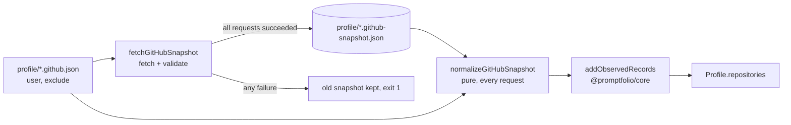

# Source adapters and snapshots

First appears in: **M8** (GitHub source adapter). Status: **in use**.

## 1. What it is

A **source adapter** turns one external source into the common profile model. It works in
separate steps:

1. **Fetch:** talk to the source over the network (the only step with I/O and its failures).
2. **Validate:** check that each response has the shape the adapter expects.
3. **Normalize:** map the source's shape to canonical, source-neutral records.
4. **Merge:** add those records to the profile with their provenance.

A **snapshot** is the validated result of one fetch, saved to a file with the time it was
retrieved. It separates *when data is fetched* from *when it is used*.

## 2. Why it matters in Promptfolio

GitHub data should be current without anyone maintaining a list, but visitors must never wait
for GitHub or see its failures. GitHub allows 60 unauthenticated requests per hour per IP
address, and serverless functions keep no memory between requests
([ADR 0001](../adr/0001-reference-app-framework.md)). Fetching per request would break on both
counts. Instead a command fetches when the owner (or, from M9, a schedule) runs it, and every
request reads the snapshot like the profile file
([ADR 0009](../adr/0009-github-source-as-fetched-snapshot.md)).

## 3. How it works

- **Automatic selection.** The owner gives only a username. The fetcher takes the owner's public,
  non-fork repositories: pinned ones first (pinned items exist only in GitHub's GraphQL API, which
  needs a token), then by last push, 12 without a token and 20 with one. `exclude` hides a
  repository; it applies at load time too, so hiding needs no refetch.
- **All or nothing.** If any request fails, the snapshot is not written. A partial snapshot would
  silently drop repositories. A missing README is not a failure. The file is written to a
  temporary name and renamed, so a reader never sees half a file. This is the simplest
  "last known good": the previous snapshot stays until a complete one replaces it. M9 adds
  refresh status and per-repository fallback.
- **Source keys and the owner's notes.** Each repository's id is `github.com/<owner>/<repo>`.
  The owner can describe a repository by writing a project with that same id: the profile
  follows the source, not the other way. The two records keep their own provenance, and a
  lookup returns both.
- **Less churn on purpose.** Dates are kept by month and star counts are left out, because any
  content change invalidates every prepared answer
  ([prepared answers and invalidation](prepared-answers-and-invalidation.md)). `retrievedAt` is not
  content, so a refetch that finds nothing new keeps the answers current.

## 4. Where it lives in the code

- Package: [packages/source-github/src/](../../packages/source-github/src/) — `config.ts`,
  `select.ts`, `fetch.ts` (the only I/O), `snapshot.ts`, `normalize.ts`
- Merge and the `Repository` record: [packages/core/src/profile/observed.ts](../../packages/core/src/profile/observed.ts),
  [types.ts](../../packages/core/src/profile/types.ts)
- Reading the files at request time: [apps/portfolio/src/server/github-source.ts](../../apps/portfolio/src/server/github-source.ts)
- The command: [apps/portfolio/scripts/fetch-github.ts](../../apps/portfolio/scripts/fetch-github.ts)
- Tests: `fetch.test.ts`, `normalize.test.ts`, `select.test.ts` in the package,
  [observed.test.ts](../../packages/core/src/profile/observed.test.ts),
  [profile.test.ts](../../apps/portfolio/src/server/profile.test.ts)
- Scheduled refresh: **planned** (M9). Forks and merged pull requests: **planned** (M8.1)

## 5. Common pitfalls and misconceptions

- "The adapter verifies the profile." It shows what GitHub shows. A repository under the owner's
  account does not prove who wrote its code.
- Mixing fetch and normalize makes every test need the network and every request pay for GitHub.
  Keep the I/O in one function and test the rest with fixtures.
- Writing whatever came back, even partially, replaces good data with incomplete data. Validate
  everything first, then replace the file in one step.
- Changing source data more often than needed is not free: here it invalidates prepared answers.

## 6. Further reading

- [GitHub REST API: repositories](https://docs.github.com/en/rest/repos/repos)
- [GitHub GraphQL API: users (pinnedItems)](https://docs.github.com/en/graphql/reference/users)
