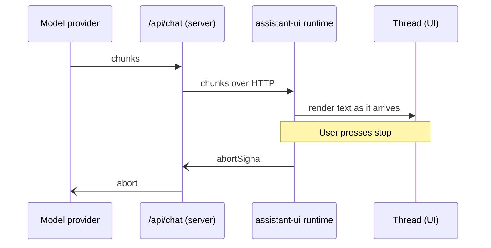

# Streaming

First appears in: **M4** (first AI integration); thread titles already use a stream in M3. Status: **in use**.

## 1. What it is

Streaming means the server sends the model's reply in small pieces as they are generated, instead
of waiting for the full answer. The UI appends each piece, so the visitor sees text within a
second rather than after the whole reply is done.

## 2. Why it matters in Promptfolio

Model replies take seconds. The spec asks for clear loading and streaming states; streaming is the
difference between a working chat and an apparently frozen one. It also makes cancellation useful:
the visitor can stop a long answer midway.

## 3. How it works

There are three streams, one per hop:

1. **Provider to server.** The provider streams its own event format; its AI SDK package
   (`@ai-sdk/google` or `@ai-sdk/anthropic`) turns them into provider-neutral parts, and
   `streamText` exposes them.
2. **Server to browser.** `toUIMessageStream()` re-encodes the parts as the AI SDK's *UI message
   stream*: server-sent events whose `data:` lines are small JSON chunks, such as
   `{"type":"text-delta","id":"…","delta":"Jordan is"}`, ending with `finish` and `data: [DONE]`.
   Promptfolio passes only an allowlist of chunk types (`start`, step boundaries, text, `data-sources` from M11.2, `finish`,
   `error`, `abort`) and removes `providerMetadata` from the chunks it passes. Provider `custom`
   metadata, Gemini's encrypted `thoughtSignature` on text chunks, and, from M5, tool calls and
   tool results stay on the server.
3. **Inside the browser.** `useChat` reads the chunks and appends to the assistant message's
   `parts`; assistant-ui re-renders the thread as text arrives.

Once the first byte is sent, the HTTP status is already 200, so a failure after that point cannot
become an error status. It travels inside the stream as an `error` chunk, which the handler replaces
with a generic message and a reference id (the real error goes to the server log).

Cancellation and timeouts both end the stream with an `abort` chunk, which the browser treats as
"the visitor pressed Stop": the reply just ends. That is right for a real Stop, but a timeout would
leave the visitor guessing, so the handler turns an `abort` the visitor did not cause
(`request.signal` not aborted) into the generic `error` chunk.

From M5, one reply can span several model calls (*steps*): a tool call, its result, then the
answer (see [tool calling](tool-calling.md)). The browser sees `start-step` and `finish-step`
boundaries and the final text, but nothing in between, so during a lookup the chat shows its
running state with no text yet. The provider timeouts cover all steps together.

Thread titles use a separate, tiny stream: `generateTitle` returns an `AssistantStream` with a
single text chunk, because that is the shape assistant-ui expects.

## 4. Where it lives in the code

- Server stream, error replacement, chunk allowlist and timeout-to-error conversion
  (`VISITOR_CHUNK_TYPES`, `forVisitor`): [packages/ai/src/chat-turn.ts](../../packages/ai/src/chat-turn.ts);
  tests for a mid-stream error, dropped provider parts, and hidden tool chunks in
  [chat-handler.test.ts](../../packages/ai/src/chat-handler.test.ts)
- Browser side (`useChat` with `DefaultChatTransport`):
  [apps/portfolio/src/components/chat-workspace.tsx](../../apps/portfolio/src/components/chat-workspace.tsx)
- Cancellation: `request.signal` passed to `streamText` as `abortSignal` (chat-turn.ts)
- A stream without a model: `preparedAnswerStream` in
  [packages/ai/src/prepared-answers.ts](../../packages/ai/src/prepared-answers.ts) writes the chunks of a
  one-step text answer for a prepared answer (M7); it goes through the same `forVisitor` filter
- Title stream (`createAssistantStream`): [apps/portfolio/src/chat/browser-thread-list-adapter.ts](../../apps/portfolio/src/chat/browser-thread-list-adapter.ts)
- SDK choice: [ADR 0003](../adr/0003-ai-sdk-selection.md)

## 5. Common pitfalls and misconceptions

- A stream can fail halfway. The UI must show a partial reply as failed, not as a complete answer.
- Stopping the UI is not enough; the abort must reach the server request to the provider, or tokens
  keep being generated and billed.
- Streaming does not make the model faster overall; it only shows the first words sooner.
- A stream can also just stop producing anything. Without a timeout the visitor waits
  indefinitely; with one, check how the timeout reaches the browser (here: as an `abort`).
- Don't build a custom streaming protocol. The spec says to use the SDK's (ADR 0003). A UI
  message stream is only a sequence of chunks, though, so the server can write one itself when no
  model is involved, as M7 does for prepared answers.
- Whatever the server streams, the client may store and send back. In M4, Anthropic's `custom`
  metadata part was echoed in the next request and rejected by the allowlist, breaking follow-up
  questions; tests with a mock model missed it because the mock emitted no such part. That is why
  M5 turned the filter into an allowlist: new chunk types are dropped until allowed on purpose.
- Allowing a chunk *type* is not the same as allowing every *field* in it. Gemini attaches an
  encrypted `thoughtSignature` (an opaque token for its reasoning state) as `providerMetadata` on
  every `text-delta`, an allowed type, so it reached the browser until M5's review stripped the
  field too. A mock model without metadata cannot catch this; the test now sends some.

## 6. Further reading

- [AI SDK: streaming](https://ai-sdk.dev/docs/foundations/streaming)
- [MDN: Streams API](https://developer.mozilla.org/en-US/docs/Web/API/Streams_API)
