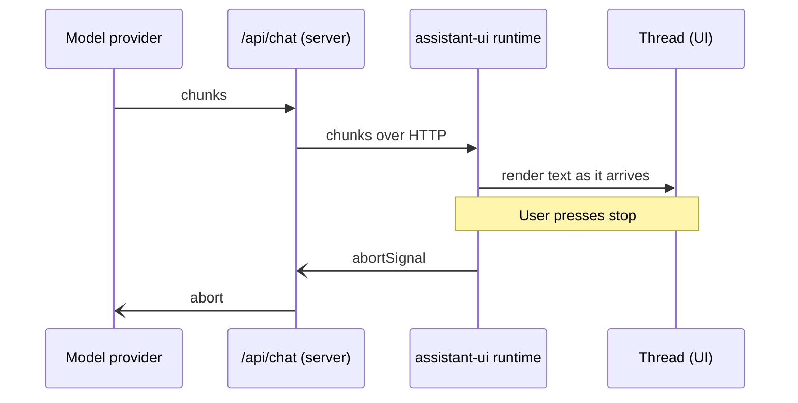

# Streaming

First appears in: **M4** (first AI integration); thread titles already use a stream in M3. Status: **planned** for replies.

## 1. What it is

Streaming means the server sends the model's reply in small pieces as they are generated, instead
of waiting for the full answer. The UI appends each piece, so the visitor sees text within a
second rather than after the whole reply is done.

## 2. Why it matters in Promptfolio

Model replies take seconds. The spec asks for clear loading and streaming states; streaming is the
difference between a working chat and an apparently frozen one. It also makes cancellation useful:
the visitor can stop a long answer midway.

## 3. How it works

Today the placeholder model returns the whole reply at once. The one stream already in the code is
the thread title: `generateTitle` returns an `AssistantStream` with a single text chunk, because
that is the shape assistant-ui expects.

## 4. Where it lives in the code

- Title stream (`createAssistantStream`): [apps/portfolio/src/chat/thread-list-adapter.ts](../../apps/portfolio/src/chat/thread-list-adapter.ts)
- Cancellation in the placeholder (`abortSignal`): [apps/portfolio/src/chat/placeholder-model.ts](../../apps/portfolio/src/chat/placeholder-model.ts)
- Streaming model replies (`streamText` on the server, AI SDK transport in the client): **planned** (M4)
- SDK choice: [ADR 0003](../adr/0003-ai-sdk-selection.md)

## 5. Common pitfalls and misconceptions

- A stream can fail halfway. The UI must show a partial reply as failed, not as a complete answer.
- Stopping the UI is not enough; the abort must reach the server request to the provider, or tokens
  keep being generated and billed.
- Streaming does not make the model faster overall; it only shows the first words sooner.
- Don't build a custom streaming protocol. The spec says to use the SDK's (ADR 0003).

## 6. Further reading

- [AI SDK: streaming](https://ai-sdk.dev/docs/foundations/streaming)
- [MDN: Streams API](https://developer.mozilla.org/en-US/docs/Web/API/Streams_API)
