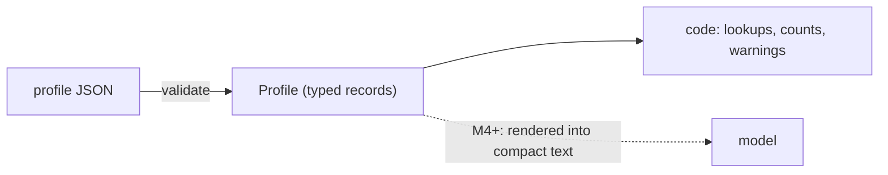

# Structured data vs. prompt text

First appears in: **M2** (profile schema). Status: **in use**.

## 1. What it is

Profile facts are stored as typed records (`Profile`, `Role`, `Project`, …) that code can validate,
look up, and count, instead of one block of free text that is pasted into a model prompt. The
model only ever sees a rendering of those records; the records themselves stay the source of truth.

## 2. Why it matters in Promptfolio

- The spec forbids the assistant from inventing facts. With records, code can answer "is there a
  project with id `service-catalog`?" deterministically; with a prose blob, only the model can,
  and it may guess.
- M5 tools look up records by id, skill, or role. M7/M9 caches depend on knowing *which* facts
  changed. Neither works on free text.
- A second profile (M12) is just a different JSON file, not a rewritten prompt.

## 3. How it works



Compare the two ways to say the same thing:

```text
Prompt text:   "Jordan worked at Acme 2021–2023 doing React and testing..."
Structured:    { id: "acme-frontend", organization: "Acme Corp", start: "2021-03",
                 end: "2023-08", skills: ["TypeScript", "React", "Testing"], provenance: {...} }
```

The structured form can be checked (`end` is after `start`), cross-referenced (`skills` must exist
in `Profile.skills`), and cited (`acme-frontend`).

## 4. Where it lives in the code

- Canonical types: [packages/core/src/profile/types.ts](../../packages/core/src/profile/types.ts)
- Authoring schema: [packages/core/src/profile/schema.ts](../../packages/core/src/profile/schema.ts)
- Sample data: [apps/portfolio/profile/example.profile.json](../../apps/portfolio/profile/example.profile.json)
- Decision: [ADR 0005](../adr/0005-profile-model-and-provenance.md)
- Rendering records into model context: **planned** (M4/M5)

## 5. Common pitfalls and misconceptions

- "The model can read JSON, so structure doesn't matter." It can read it, but it cannot *enforce*
  it. Structure is for the code, not for the model.
- Turning the records back into one long prompt string early and then only working with that
  string loses ids and provenance.
- Adding fields "just in case": everything in a profile is public and sent to a model
  ([ADR 0005](../adr/0005-profile-model-and-provenance.md), point 9), so extra fields cost tokens
  and may leak.

## 6. Further reading

- [Zod: defining schemas](https://zod.dev/api)
- [TypeScript Handbook: object types](https://www.typescriptlang.org/docs/handbook/2/objects.html)
