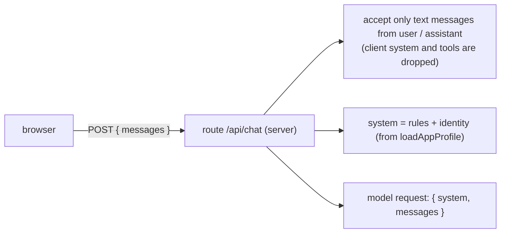

# System prompt

First appears in: **M4** (first AI integration). Status: **planned**.

## 1. What it is

The system prompt is the instruction text sent to the model alongside the conversation, separate
from the visitor's messages. It sets the assistant's role and rules ("answer about this profile
only; say when something is not in the profile") and, in Promptfolio, carries the owner's identity.
Other profile facts arrive through tools from M5 (see [context selection](context-selection.md)).

## 2. Why it matters in Promptfolio

It is where the "don't invent facts" requirement is first expressed to the model. But it is
guidance, not enforcement: the spec and `CLAUDE.md` both say a prompt is not an authorization
boundary.

## 3. How it works

Planned shape for M4: the server builds the system prompt; the browser never supplies it.



The identity block is delimited and labelled with its basis, for example:

```text
<owner_identity basis="self-reported">
Name: Jordan Lee
Headline: Frontend engineer
Summary: Builds accessible web apps with TypeScript and React.
</owner_identity>
```

The rules tell the model to say when something is not provided, never to invent facts, and to
speak about the owner in the third person, never as them.

## 4. Where it lives in the code

- Server-side prompt construction: **planned** (M4, `/api/chat` route and `@promptfolio/ai`)
- Identity input it will render: [packages/core/src/profile/types.ts](../../packages/core/src/profile/types.ts)
- Why the client's `system` field must be ignored: [ADR 0007](../adr/0007-chat-ui-assistant-ui.md), consequences

## 5. Common pitfalls and misconceptions

- "The prompt says don't do X, so X can't happen." Models can ignore instructions, and visitor
  messages can try to override them (prompt injection). Limits, tool permissions, and confirmations
  live in code.
- Accepting a system prompt from the browser lets any visitor rewrite the assistant's rules.
- Putting secrets or private configuration in the prompt: assume anything in it can be repeated
  back to a visitor.
- Dumping the whole profile into the prompt is cheap for a small profile, but loses provenance
  and hides invention; see [context selection](context-selection.md).

## 6. Further reading

- [AI SDK: prompts (system, messages)](https://ai-sdk.dev/docs/foundations/prompts)
- [Anthropic: giving Claude a role with a system prompt](https://docs.claude.com/en/docs/build-with-claude/prompt-engineering/system-prompts)
  (the M4 plan chooses Anthropic; the concept is the same across providers)
