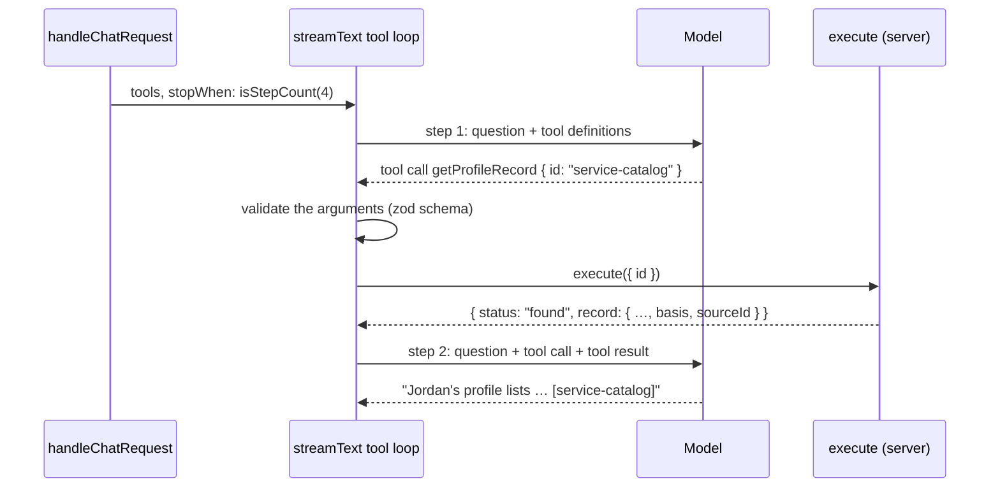

# Tool calling

First appears in: **M5** (tools and grounded profile lookup). Status: **in use**.

## 1. What it is

A tool is a function the server offers to the model: a name, a description, and a JSON schema for
its input. Instead of answering, the model can reply with a *tool call*, a name plus JSON
arguments. The AI SDK checks the arguments against the schema, runs the function on the server,
and sends the result back to the model, which then writes its answer. The model never runs code;
it only asks.

## 2. Why it matters in Promptfolio

It is how the assistant gets profile facts without putting the whole profile in the system prompt
(see [context selection](context-selection.md)). Each fact arrives as a record with an id and a
basis, so the answer can cite it and say whose claim it is. Because the lookups are deterministic
code over the validated profile, "not in the profile" is a definite result, not a guess.

## 3. How it works

One visitor question can take several model calls, called *steps*:

The two tools are `listProfileRecords({ section, skill? })`, which returns one section's records
with ids, descriptions, dates, and provenance, and `getProfileRecord({ id })`, which adds the
detail lists (highlights, responsibilities, outcomes, links) for one record, or returns
`not_found`.

Every tool round trip costs one more model call, because the model has to read a result before it
can use it. So the summaries carry what a basic answer needs: a section question takes one lookup
and two model calls, not a list, a get, and three. The first M5 version had thinner summaries,
and the model fetched full records just to learn a project's description or a degree's years.

Rules the code enforces, whatever the model or the prompt says:

| Rule | How |
| ---- | --- |
| Only the server's tools exist | `tools` comes from `createProfileTools`; the client's `tools` field is stripped. A call to any other name (`sendEmail`) fails before anything runs. |
| Arguments are validated | strict zod schemas; invalid arguments are never passed to `execute`, and the model gets the validation error as the tool result |
| A bounded loop | `stopWhen: isStepCount(4)`; on the last step `prepareStep` sets `toolChoice: "none"`, so the answer ends in text |
| A bounded number of calls | at most 8 per request, counted in the tool set's closure; later calls return `limit_reached` |
| Tool activity stays on the server | the stream to the browser is an allowlist of text chunks; tool calls and results never reach it, so the browser has no tool parts to send back (the request allowlist rejects them) |

Expected outcomes are **results, not exceptions**: `not_found`, `skillInProfile: false`, and
`limit_reached` are normal values the model reads and explains. `execute` throws only on a bug.

Hiding the *mechanism* is not hiding the *evidence*. Tool names, schemas, and raw results stay on
the server, but the system prompt asks the model to explain where a fact comes from (record id,
source, basis, date) whenever a visitor asks.

## 4. Where it lives in the code

- Tools, input schemas, call budget: [packages/ai/src/profile-tools.ts](../../packages/ai/src/profile-tools.ts),
  tested in [profile-tools.test.ts](../../packages/ai/src/profile-tools.test.ts)
- Pure lookups without the AI SDK (`findRecordById`, `recordsUsingSkill`):
  [packages/core/src/profile/query.ts](../../packages/core/src/profile/query.ts)
- The loop (`tools`, `stopWhen`, `prepareStep`), the output allowlist (`forVisitor`), and tool-call
  logging (`logToolCalls`): [packages/ai/src/chat-handler.ts](../../packages/ai/src/chat-handler.ts);
  multi-step tests with `MockLanguageModelV4` in [chat-handler.test.ts](../../packages/ai/src/chat-handler.test.ts)
- Limits (`maxSteps`, `maxToolCalls`): [packages/ai/src/limits.ts](../../packages/ai/src/limits.ts)
- Design and decisions: [M5 plan](../plans/m5-tools-grounded-lookup.md)

## 5. Common pitfalls and misconceptions

- "The model runs the tool." It only proposes a call; our code decides whether and how it runs.
- Forgetting `stopWhen`: the default is one step, so the reply ends right after the tool call with
  no answer.
- Trusting tool arguments because a schema exists for them. The schema checks shape; the values are
  still model output (here they are only lookup keys, so the worst case is `not_found`).
- Trusting tool results sent back by the browser. The AI SDK's default stream sends tool parts to
  the client, which stores and resends them; anything resent can be forged.
- Throwing for "not found". The model then sees an error instead of a fact it can explain.
- Counting a model's per-step limits as per-request limits: `maxOutputTokens` applies to each step,
  and a lookup turn makes two or three model calls, which also counts against provider rate
  limits.
- A tool result is not proof. A cited id shows which record the model *claims* to have used; a
  check that the cited ids were actually returned is planned for M11.

## 6. Further reading

- [AI SDK: tool calling](https://ai-sdk.dev/docs/ai-sdk-core/tools-and-tool-calling)
- [Anthropic: tool use overview](https://docs.claude.com/en/docs/agents-and-tools/tool-use/overview)
- [Gemini API: function calling](https://ai.google.dev/gemini-api/docs/function-calling)
