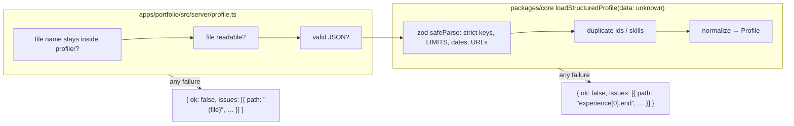

# Validation at boundaries

First appears in: **M2** (profile loading). Status: **in use**; extended in M4 (chat route), M5 (tool arguments, output allowlist), and M6
(browser storage).

## 1. What it is

Some data comes from outside our code, so we can't assume it is correct: a profile file someone
wrote by hand, a request sent by a browser, or arguments a model asks a tool to run with. A
*boundary* is the first function that receives such data. Validating at the boundary means that
function checks everything (shape, size, format) before passing the data on, so the rest of the
code can trust it without checking again.

## 2. Why it matters in Promptfolio

- The profile file is hand-written and may contain typos or oversized text that would later be sent
  to a model.
- From M4, browser requests to `/api/chat` are untrusted: any client can send a `system` prompt,
  `tools`, file parts, or a forged conversation history
  ([ADR 0007](../adr/0007-chat-ui-assistant-ui.md), consequences).
- From M5, model output (tool arguments) is untrusted too.
- From M6, data read back from the browser's `localStorage` is untrusted: it may be malformed, old,
  oversized, or edited by hand.

## 3. How it works

The profile path has two boundaries, one in the app and one in the library:

Results, not exceptions: data errors come back as `{ ok: false, issues }` with a path for each
problem, all at once. Exceptions are reserved for programming errors (an empty `sourceId`).

The chat request (M4) is a third boundary, `parseChatRequest` in `@promptfolio/ai`. It uses an
**allowlist**: it describes what is accepted and rejects everything else, instead of listing what
to remove.

1. Read the body, stopping after 100 KB, so an oversized body is never parsed (413).
2. Parse JSON (400), then check the shape with zod: only `messages` is read; roles are `user` or
   `assistant` (a `system` role is rejected); parts are `text`, `data-sources` (the server's own sources block, dropped on arrival so a forged one has no effect), or `step-start` (a content-free
   marker the AI SDK adds, dropped). Other body fields, such as `system` and `tools`, are stripped.
3. Check the limits (413) and that the last message is a non-empty question (400).
4. Rebuild clean messages from the accepted text only, and pass those on.

Each failure returns a short plain-text message that is safe to show, and the model is never
called. A visitor can still forge earlier "assistant" turns; the system prompt tells the model that
only tool results in the current answer are evidence.

Tool arguments (M5) are a fourth boundary: they are model output. The AI SDK validates them
against each tool's strict zod schema before `execute` runs; invalid arguments or an unknown tool
name never reach our code, and the model receives the validation error instead. Valid values are
still only lookup keys: a wrong id gives `not_found`, never access to anything.

The stream back to the browser mirrors the request allowlist: `forVisitor` passes only the chunk
types needed to show a text answer, and removes `providerMetadata` from those chunks. Tool calls and results never leave the server, so the browser
has no tool parts to send back, and the request allowlist keeps rejecting them.

The prepared-answers file (M7) is another input, even though the owner writes it: it is parsed
with a strict schema, and a missing, unreadable, or invalid file means "no prepared answers", so
every question is answered live. The request's `trigger` is now read too, as metadata: an
unknown value counts as a new message instead of rejecting the request.

Saved conversations (M6) are a boundary in the browser: `ThreadStore` keeps only the shape the
server accepts when writing, and validates everything it reads back with zod, dropping invalid
entries instead of throwing. This protects the UI, not the server: the server still validates
every request, because a visitor can edit storage as easily as a request.

M8 adds three untrusted inputs. **GitHub responses** are validated with schemas that drop unknown
fields (GitHub adds fields over time) and reject wrong types, missing URLs, and oversized bodies;
**the GitHub configuration** and **the snapshot file** use strict schemas, like the profile, because
Promptfolio owns their format. Normalization then cleans what is allowed through (control
characters, homepage only as an http or https URL, topic format, length caps), and
`addObservedRecords` validates the canonical records once more in core. An invalid configuration
or snapshot fails the profile load, like an invalid profile file.

M10 adds the contact routes. `prepare` uses a strict schema, so a request that names a recipient, sender,
or subject is rejected, and it normalizes the message first, so the review shows the real text. `send`
accepts one field, a signed token, and its payload is validated again after the signature passes. The
dialog in the browser checks nothing itself: it displays the server's answers.

## 4. Where it lives in the code

- Contact requests: [packages/contact/src/request.ts](../../packages/contact/src/request.ts)
- File and path checks: [apps/portfolio/src/server/profile.ts](../../apps/portfolio/src/server/profile.ts)
- Schema and `LIMITS`: [packages/core/src/profile/schema.ts](../../packages/core/src/profile/schema.ts)
- `ProfileLoadResult`, `toProfileIssue`, `formatPath`: [packages/core/src/profile/load.ts](../../packages/core/src/profile/load.ts)
- Owner-facing error page: [apps/portfolio/src/app/page.tsx](../../apps/portfolio/src/app/page.tsx)
- Tests ("rejects …", "reports every problem at once"): [packages/core/src/profile/load.test.ts](../../packages/core/src/profile/load.test.ts)
- Chat request allowlist and limits: [packages/ai/src/request.ts](../../packages/ai/src/request.ts),
  [packages/ai/src/limits.ts](../../packages/ai/src/limits.ts); tests ("rejects …") in
  [packages/ai/src/chat-handler.test.ts](../../packages/ai/src/chat-handler.test.ts)
- Tool input schemas (`listInputSchema`, `getInputSchema`): [packages/ai/src/profile-tools.ts](../../packages/ai/src/profile-tools.ts);
  tests ("rejects …") in [profile-tools.test.ts](../../packages/ai/src/profile-tools.test.ts), and
  invalid or unknown calls from the model in [chat-handler.test.ts](../../packages/ai/src/chat-handler.test.ts)
- Output allowlist (`VISITOR_CHUNK_TYPES`): [packages/ai/src/chat-turn.ts](../../packages/ai/src/chat-turn.ts)
- Prepared-answers file (`parsePreparedAnswers`): [packages/ai/src/prepared-answers.ts](../../packages/ai/src/prepared-answers.ts),
  read by [apps/portfolio/src/server/prepared-answers.ts](../../apps/portfolio/src/server/prepared-answers.ts)
- Saved conversations: [apps/portfolio/src/chat/thread-store.ts](../../apps/portfolio/src/chat/thread-store.ts);
  tests in [thread-store.test.ts](../../apps/portfolio/src/chat/thread-store.test.ts)
- GitHub responses and snapshot (`parseGitHubSnapshot`), configuration (`parseGitHubConfig`):
  [packages/source-github/src/snapshot.ts](../../packages/source-github/src/snapshot.ts),
  [config.ts](../../packages/source-github/src/config.ts); observed records in core:
  [packages/core/src/profile/observed.ts](../../packages/core/src/profile/observed.ts)

## 5. Common pitfalls and misconceptions

- A TypeScript type is not validation. `JSON.parse` returns `any`; the type only exists at compile
  time. That is why `loadStructuredProfile` takes `unknown`.
- Validating in the browser is a convenience, not security. The server must validate again.
- Strict objects (`z.strictObject`) reject unknown keys on purpose, so a typo like `hightlights`
  fails loudly instead of being silently dropped. The chat request does the opposite for unknown
  *fields* (it strips them, because clients legitimately send `id` and `trigger`), but rejects
  unknown *part types*, because those would carry content to the model.
- A blocklist ("remove `system` and `tools`") misses whatever you did not think of; the M4
  browser check found a provider metadata part that no blocklist would have listed.
- zod is internal to `core`; its error type is converted to `ProfileIssue` so zod's version is not
  part of the public API.
- A prompt instruction ("only answer about the profile") is not a boundary. Limits and permissions
  are enforced in code.

## 6. Further reading

- [Zod: basic usage and `safeParse`](https://zod.dev/basics)
- [TypeScript Handbook: narrowing with discriminated unions](https://www.typescriptlang.org/docs/handbook/2/narrowing.html#discriminated-unions)
