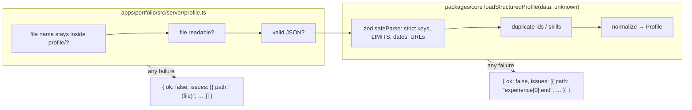

# Validation at boundaries

First appears in: **M2** (profile loading). Status: **in use**; extended in M4 (chat route).

## 1. What it is

Some data comes from outside our code, so we can't assume it is correct: a profile file someone
wrote by hand, a request sent by a browser, or arguments a model asks a tool to run with. A
*boundary* is the first function that receives such data. Validating at the boundary means that
function checks everything (shape, size, format) before passing the data on, so the rest of the
code can trust it without checking again.

## 2. Why it matters in Promptfolio

- The profile file is hand-written and may contain typos or oversized text that would later be sent
  to a model.
- From M4, browser requests are untrusted: assistant-ui's transport can send a `system` prompt and
  `tools` that the server must ignore ([ADR 0007](../adr/0007-chat-ui-assistant-ui.md),
  consequences).
- From M5, model output (tool arguments) is untrusted too.

## 3. How it works

The profile path has two boundaries, one in the app and one in the library:

Results, not exceptions: data errors come back as `{ ok: false, issues }` with a path for each
problem, all at once. Exceptions are reserved for programming errors (an empty `sourceId`).

## 4. Where it lives in the code

- File and path checks: [apps/portfolio/src/server/profile.ts](../../apps/portfolio/src/server/profile.ts)
- Schema and `LIMITS`: [packages/core/src/profile/schema.ts](../../packages/core/src/profile/schema.ts)
- `ProfileLoadResult`, `toProfileIssue`, `formatPath`: [packages/core/src/profile/load.ts](../../packages/core/src/profile/load.ts)
- Owner-facing error page: [apps/portfolio/src/app/page.tsx](../../apps/portfolio/src/app/page.tsx)
- Tests ("rejects …", "reports every problem at once"): [packages/core/src/profile/load.test.ts](../../packages/core/src/profile/load.test.ts)
- Chat request validation and input limits: **planned** (M4). Tool argument validation: **planned** (M5)

## 5. Common pitfalls and misconceptions

- A TypeScript type is not validation. `JSON.parse` returns `any`; the type only exists at compile
  time. That is why `loadStructuredProfile` takes `unknown`.
- Validating in the browser is a convenience, not security. The server must validate again.
- Strict objects (`z.strictObject`) reject unknown keys on purpose, so a typo like `hightlights`
  fails loudly instead of being silently dropped.
- zod is internal to `core`; its error type is converted to `ProfileIssue` so zod's version is not
  part of the public API.
- A prompt instruction ("only answer about the profile") is not a boundary. Limits and permissions
  are enforced in code.

## 6. Further reading

- [Zod: basic usage and `safeParse`](https://zod.dev/basics)
- [TypeScript Handbook: narrowing with discriminated unions](https://www.typescriptlang.org/docs/handbook/2/narrowing.html#discriminated-unions)
