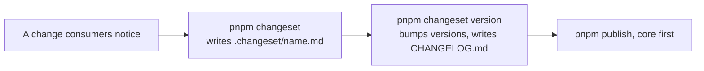

# Versioning and releases

First appears in: **M13.4**. Status: **in use**.

## 1. What it is

A version number tells consumers how much changed. Changesets records that with each change, in a small file, and later turns
those files into version bumps and changelogs.

## 2. Why it matters in Promptfolio

`ai` and `source-github` depend on an exact version of `core`, so releasing one package alone could leave them disagreeing.
Bumping by hand across three manifests and three changelogs is easy to get wrong.

## 3. How it works

- **One version.** `fixed` in the configuration moves `core`, `ai`, and `source-github` together. A patch to `core` alone took
  all three from `0.0.1` to `0.0.2` in a test.
- **What is left out.** The apps and `@promptfolio/contact` are in `ignore`, so they do not change version.
- **`privatePackages.version` is on,** because the three packages were `private: true` when this was set up, and
  Changesets otherwise skips private packages without saying so.
- **Below 1.0, the range does not protect anyone.** `^0.0.1` matches only `0.0.1`, so consumers upgrade by hand. Any release can
  break things until the first outside project adopts the packages, when they move to `0.1.0`.

## 4. Where it lives in the code

- Configuration: [.changeset/config.json](../../.changeset/config.json)
- The release checklist: [M13 plan](../plans/m13-library-readiness.md#release-checklist)

## 5. Common pitfalls and misconceptions

- **Not every commit needs a changeset.** Only what a consumer would notice does. Internal refactors and docs do not.
- **A changeset is not a release.** Files collect until someone runs `changeset version`, and publishing is another step.
- **A silent no-op looks like success.** With private packages not versioned, `changeset version` reported that everything was
  updated and changed nothing. Check the versions afterwards.

## 6. Further reading

- [Changesets: introduction](https://github.com/changesets/changesets/blob/main/docs/intro-to-using-changesets.md)
- [Changesets: fixed packages](https://github.com/changesets/changesets/blob/main/docs/fixed-packages.md)
- [Semantic Versioning](https://semver.org/)
