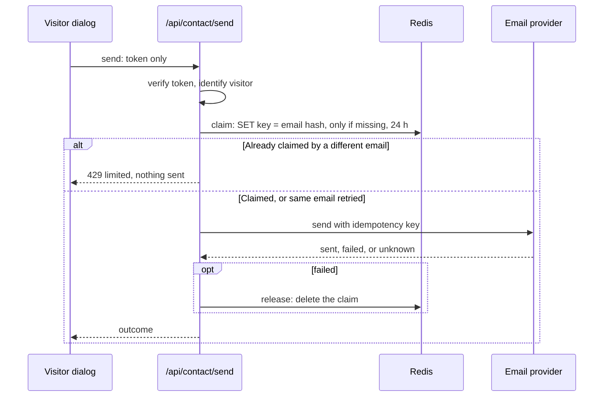

# M10.1 plan: one email per visitor per day

- **Status:** Done (2026-10-30). Plan approved with every recommended default; implemented and approved
  in review. The deployed checks wait for M12 (see [Review results](#review-results)).
- **Date:** 2026-10-30
- **Roadmap:** an addition to [M10](m10-contact-workflow.md), which is still uncommitted and in review.

## Objective

The API sends at most one email per visitor in any 24 hours, and tells a blocked visitor why. This
replaces M10's "no store" decision ([ADR 0012](../adr/0012-contact-workflow.md), decision 6).

## Findings

Checked 2026-10-30.

- **The firewall cannot do it.** [Vercel's window](https://vercel.com/docs/vercel-firewall/vercel-waf/rate-limiting)
  is at most 10 minutes on Hobby and Pro and 1 hour on Enterprise, and it counts requests, not emails.
- **The record needs a shared store.** The project has none, and memory, function files, and cookies
  cannot hold it ([note](../learning/abuse-protection-on-serverless.md)).
- **The address can be read safely on Vercel.** It [overwrites `x-forwarded-for`](https://vercel.com/docs/headers/request-headers)
  to prevent spoofing, and `x-vercel-forwarded-for` has the same value. Other hosts may not protect these.
- **[Upstash Redis](https://upstash.com/docs/redis/overall/pricing), free:** 1 database, 500K commands a
  month, 250 MB, 10 GB of bandwidth. A send uses at most 3 commands. The page does not say whether idle
  databases are archived.
- **`@upstash/redis` 1.40.0:** MIT, one dependency (`uncrypto`), calls Redis over HTTP, so serverless
  functions hold no open connections. [`set`](https://upstash.com/docs/redis/sdks/ts/commands/string/set)
  takes `nx` and `ex`. **To confirm from the installed types:** what `set` returns when `nx` blocks it.

## Design

- **Claim, then send.** `SET ... NX` is atomic, so two requests at once cannot both claim the slot.
  The claim happens only after the token is verified, so invalid tokens never reach Redis.
- **Outcomes.** `sent` and `unknown` keep the claim, because an email may have gone out. `failed`
  deletes it. A retry of the same email is allowed: the claim holds its idempotency key, and the provider
  will not send it twice.
- **Visitor.** An HMAC of the IP address, so Redis never holds the address itself. For IPv6 it uses the
  first 64 bits, because one connection often controls that whole block. The HMAC uses
  `CONTACT_TOKEN_SECRET` with a label that separates it from token signing, so no new secret is needed.
- **Failing closed.** If Redis errors, takes over 2 seconds, or no address can be read, nothing is sent
  and the visitor is asked to try later (503). The limit is never silently skipped.
- **Code location.** `@promptfolio/contact` gets a `ContactSendLimiter` interface (`claim`, `release`), a
  visitor callback, and a `limited` status. Both options are required, so no consumer loses the limit by
  accident. The app's `src/server/contact.ts` holds the Redis adapter and reads the header.
- **Configuration.** `UPSTASH_REDIS_REST_URL` and `UPSTASH_REDIS_REST_TOKEN` join the required contact
  variables. If they are missing, the form stays off and the log names them.
- **Dialog.** Shows `limited` as a clear message and keeps the draft. A host 429 on either route now says
  the request limit was reached, not `unknown`, since the request never reached the app.
- **Privacy.** The dialog adds that a coded form of the visitor's IP address is kept for 24 hours to
  enforce the limit. Message text is still not saved.
- **Firewall.** The guide's rule stays, at 10 requests per 600 seconds: the daily check does not cover
  `prepare`, or stop requests from using function time and Redis commands.

**Limits:** people sharing an address share one email a day. Changing address gets around it, and many
addresses can still use up the provider quota. A failed release, or a claim that lands after the
2-second timeout, blocks the visitor for up to 24 hours although nothing was sent. If concurrent retries
of one email get different answers, a `failed` can delete the claim of a `sent`.

## Scope exclusions

Checking at `prepare`, a per-address or global daily cap, chat limits (M11), logins or address
verification, storing messages, and creating real Redis or firewall resources (M12).

## Files

- **`packages/contact/src`:** `handlers.ts`, `handlers.test.ts`, `index.ts`, `limits.ts`.
- **`apps/portfolio`:** `src/server/contact.ts` and its test, `src/chat/contact-flow.ts` and its test,
  `src/components/contact-dialog.tsx`, `.env.example`, `package.json`, and `pnpm-lock.yaml`.
- **Docs:** ADR 0012, the M10 plan, the setup guide (including the 10-minute window), the roadmap, and
  learning notes on abuse protection and on contact confirmation and idempotency.

## Acceptance

Tests use fakes, with no network, Redis, or email.

1. A second, different email from one visitor within 24 hours gets 429 and the sender is not called. It
   is allowed again after expiry, and a different visitor is unaffected.
2. Two simultaneous sends of different emails call the sender once.
3. `failed` releases the claim; `sent` and `unknown` keep it. Retrying the same email calls the sender
   with the same key.
4. A limiter error, timeout, or missing address gives 503 and no send. An invalid token never reaches
   the limiter.
5. The adapter never passes the raw address to Redis, hashes IPv6 by its first 64 bits, and uses 24 hours.
   Redis's answers are mapped correctly against a fake client.
6. No response or log contains the address or its hash. The dialog shows `limited` and a host 429 as "not
   sent". `pnpm verify` passes.

**Manual, each only with approval:** (1) the dialog with a real free Redis database and a fake email
provider; (2) at deployment (M12), one real send and one blocked send, to confirm the deployed header.

## Open decisions

| # | Question | Recommended default | Alternatives |
| - | -------- | ------------------- | ------------ |
| 1 | Who is a visitor? | Hashed IP address (IPv6 by first 64 bits) | Also the typed email (easily changed) |
| 2 | "Same day" | Rolling 24 hours | Calendar day (23:59 and 00:01 both pass) |
| 3 | Store | Upstash Redis | Postgres (more setup for one short-lived value) |
| 4 | If Redis is down | Send nothing | Send anyway (the limit quietly stops working) |
| 5 | Without Redis variables | Form stays off | Form works unlimited (one missed variable removes the limit) |
| 6 | Unsent attempts | Do not count them | Count them (a provider outage blocks visitors for a day) |
| 7 | Record of the decision | Update ADR 0012, as it is uncommitted | A new ADR replacing decision 6 |

## Review results

Recorded 2026-10-30.

**Automated:** `pnpm verify` passes: lint, typecheck, 551 tests (`core` 74, `contact` 48, `source-github`
119, `ai` 122, app 188), and the build, with the same two "dynamic filesystem access" warnings as before.
No test uses the network, Redis, or email.

**Browser check against fakes.** A production build with placeholder settings, the real routes and the real
Redis and Resend SDKs, pointed at local stand-ins. The stand-ins follow the documented API, so they do not
prove Upstash's or Resend's own behaviour.

| Checked | Result |
| ------- | ------ |
| First message through the dialog | Pass: sent, one email, one slot |
| Second, different message | Pass: limit message, no Try again button, draft kept, still one email |
| Refused email, then another from that visitor | Pass: 502, slot released, the next one sent (by request, not dialog) |
| Two addresses in one IPv6 /64 | Pass: first sent, second 429 (by request) |
| Raw addresses in the store | Pass: none |
| Client bundle | Pass: no placeholder secrets, address, or Redis client |

**Found and fixed by this check:** `z.httpUrl()` refused `localhost` and IP addresses, which would have
blocked a local Redis proxy. It now accepts any http or https URL.

**Changed in review (developer's request):** 429 messages now say a limit was reached.

**Developer's check (2026-10-30, reported by the developer):** on `localhost`, one message sent, and each
of more than ten retries with a different message got the daily limit message. The firewall message cannot
appear there, because the rule exists only on Vercel.

**Not run:** manual check 2, so the deployed IP header and a real firewall 429 have not been seen (M12).
