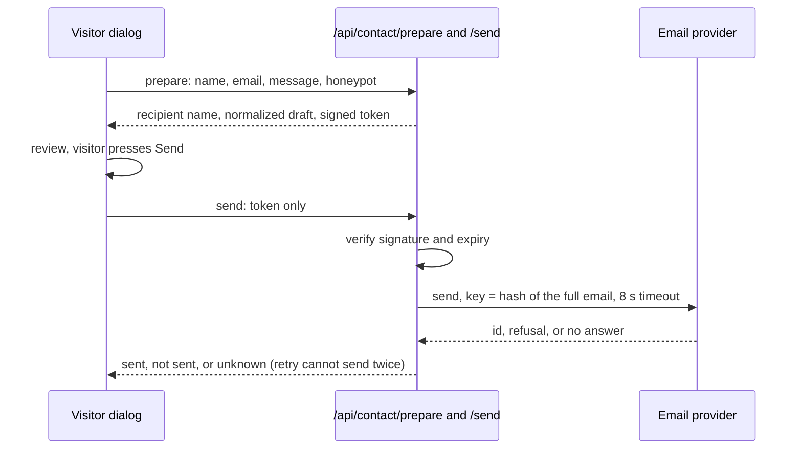

# M10 plan: contact workflow

- **Status:** Plan approved with every recommended default (2026-10-30). Implemented, waiting for
  review; manual check 1 done, checks 2 to 4 not run (see [Review results](#review-results)).
- **Date:** 2026-10-30
- **Roadmap:** [M10 — Contact workflow](../ROADMAP.md#m10--contact-workflow)
- **Changed by:** [M10.1](m10-1-daily-send-limit.md), which adds a store and a limit of one email per
  visitor per day. This plan's decision 6 and its "no store" statements describe M10 before that change.

## Objective

A visitor writes to the profile owner through a form, sees exactly what will be sent, and confirms
it. The server sends only what it validated and signed, only to the configured owner, and reports
success only when the provider confirms it.

## Findings

- **The model cannot reach the browser.** `forVisitor` drops tool chunks and the request allowlist
  rejects tool parts, so a model-driven card would have to change both.
- **Stateless cannot count per visitor.** Tokens and cookies can be discarded, and memory does not
  survive between serverless calls. [ADR 0001](../adr/0001-reference-app-framework.md) expected our
  own storage, but a host firewall can count and a provider's idempotency key can deduplicate.

| Checked 2026-10-30 | Resend (`resend` 6.35.0) | SMTP with Nodemailer (10.3.1) |
| ------------------ | ------------------------ | ----------------------------- |
| Compatibility | Node 20+, MIT, HTTP. Adds `postal-mime`, `standardwebhooks` | Node 20+, MIT-0, no dependencies, bundled types |
| Duplicates | `idempotencyKey`, 24 hours: same key and payload return the original result | No protection |
| Timeout | `signal` option | Defaults up to 120 s, must be lowered |
| Credential | API key, can be `sending_access` only | Gmail: an app password, requires 2-Step Verification |
| Sender, limits | Free: 100 per day, 3,000 per month. `onboarding@resend.dev` delivers only to the account's own address, which fits this case | Gmail: about 500 per day (Google's pages differ) |
| On Vercel | Recommended by Vercel | Ports 465 and 587 open; Vercel calls HTTP APIs more reliable |

Sources: Resend [send](https://resend.com/docs/api-reference/emails/send-email),
[idempotency](https://resend.com/docs/dashboard/emails/idempotency-keys),
[errors](https://resend.com/docs/api-reference/errors),
[test sender](https://resend.com/docs/knowledge-base/403-error-resend-dev-domain),
[pricing](https://resend.com/pricing); [Nodemailer](https://nodemailer.com/); Vercel
[SMTP](https://vercel.com/kb/guide/serverless-functions-and-smtp),
[rate limiting](https://vercel.com/docs/vercel-firewall/vercel-waf/rate-limiting).

## Design

- **Confirmation.** The token (HMAC-SHA-256 with Web Crypto, 15 minutes) *contains* the content, and
  `send` takes only the token, so the text cannot change after review. **Limit:** this proves the
  content passed `prepare` unchanged, not that a human read it. A script can call both routes.
- **Replay and double submit.** Send is disabled in flight. The provider key is a SHA-256 of `from`,
  `to`, subject, and body, so a replay, or an identical message within 24 hours, sends once.
  **Unverified:** whether a *refused* attempt reserves its key (manual check 3).
- **Recipient.** `CONTACT_TO_EMAIL` is read only in a `server-only` module. The visitor sees "To:
  Jordan Example (profile owner)", from `identity.name`; the address never reaches the browser or
  the token. Without configuration there is no button, and the routes answer 503.
- **The email.** The visitor's address goes only in `reply_to`, and the visitor gets no copy, so the
  routes cannot mail third parties. Fixed subject, plain text, and a note that the address is unverified.
- **Validation.** zod strict: name 1 to 100 without control characters, email at most 254, message 10
  to 2,000, body at most 16 KB, JSON only, `Sec-Fetch-Site: cross-site` rejected. Logs hold only the
  request id and outcome. Neither route calls a model or stores anything.
- **Truthful outcomes.** `ContactSender.send` returns `sent` (with id), `failed` (a refusal, including
  quota 429), or `unknown` (timeout, network, 5xx, no id). The send is awaited before responding. "Sent"
  means the provider accepted it, not that it was delivered; the draft stays in the dialog on failure.
- **Where code lives.** New `@promptfolio/contact` (zod only): token, validation, message building,
  web `Request` and `Response` handlers, and the `ContactSender` interface, with no address or provider.
  Contact needs no AI SDK, so it stays out of `@promptfolio/ai`. The app's `src/server/contact.ts`
  holds the environment and the Resend adapter, as `model.ts` does.
- **Assistant.** One prompt rule: it cannot send or pass on messages and points to the Contact button.
  Otherwise it could say "I'll let them know". Prepared answers go live until regenerated.

| Abuse layer | Stops | Does not stop |
| ----------- | ----- | ------------- |
| Fixed recipient, no copy | Spamming third parties | Spam to the owner |
| Honeypot, cross-site check, token | Simple bots, other sites using a visitor's browser | Any written script |
| Idempotency key | Identical repeats | Varied messages |
| Provider quota | Unbounded volume and cost | **A flood uses it up, then real visitors get "not sent" until reset** |
| Host rule per IP (Vercel: all plans, Hobby 1 rule, per region), documented, set at deployment | One fast source | Rotating IPs; absent until M12 |

Nothing verifies a visitor's address, so anyone can claim anyone's. If M11 needs a store for chat
limits (for example `@upstash/ratelimit` 2.2.0), it can serve this too.

## Scope exclusions

Model-drafted messages or a contact tool, a copy to the visitor, sender verification, bounce webhooks,
captcha, a rate-limit store, attachments, storing messages, and any deployment or firewall rule (M12).
The spec's "prepare a contact action" tool and the roadmap's "collect/clarify" are met by the form and
`prepare`, not the model; the spec says the assistant *may* do this.

## Files

- **New:** `packages/contact/`; in `apps/portfolio/src`: `server/contact.ts`, `app/api/contact/prepare/`
  and `send/` routes, `components/contact-dialog.tsx`, `chat/contact-flow.ts` (pure state).
- **Changed:** `chat-workspace.tsx`, `page.tsx`, `.env.example` (`RESEND_API_KEY`, `CONTACT_TO_EMAIL`,
  `CONTACT_FROM_EMAIL`, `CONTACT_TOKEN_SECRET`), `package.json`, `packages/ai/src/system-prompt.ts`.
- **Docs:** `docs/guides/contact-setup.md`, ADR 0012, notes on ADRs 0001 and 0002, architecture,
  roadmap. New learning notes on contact confirmation and idempotency, and on abuse protection on
  serverless; updates to server-side secrets, validation at boundaries, system prompt, and the index.

## Acceptance

Tests use a fake sender and a fixed clock, with no email or network.

1. `prepare` rejects each invalid field, oversized body, wrong type, cross-site request, and filled
   honeypot (with no fake success); `send` rejects a tampered, wrongly signed, or expired token. The
   sender is never called in these cases.
2. The sender receives exactly the prepared content and the configured recipient; nothing in a request
   can change `to`, `from`, or the subject. A replay gives the same key; different content does not.
3. Only `sent` gives a success response. The adapter maps a fake client's id, 4xx, 409, 429, 5xx, abort,
   and missing id correctly.
4. No response or log contains the address, a secret, or visitor text, and a build with a sentinel
   address has no match in `.next/static`.
5. `contact-flow` covers every state, keeps the draft on failure, and blocks a second send. `pnpm verify`
   passes.

**Manual, each only with approval:** (1) the dialog in the browser with stubbed responses; (2) one real
send to `delivered@resend.dev`, then to the owner's account address; (3) a replay and a refused attempt;
(4) regenerating the example's prepared answers, which uses model calls.

## Open decisions

| # | Question | Recommended default | Alternatives |
| - | -------- | ------------------- | ------------ |
| 1 | Does the assistant draft? | No: a form from a header button, plus the prompt rule | A model tool that prefills it, changing `forVisitor`, the allowlist, and the UI |
| 2 | Confirmation | Signed token holding the content | `confirmed: true` (enforces nothing); stored drafts (needs a store) |
| 3 | Double submit | Key from a content hash, plus a disabled button | Random per-token key (re-prepared messages send twice) |
| 4 | Provider | Resend SDK behind `ContactSender` | Direct `fetch` (no dependency, more code); Nodemailer (no duplicate protection) |
| 5 | Recipient | Owner's name shown, address only in server environment | Showing the address; a per-profile config file |
| 6 | Rate limiting | No store: quota, cheap checks, documented host rule; revisit in M11 | Upstash now (exact, but a new service and secret); Turnstile (adds a third-party script) |
| 7 | Code location | New `@promptfolio/contact`, adapter in the app | Inside `@promptfolio/ai`; app only (M12's consumer would copy it) |
| 8 | Prompt rule | Add now, regenerate the example's answers once with approval | Wait for M11 (one regeneration, but it may claim to pass messages on until then) |
| 9 | ADR | ADR 0012, with notes on 0001 and 0002 | Update notes only |

## Review results

Recorded 2026-10-30.

**Automated:** `pnpm verify` passes: lint, typecheck in all five packages, 497 tests (`core` 74,
`contact` 32, `source-github` 119, `ai` 122, app 150), and the build, with the same two "dynamic
filesystem access" warnings as before M10. No test uses the network, email, or a model. Acceptance
criteria 1 to 3 and 5 are covered by `handlers.test.ts`, `contact.test.ts`, and `contact-flow.test.ts`.

Criterion 4: built with sentinel contact settings, the sentinel has 0 matches in `.next/static` and in
all of `.next`. Controls: provider code has 0 client and 3 server matches, and the dialog is in the client
bundle.

**Deviations and details:**

- The package receives the address through `ContactOptions` so it can hash and pass it. Nothing is
  hard-coded, and it never enters a response, token, or log.
- A provider's `409 concurrent_idempotent_requests` is `unknown`, not a fourth "still being sent" state:
  the visitor's next step is the same.
- `readBodyWithLimit` is copied from `@promptfolio/ai`, because `contact` should not depend on the AI SDK.
- The home page is prerendered, so `next build` fixes whether the Contact button appears (in the guide).
- The dialog does not limit length itself; the server's field errors do.
- **Fixed in review (developer's approval, 2026-10-30):** with no contact settings, a real answer named
  the Contact button although the page had none, because the rule said "if the page shows one" and the
  model cannot see the page. `contactFormAvailable` now decides the wording, in `@promptfolio/ai` and from
  the chat route and `prepare-answers`, and is part of the instructions fingerprint.
- **Changed in review (developer's approval, 2026-10-30):** the review showed the whole email, including
  "Sam wrote to you", which is written for the owner and confused the visitor. `prepare` now returns the
  name, address, and message, and the review shows only those. The email itself is unchanged. The sent
  screen now says a reply "will come to" the visitor's address.

**Manual check 1, the dialog (2026-10-30, approved by the developer).** Run with more than the planned
stubs: a production build with placeholder settings, the real routes, adapter, and Resend SDK, pointed through
`RESEND_BASE_URL` at a local fake provider, so no email or model call was possible.

| Checked | Result |
| ------- | ------ |
| Button, compose, field errors, review, sent | Pass; closing after a send clears the form |
| Refused (403), outage (503), no answer | Pass: "not sent", then "could not confirm"; the no-answer case took the 8 s timeout (`application_error (null)`, as read in the SDK) |
| Edit after a failure | Pass: the draft is kept |
| Same message sent three times, by dialog, then two token replays | Pass: one idempotency key every time. The fake provider only records this; Resend's own behaviour is check 3 |
| Tampered token, a `to` field, filled honeypot | Pass: 400, and no provider call |
| Address | Pass: `to` reached the provider, and it is in no page, token, or response. Server logs hold ids and outcomes only |
| Narrow (375x812) and short (375x420) screens | Pass after the fix below, with long name, address, and message |

Found and fixed by this check:

- **Untrue status line.** The review kept saying "Nothing has been sent yet" during a send and beside "could
  not confirm whether your message was sent". `reviewStatus` now says it only before the first attempt, with
  tests.
- **Short screens.** The dialog had no height limit, so a long review could push its buttons off a short screen.
  It now scrolls.

**Not run, each waiting for approval:** manual checks 2 to 4. So no real send has happened, Resend's own handling
of a repeated key has not been seen, and whether a refused attempt reserves its key is still unverified. The dialog
was checked in the built-in browser only, and with the mouse.

**Effect of the prompt rule:** prepared answers no longer match the instructions fingerprint, so starters
are answered live until regenerated (manual check 4).
