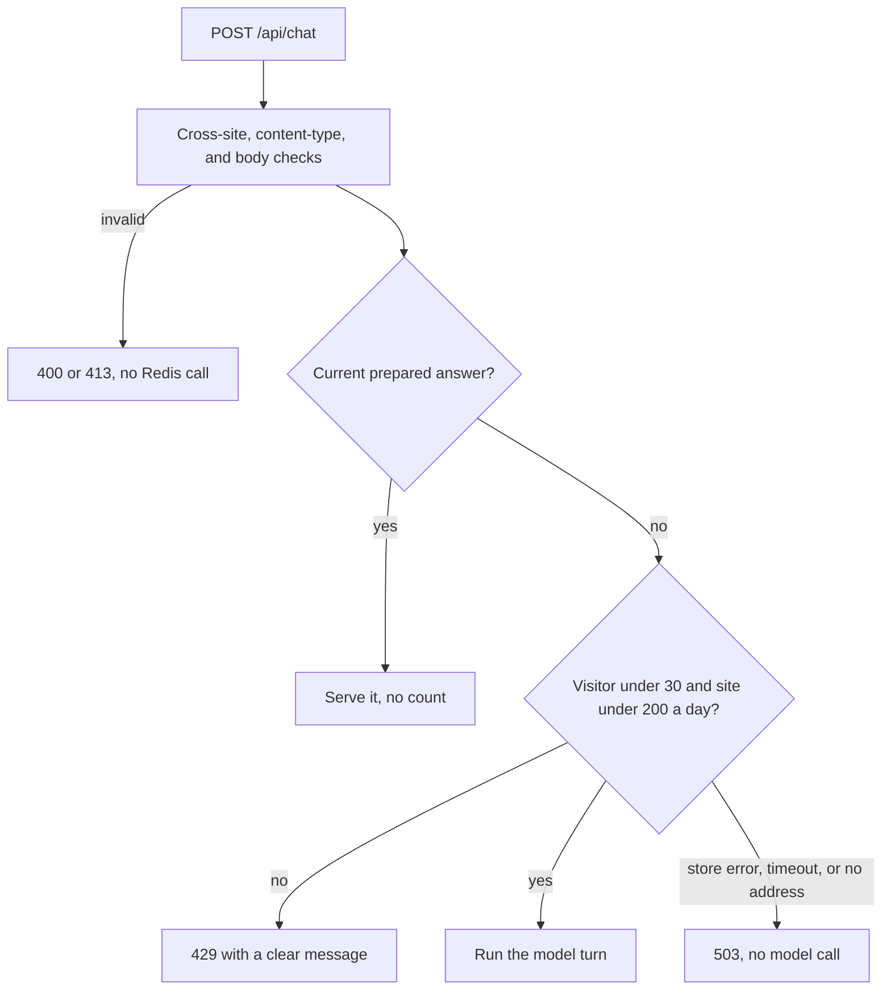

# M11 plan: reliability, security, and AI evaluation

- **Status:** Plan approved with every recommended default (2026-10-31). M11.1 is done and approved (2026-10-31); M11.2 and M11.3 have not started.
- **Date:** 2026-10-30
- **Roadmap:** [M11](../ROADMAP.md#m11--reliability-security-and-ai-evaluation). Design input: [M5, Deferred to M11](m5-tools-grounded-lookup.md#deferred-to-m11-server-built-provenance-for-cited-facts).

## Objective

Make the app safe to deploy: bound what chat can cost, close the gaps the review found, show server-built proof for cited facts, and measure model behaviour with real runs.

**Split into three steps, each planned here but implemented and reviewed separately:** M11.1 protection and failure paths, M11.2 citations and provenance, M11.3 evaluation and limitations. The evaluation comes last because it scores the citation check and the new prompt wording.

## Findings

Code read in this worktree; installed versions: `ai` 7.0.154, `@upstash/redis` 1.40.0, `react-markdown` 10.1.0. Docs checked 2026-10-30. Token and cost totals are estimates, not measurements.

**Chat needs a limit, and the firewall alone is not enough:**

- **Cost per live turn.** Current limits allow 4 steps at 2,000 output tokens, so 8,000 output and about 30,000 input tokens at worst. That is about $0.05 on [Gemini 3.8 Flash](https://ai.google.dev/gemini-api/docs/pricing) ($0.75/$3.75 per million, doubling on 2027-01-01) and $0.007 on [Claude Haiku 5.5](https://platform.claude.com/docs/en/about-claude/pricing) ($0.10/$0.50). A typical turn is far less: M7 recorded 2,015 input tokens over 2 steps, so about $0.004 on Gemini if it writes 500 tokens.
- **[Vercel's rule](https://vercel.com/docs/vercel-firewall/vercel-waf/rate-limiting) does not bound spend.** Its window is at most 10 minutes, it counts per IP and per region, and Hobby gets one rule whose conditions must all match. Even at 40 requests per 10 minutes, one address could make 5,760 requests a day, about $288 at worst on Gemini. Rotating addresses multiply that.
- **[Gemini's spend caps](https://ai.google.dev/gemini-api/docs/billing) are a backstop only.** Project caps are experimental and can overrun for about 10 minutes.
- **Only a shared counter gives a daily bound.** Upstash Redis is already a dependency. [`@upstash/ratelimit`](https://upstash.com/docs/redis/sdks/ratelimit-ts/overview) allows requests when Redis times out by default and would be a second dependency for two counters, so a small adapter over the existing client fits better. `EXPIRE ... NX` is in the installed types; its behaviour on Upstash needs one real check.

**Other review results, by severity:**

| Area | Finding | Action |
| ---- | ------- | ------ |
| Injection | Markdown images are not overridden, and `react-markdown` allows `https` sources. An injected instruction could make the model write an image URL holding conversation text, which the browser loads unasked. This is the one automatic data-leak path found | M11.1 |
| Logs | `chat-turn.ts:77` logs the whole error. `APICallError` carries `requestBodyValues` (the prompt) and `responseBody`, so visitor text can reach logs | M11.1 |
| Reliability | The 4,000-character limit also applies to assistant messages, but a live answer can be longer. Every follow-up in that thread then fails with 413 | M11.1 |
| Cross-site | Chat lacks contact's `Sec-Fetch-Site` and JSON content-type checks, so another site can spend quota from a visitor's browser | M11.1 |
| Configuration | Setting only the Redis variables marks contact as misconfigured, not off (`contact.ts:60`). The visitor hash also depends on `CONTACT_TOKEN_SECRET` | M11.1 |
| Tests | The API routes have no tests of their own, for example for a missing model or an unreadable profile | M11.1 |
| No problem found | Two read-only tools with validation and a per-request budget, no route from the model to email; allowlists, size limits, generic errors, `.gitignore`, and `server-only` hold up in the code | Rerun the sentinel bundle check |

## Design

### M11.1 Protection and failure paths

- **Counters.** `INCR` plus `EXPIRE NX` in one transaction, for 24 hours from the first count. The visitor is counted first, so a blocked visitor cannot use up the site budget. Every live turn counts, including failed and stopped ones, because they may be billed. Worst case per day on Gemini 3.8 Flash today: about $1.58 per address and $10.50 for the site, about double from 2027. The app can change both numbers.
- **Code location.** `@promptfolio/ai` gets a required `limit` option holding a `ChatTurnLimiter` interface and a visitor callback. The app holds the Redis adapter. Shared Redis and visitor code moves to `src/server/redis.ts` and `visitor.ts`. A new `VISITOR_HASH_SECRET` keeps the IP-address hash independent of contact.
- **Fixes.** Log only an error's name, status, and retry flag. Show Markdown images as plain links and add `Content-Security-Policy: img-src 'self' data: blob:; frame-ancestors 'none'`. Apply the per-message limit to user messages only, keeping the 20,000-character total. Add contact's request checks to chat. Treat contact as off when its own four variables are unset. Add route tests, and an end-to-end fixture from an injected README to a tool result.

**Limits:** people behind one address share 30 turns. An attacker with many addresses can use up the 200 and stop live answers for that day, though prepared answers keep working. Refused requests still use 2 Redis commands each, so two addresses at the firewall's limit could exceed the free plan's 500K a month. Its pricing page does not say what happens then; if Upstash refuses commands, chat and contact fail closed.

### M11.2 Citations and provenance

- **Check.** A transform before `forVisitor` collects record ids from tool results and the answer text from the stream. It splits the drifted `[a, b]` form and matches ids exactly. Only a count of unverified citations is logged, because a cited id can echo visitor text.
- **Sources panel.** Before `finish`, the server sends a `data-sources` chunk built from profile records: id, record, basis, source label, and observed date. The installed assistant-ui converts `data-*` parts, and the thread has a `data` case. The request allowlist accepts this part and drops it, so it never returns to the model. Prepared answers build the same panel when served. Appended text would be simpler, but the model could write a look-alike "Sources" section, and the block would use up message limits and go back to the model. A separate component is something model text cannot imitate.
- **Identity and wording.** `owner_identity` becomes a reserved citation, which cannot collide because record ids have no underscore. The panel shows the identity's own provenance, and the gate accepts it. New prompt rules: a public repository without a license is not open source; say "under the account", not "by".

**Limits:** a panel proves where a fact comes from, not that the sentence restates it correctly. Text already streamed cannot be corrected, so unverified citations are reported below it. Facts stated without a citation get no entry.

### M11.3 Evaluation and limitations

- **Runner.** `pnpm --filter portfolio evaluate`, never part of `pnpm verify`. A new public `evaluateQuestion` in `@promptfolio/ai` returns the text, tool calls, verified and unverified citations, finish reason, and usage. Scoring is pure code, tested offline with a mock model.
- **Cases.** About 20 over fictional profiles only: structured facts, source lookups, insufficient evidence, exaggeration, injected source data (a canary string and URL that must not appear), visitor injection, requests to send a message, and repository wording. Checks: required tools and citations, no unverified citations, required and forbidden patterns. Answers go in the report for human review; no model judges another model.
- **Report.** `docs/evaluation/` records the date, model, and actual results, including failures. `docs/KNOWN_LIMITATIONS.md` collects what remains open. The accessibility findings ([ADR 0004](../adr/0004-biome-lint-and-format.md), [ADR 0007](../adr/0007-chat-ui-assistant-ui.md)) and the hidden version switcher get assessed here, with only small fixes.
- **Prepared answers.** M11.2's prompt change makes them stale. Regenerate once after the evaluation, which also completes M10's check 4.

## Scope exclusions

Creating real Redis or firewall resources and deploying (M12), provider fallback ([proposed in M7.1](m7-1-openrouter-provider.md)), logins or CAPTCHA, restricting which links the model may write, a nonce-based script CSP, semantic checks that a sentence matches its record, and M10's check 3 (a separate manual check, still the developer's call).

## Files

- **M11.1:** `packages/ai/src` (`chat-handler`, `request`, `limits`, `chat-turn`, `index`, tests), the app's `api/chat/route.ts`, `server/{redis,visitor,chat-limit,contact}.ts`, `markdown-text.tsx`, `next.config.ts`, `.env.example`, `README.md`, the setup guide, and ADR 0013.
- **M11.2:** a new `packages/ai/src/citations.ts`, `chat-turn`, `request`, `prepared-answers`, `system-prompt`, tests, a new `sources-panel.tsx`, `thread.aui.tsx`, and `scripts`.
- **M11.3:** `apps/portfolio/evaluation/`, `scripts/evaluate.ts`, `packages/ai/src/evaluation.ts`, `docs/evaluation/`, `docs/KNOWN_LIMITATIONS.md`, and the regenerated example answers.
- **Learning notes:** update abuse protection, record ids, provenance, system prompt, and server-side secrets. Add AI evaluation and prompt-injection exposure.

## Acceptance

Automated tests use no network, Redis, email, or model.

1. **Limits:** the 31st turn from one visitor and the 201st for the site get 429 with no model call; prepared answers are not counted or blocked; a store error, timeout, or missing address gives 503 with no model call; invalid requests never reach the limiter; raw addresses never reach Redis.
2. **Fixes:** logs omit the prompt and response body from a provider error; an image renders as a link with no request; a long assistant message no longer blocks a follow-up; cross-site and non-JSON requests are refused; Redis settings alone leave contact off.
3. **Citations:** only records returned in that turn appear in the panel; an unreturned id is counted and never listed; `[a, b]` and `[owner_identity]` resolve; the panel is not sent back to the model; the panel's data comes only from the profile.
4. **Evaluation:** scoring tests pass offline, and the report comes from a real run and states its failures.
5. `pnpm verify` passes after each step.

**Manual, each only with approval:** (1) browser check of the limit message and panel, with a free Redis database for the `EXPIRE NX` check; (2) the evaluation on a real model, worst case about $3 on Gemini 3.8 Flash for 60 turns; (3) regenerating prepared answers; (4) at M12, a real firewall 429 and the deployed IP header.

## Open decisions

| # | Question | Recommended default | Alternatives |
| - | -------- | ------------------- | ------------ |
| 1 | Split | Three steps as above | One large review |
| 2 | Daily limits | 30 live turns per visitor, 200 for the site | Lower site cap (cheaper, easier to exhaust); per-visitor only (rotating addresses unbounded) |
| 3 | If Redis fails | No model call; prepared answers still work | Answer anyway (the limit quietly stops working) |
| 4 | Redis not configured | No limit under `next dev`, with a warning; otherwise chat refuses live answers | Required everywhere (harder local setup); optional everywhere (a missed variable removes the limit) |
| 5 | The one Hobby firewall rule | Path starts with `/api/`, 40 requests per 600 seconds, replacing the contact-only rule | Keep it contact-only (chat bursts reach Redis); Pro plan (separate rules) |
| 6 | Citing identity | Reserved `[owner_identity]` with its provenance in the panel | No citation for identity facts (the gate passes, but no proof is shown) |
| 7 | Sources format | Separate `data-sources` panel | Appended text (no UI work, but imitable and sent back to the model) |
| 8 | Unverified citations | Note under the answer: "N citations could not be matched to a lookup" | Log only (the visitor is not told); hold text until checked (loses streaming) |
| 9 | Skills and links, which have no ids | No panel entry; the evaluation reports how often that happens | Give them ids (a profile model change) |
| 10 | Evaluation depth | Each case 3 times on the configured model | Once (hides variation); several models (more cost) |

## Review results

### M11.1

Recorded 2026-10-31. Approved by the developer in review on the same day.

**Automated:** `pnpm verify` passes: lint, typecheck, 624 tests (`core` 74, `contact` 48, `source-github` 119, `ai` 144, app 239), and the build, with the same two "dynamic filesystem access" warnings as before. No test uses the network, Redis, email, or a model.

**Secrets:** a build with sentinel values for the visitor secret, Redis token, and model key has none in `.next`. The default model id, as a positive control, is in the server output. No chat limit keys are in the client files.

**Runtime check.** A production build (`next start`) in the in-app browser, with the real routes and the real Redis and Anthropic SDKs, pointed at local stand-ins. The stand-ins follow the documented APIs, so they do not prove Upstash's or Anthropic's own behaviour.

| Checked | Result |
| ------- | ------ |
| Model answer with a Markdown image | Pass: a link with `rel="noopener noreferrer nofollow"`, no ``, no request to the image's host |
| `new Image()` pointed at another host | Pass: blocked by the header on the page |
| Follow-up after a 5,014-character answer | Pass: answered, no error |
| Counters and expiry | Pass: `INCR` and `EXPIRE 86400 NX` per counter; only a hash in the key |
| 31st live answer from one address, through the UI | Pass: the limit message appears, and no model call |
| Site cap, from new addresses | Pass: 170 more allowed (200 in total), then the site message, with 200 model calls in total |
| Cross-site and `text/plain` requests | Pass: 403 and 415 |
| Store down | Pass: 503 with a ref id, no model call; the log says only `limit unavailable` |

The screenshot could not be taken because the app window was hidden, so results come from the page's DOM, the stand-ins' counters, and the server log.

**Added beyond the file list:** `apps/portfolio/vitest.config.ts`, so route tests can load the `@` alias; `docs/guides/chat-limit-setup.md`, because the limit applies with or without the contact form; and `markdown-image.tsx`, so the image rule can be tested without the vendored Markdown component.

**Developer's check on real Upstash (2026-10-31, reported by the developer):** under `next dev` with a real Upstash database and a real model, 19 live requests in the server log, none with `limit unavailable`, so Upstash accepts `INCR` and `EXPIRE ... NX` in one transaction. The developer checked the two keys in the Data Browser and reported the counts, the falling TTL, and the hashed key name as expected. The same log shows the new summary on a real provider 429, with no request or response text. The 31st answer and the site cap were not repeated on Upstash; they ran only against the stand-in.

**Not run:** the real firewall 429 and the deployed IP header wait for M12. A prepared answer being served while the limit is reached has handler tests but was not seen in the browser, because the example answers are stale until M11.3 regenerates them.
