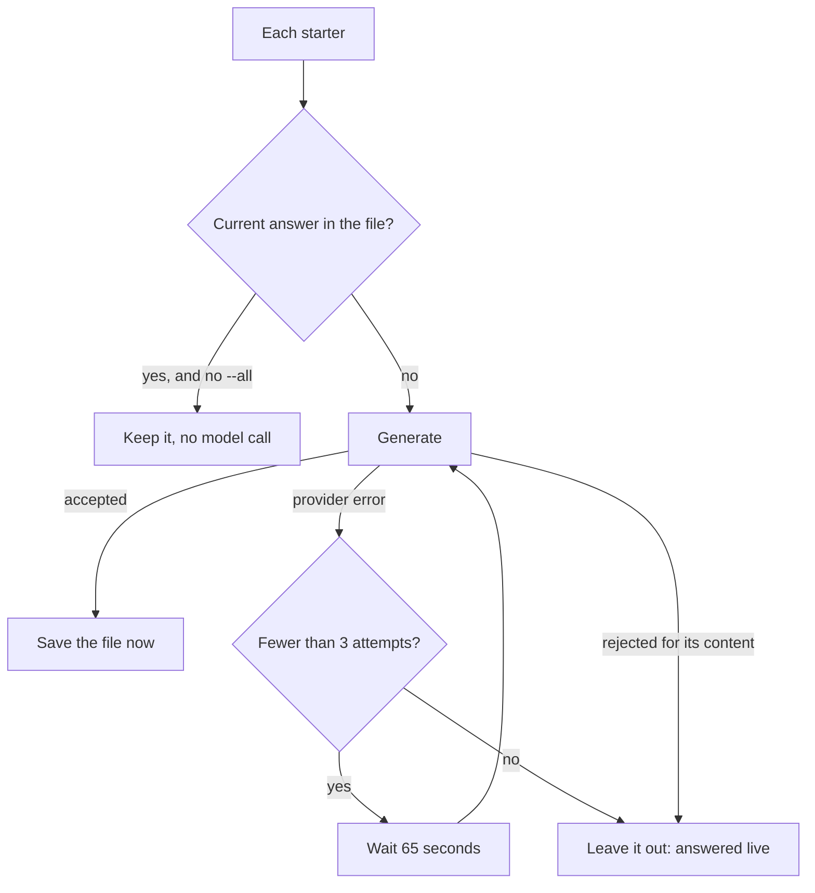

# M12.4 plan: small fixes from the evaluation runs

- **Status:** Done (2026-11-01), including a fifth fix the developer approved after seeing a live answer cut off. In review.
- **Date:** 2026-10-31
- **Background:** [M12 review results](m12-second-consumer-and-deployment.md#review-results) and [the Ling run](../evaluation/README.md#the-run-on-ling-failed-the-gate). M12.3 stays reserved for deployment.

## Objective

Fix four small problems the real runs exposed. None needs an account, a model call, or a prompt change, so prepared answers stay current and the Ling reports stay valid as written.

## Findings

Code read at `f2482d1`. Installed: `ai` 7.0.154, `@ai-sdk/gateway` 4.0.127.

| # | Problem | Evidence | Cause |
| - | ------- | -------- | ----- |
| 1 | `prepare-answers` gives up too easily | One pass wrote 2 of 5, then a rerun would have replaced the good ones | One attempt per starter, and it always regenerates every answer |
| 2 | `[a; b]` is not read as two citations | `[route-planner; github.com/...]` counted as one unverified id | `citedIds` splits at commas only |
| 3 | Checks fail good answers | "isn't listed" and "No evidence" counted as not declining, 3 of Ling's 8 failures | `ABSTAINS` in `evaluation/cases.ts` misses these wordings |
| 4 | The log hides a gateway error's cause | A 403 and a 400 both logged as `GatewayInternalServerError` | `modelErrorSummary` adds a status only for `APICallError`, and `GatewayError` is a separate class |

## Design

**1. Prepared answers: retry, and keep what is good.**

- The logic moves from the script to `src/server/prepare-answers.ts`, with the generator and wait injected, like `refresh.ts`, so it can be tested. The script keeps its exit codes.
- `@promptfolio/ai` gets one new export, `isPreparedAnswerCurrent`, wrapping the check the server already uses, so "current" has one definition.
- Stale answers are dropped, as they could never be served. `--all` regenerates everything, for a change of model.
- No interval between starters: the retry handles rate limits, and a fast provider loses no time.

**2. Citations.** `citedIds` splits at commas and semicolons. `citation-links.ts` splits the same way, so a marker and the server agree. An existing test compares the two.

**3. Checks.** Add `isn't` and `aren't` forms, and `no evidence`, to `ABSTAINS`. The reports stay as written, and the README lists this under "What the checks got wrong".

**4. Error log.** `modelErrorSummary` adds `statusCode` for any error carrying a numeric one, read by its shape because `ai` does not export `GatewayError`. It still logs no message or body, which can repeat a visitor's text.

## Scope exclusions

Prompt changes, including narration or model-written "Sources"; full-width `【id】` citations; source ids such as `[owner-profile]`; other models; the empty answer from the output limit; rerunning the evaluation; and deployment.

## Files

- `packages/ai/src`: `prepared-answers.ts`, `index.ts`, `citations.ts`, `chat-turn.ts`, and their tests.
- `apps/portfolio`: new `src/server/prepare-answers.ts` and test, `scripts/prepare-answers.ts`, `src/chat/citation-links.ts` and test, `evaluation/cases.ts` and its test.
- Docs: `docs/evaluation/README.md`, `docs/KNOWN_LIMITATIONS.md`, and the learning notes on prepared answers and record ids.

## Acceptance

Automated tests use no network or model. `pnpm verify` passes.

1. A provider error is retried up to 3 times with the wait; a content rejection is not retried; a current answer makes no model call; a stale one is regenerated; `--all` regenerates all; a failure on one starter leaves earlier answers saved; and nothing accepted and nothing current writes no file.
2. `[a; b]` gives two ids in `citedIds` and two markers in the app.
3. The wordings from the Ling report count as declining, and a confident claim such as "Riley knows Kubernetes" still does not.
4. With a stubbed `fetch` returning the gateway's 403 body, the log has the status and no message text.

**Not run:** real model calls. If you want to see it for real, your local `prepare-answers` run on your own profile will show the retries.

## Open decisions

| # | Question | Recommended default | Alternatives |
| - | -------- | ------------------- | ------------ |
| 1 | What a rerun does | Keep current answers, and fill the gaps | Regenerate all by default (repeats model calls, and can lose good answers) |
| 2 | Retries | 3 attempts, 65 seconds apart, as in the evaluation | Fewer (more gaps); configurable (a setting nobody needs yet) |
| 3 | Interval between starters | None | A short gap (slower, and you removed the evaluation's) |

## Review results

### Fixes 2 to 5

Recorded 2026-11-01. In review.

**Automated:** `pnpm verify` passes: lint, typecheck, 744 tests (`core` 74, `contact` 48, `source-github` 123, `ai` 199, minimal consumer 6, app 294), and the build. No test uses a real model. The new gateway test sends a stubbed 403 through the real gateway adapter.

- **Fix 2, citations:** semicolons split ids, as planned. **Added:** bracketed text with a space is no longer a citation, after a real answer's `[source: public GitHub data ...]` got it rejected. So a citation written with spaces is no longer counted as unverified. An existing test used such a citation as its input; it now uses an id-shaped one, and still checks that the text is never repeated.
- **Fix 3, checks:** "isn't listed" and "No evidence" count as declining. A confident claim still fails. The Ling reports stay as written.
- **Fix 4, log:** any error's numeric status is logged, with no message.
- **Fix 5, added: the whole-reply limit is 55 seconds, and the route's `maxDuration` is 60.** The developer's screenshot showed a live answer cut off mid-sentence while it was still writing. The first-chunk and between-chunk limits stay at 15 and 10 seconds, so a stopped model still fails quickly. The prompt did not change, so prepared answers stay current.

**Not run:** the longer limit against a real model. Evaluation numbers from before it, including Ling's 21 timeouts, are not comparable. An answer this long may now hit the 2,000-token limit, and the 4,000-character cap still applies to prepared answers.

### Fix 1: prepared answers

Recorded 2026-10-31. In review.

**Automated:** `pnpm verify` passes: lint, typecheck, 738 tests (`core` 74, `contact` 48, `source-github` 123, `ai` 197, minimal consumer 6, app 290), and the build, with the same two warnings as before.

**Real runs, on the fictional example, contact form off:**

| Run | Result | Time |
| --- | ------ | ---- |
| Plain, all answers current | Kept 5, no model call, file unchanged | Under 1 second |
| `--all` through Ling | 5 of 5, after one retry each on 2 starters | 4 minutes |

The `--all` answers were only a test of the command, so they were discarded and the answers reviewed in M12.2 stay committed. A real run on the developer's own profile has not happened.
