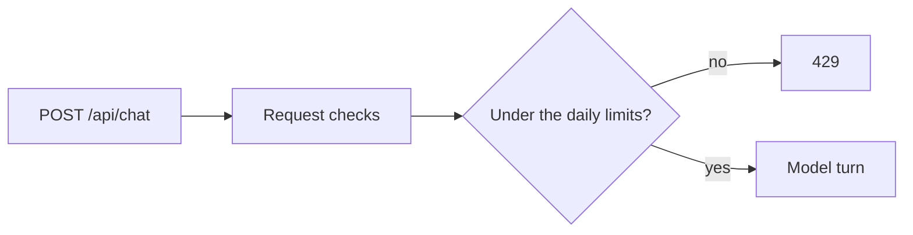

# M12.5 plan: remove prepared answers

- **Status:** Proposed, waiting for approval. Nothing is implemented.
- **Date:** 2026-11-01
- **Background:** the developer's decision (2026-11-01), after the upkeep in [M12.4](m12-4-reliability-fixes.md). Reverses [ADR 0008](../adr/0008-prepared-answers-as-files.md) and the serving part of M7.

## Objective

Every question is answered live. Starters stay, and send their prompt as an ordinary first message. [The spec](../../PROMPTFOLIO_SPEC.md) allows this: a starter "may" show a prepared answer, and the cache rules apply only "if" answers are cached.

## Findings

Code read at `ffb411d`.

- **To remove:** about 500 lines of code and 900 of tests: most of `packages/ai/src/prepared-answers.ts`, the handler's branch, the app's `prepared-answers.ts` and `prepare-answers.ts`, the script, and `example.profile.answers.json`.
- **Used by other features, so these stay and move:**
  - `readVisitorText` is used by the evaluation.
  - `profileFingerprint` is the profile version the refresh compares, so a refresh still writes only on a real change.
  - The Sources panel, citations, and `contactFormAvailable` are unaffected.
- **No longer needed:** the `trigger` field in `parseChatRequest`, which only decided whether a prepared answer could be used, and `instructionsFingerprint`.

## What this changes for visitors

| | Before | After |
| - | ------ | ----- |
| Starter click | Instant, works during a provider outage | Live, and can time out or fail like any question. On Ling, the evaluation's failure rate was about 1 in 3 attempts |
| Daily limits | Not counted | Each click counts against 30 per visitor and 200 for the site |
| Owner upkeep | Regenerate and review after changes | None |

The limits themselves do not change. The refresh stops reporting on prepared answers.

## Design

- `profileFingerprint` moves to `@promptfolio/core`, beside `canonicalProfileContent`, which it hashes. The refresh then no longer needs `@promptfolio/ai`.
- `readVisitorText` moves to `evaluation.ts`.
- `prepared-answers.ts` and its test are deleted. Tests in them that still matter, such as a raw tool call being stopped, are already covered in `chat-handler.test.ts` and `evaluation.test.ts`, and the citation checks in `citations.test.ts`. Any gap found while deleting gets a test.

## Scope exclusions

Changing the starters or the limits, caching of any other kind, reversing the M12.4 fixes, and editing old plans or evaluation reports, which stay as a record of what happened.

## Files

- **Packages:** `packages/ai/src` (`prepared-answers.ts` and test removed; `chat-handler`, `chat-turn`, `evaluation`, `request`, `limits`, `index`, tests, `README.md`), `packages/core/src` (fingerprint, `index`, tests, `README.md`).
- **App:** `route.ts`, `refresh.ts`, `package.json` (the script), and removing `scripts/prepare-answers.ts`, `server/prepared-answers.ts`, `server/prepare-answers.ts`, their tests, and the example's answers.
- **Docs:** ADR 0008 (superseded), `docs/ARCHITECTURE.md`, `docs/KNOWN_LIMITATIONS.md`, `docs/ROADMAP.md`, the guides, and the [learning note](../learning/prepared-answers-and-invalidation.md), marked removed, with other notes that mention it.

## Acceptance

Automated tests use no network or model. `pnpm verify` passes.

1. A starter's question reaches the model and counts against the limit, with no special path.
2. The refresh still writes only when the profile version changes.
3. The evaluation and the minimal consumer still pass, and no public export or app code mentions prepared answers.
4. In a browser with a fake model key, a starter click gets the generic error, which shows it went live. With a real model, it is the developer's check.

## Open decisions

| # | Question | Recommended default | Alternatives |
| - | -------- | ------------------- | ------------ |
| 1 | `*.local.answers.json` in `.gitignore` | Keep the line, because your `check.local.answers.json` holds real answers and could otherwise be committed by accident. You can delete that file yourself | Remove the line |
| 2 | Where `profileFingerprint` lives | Move it to `core` | Leave it in `ai` (smaller change, but the refresh keeps a dependency it has no other use for) |
| 3 | The learning note | Keep it, marked removed, with why | Delete it (loses the explanation of what was tried) |
