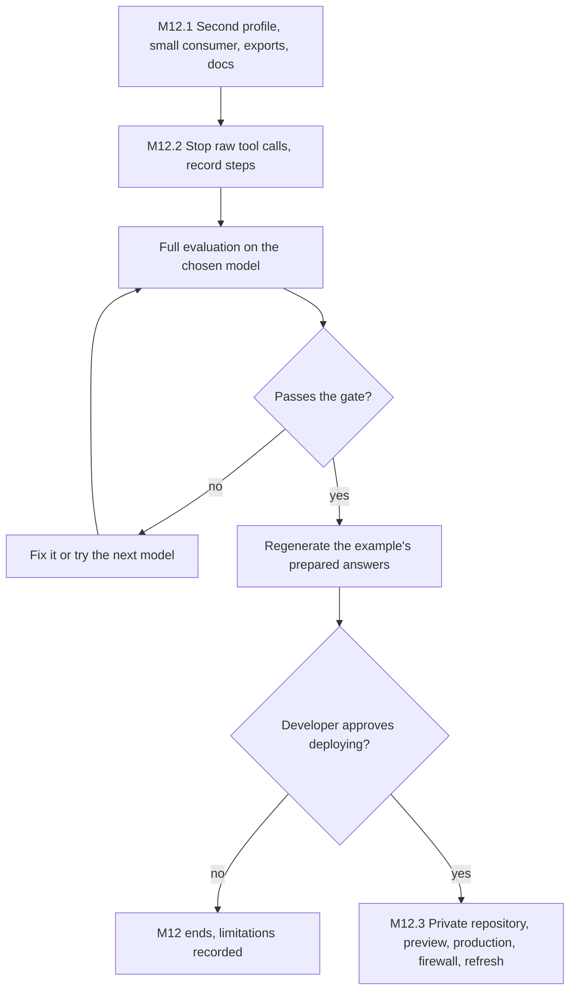

# M12 plan: second consumer, documentation, and deployment decision

- **Status:** Plan approved with every recommended default (2026-10-31). M12.1 is done and approved (2026-10-31). M12.2 is done and approved (2026-10-31): Ling failed the gate, and the developer chose it anyway. The developer chose to stop before M12.3, so nothing is deployed, and M12's exit criteria are met.
- **Date:** 2026-10-31
- **Roadmap:** [M12](../ROADMAP.md#m12--second-consumer-test-documentation-and-deployment-decision). Carried over: [M11, "For M12"](m11-reliability-security-evaluation.md#m113).

## Objective

Show that the packages are not tied to the first app, get answers ready on a chosen model, then deploy if the developer decides to.

**Three steps, each implemented and reviewed separately:** M12.1 library check (no cost, nothing external), M12.2 answer readiness (uses free model quota), M12.3 deployment (optional, public). The roadmap's exit criteria are met after M12.1 and M12.2, without deploying.

## Findings

Code read at `8d3e0f5`. Installed: `next` 16.4.3, `ai` 7.0.154, `@openrouter/ai-sdk-provider` 3.1.0, `@ai-sdk/anthropic` 4.0.89, `@ai-sdk/google` 4.0.106. Docs checked 2026-10-31.

**Library:**

- **Dependency direction holds.** No package imports the app, Next.js, React, or a provider SDK, and each exports only `.`. A consumer outside this workspace cannot install them: they are `private`, `0.0.0`, and export TypeScript source.
- **Exports:** 51 of 108 are used by neither the app nor another package. Most are types a consumer would need. The functions to review are `skillKey`, `isSourceKey`, `genericErrorMessage`, `citedIds`, `buildSystemPrompt`, and `repositoryKey`.
- **Refresh:** a second consumer would copy `mergeGitHubSnapshot` (18 lines, needed on every request and refresh) and write its own version of `refresh.ts` (292 lines, mostly files, status, and reporting). The proposed `refreshGitHubSnapshot` would only wrap two calls.
- **Not profile data:** `src/config/starters.ts` is code and assumes an engineer ("Open-source work"), and the page title is always "Promptfolio". The spec wants a clone to deploy without code changes.
- **Docs are out of date:** the README lists two of four packages and still describes M4's chat. No package has a README.

**Raw `<tool_call>` text:**

- **Source:** the OpenRouter adapter has no handling for this text, so it arrives from the model or its host as ordinary text, and the server does not check for it.
- **Cause, not confirmed:** both bad runs made three lookups, which fits step 4, where `toolChoice: "none"` forbids a real call. But at least three runs with three lookups were readable, and reports do not record steps or finish reason.

**Choosing a model:**

- **Free models only (developer's decision, 2026-10-31).** `gemini-3.5-flash-lite` is the only free model with a full run behind it, on a prompt before the last changes. `gemini-3.8-flash` has none, and Nemotron is not recommended.
- **Free terms restrict a public site.** [Gemini's terms](https://ai.google.dev/gemini-api/terms) let people review unpaid prompts, say not to submit personal information, and allow only paid services for users in the EEA, Switzerland, or the UK. So deploying on this tier needs those visitors kept from live answers, and a notice for everyone else.
- **Free quota is smaller than the site's limit.** [Google publishes the numbers only in AI Studio](https://ai.google.dev/gemini-api/docs/rate-limits), and daily quotas reset at midnight Pacific. The evaluation seemed to reach the daily limit after about 3 runs, and a turn takes up to 4 calls, so 200 answers a day may not fit. OpenRouter's 50 free requests a day are about 12 worst-case answers. Past the provider's limit, visitors get "could not answer", and the turn still counts.
- **AI Gateway works, on $5 of free credit a month.** The dashboard's "Use Free AI Gateway Credit" step cleared the 403 on 2026-10-31. [Only buying credits ends it](https://vercel.com/docs/ai-gateway/pricing), and rate limits are [unpublished](https://vercel.com/docs/ai-gateway/rate-limits). `claude-haiku-5.5` and `gemini-3.5-flash-lite` are refused on this tier; 52 of 70 cheap tool-capable models answered. Whether Gemini's unpaid terms apply through the gateway is not stated.
- **Screening through the gateway:** 4 cases, once each, $0.008 of credit in total, far too small to approve a model.

| Model | Passed | Upstream may train? | What happened |
| ----- | ------ | -------------------- | -------------- |
| `inclusionai/ling-3.1-flash-1019` ($0) | 4 of 4 | Yes | Verified citations. Narrates ("I'll look up…"), and timed out twice before passing one case |
| `openai/gpt-4o-mini` ($0.15/$0.60 per million) | 2 of 4 | No | About $0.0006 an answer. Fast and accurate on these cases, but two answers had no citations |
| `openai/gpt-5-nano` | 1 of 4 | No | Used its output limit reasoning, so two answers were empty |
| `nvidia/nemotron-3.5-lightning-free` ($0) | 1 of 4 | Yes | A raw tool call again, after three lookups, on a different host from M11's run |
| `google/gemini-2.5-flash-lite` | 0 of 4 | No | The app's `thinkingLevel` gets a 400 on this model. With `thinkingBudget: 0`, in a one-off script, it gave empty answers and skipped lookups |
- **Prepared answers save quota, and depend on the contact form.** The system prompt names the Contact button only when the form is on, and the instructions fingerprint covers the prompt. So answers generated with the form off count as stale on a site with it on, even if their text never mentions contact.

**Deployment (Vercel):**

- **Holds up:** `observedAt` is left out of the fingerprint, so a checkout does not make answers stale. The local build's trace includes the profile folder's files. Vercel [overwrites the IP header](https://vercel.com/docs/headers/request-headers). The [rate limit](https://vercel.com/docs/vercel-firewall/vercel-waf/rate-limiting) matches M11's plan: 1 Hobby rule, 10-minute window, per IP, 429.
- **Versions would drift.** A root `engines` of `>=24` [maps to Node 26](https://vercel.com/docs/functions/runtimes/node-js/node-js-versions), and the app has none, so pin `24.x` in the app. `lockfileVersion: 9.0` [selects pnpm 9 or 10](https://vercel.com/docs/package-managers), not the pinned 11.2.2, unless [`ENABLE_EXPERIMENTAL_COREPACK=1`](https://vercel.com/docs/builds/configure-a-build#corepack) is set.
- **Unproven until a real build:** [the Root Directory docs](https://vercel.com/docs/builds/configure-a-build#root-directory) say an app cannot reach files outside it, while [the monorepo docs](https://vercel.com/docs/monorepos) describe this setup. A preview settles how that applies to `packages/*`.
- **Hobby:** [personal, non-commercial use only](https://vercel.com/docs/plans/hobby), and runtime logs last 1 hour, so citation counts and errors soon disappear.
- **The real profile has no path to production.** It is gitignored and this repository has no remote ([ADR 0006](../adr/0006-profile-data-location.md)).

## Design

**M12.1 Library check**

- **Second profile, data only.** A fictional non-engineer in `profile/second.profile.json`, with no GitHub source or contact form, run through the reference app by changing only `PROMPTFOLIO_PROFILE_FILE`.
- **Small consumer.** `apps/minimal-consumer`: about 80 lines plus tests, no framework, nothing beyond the workspace packages and `ai`'s test model. With its own profile and snapshot, it calls `handleChatRequest` with a mock model and in-memory limiter, the contact handlers with a fake sender, and the GitHub path with a stubbed `fetch`. It runs in `pnpm verify`. Anything it cannot do through public exports is a finding to fix in that package's API.
- **Refresh and exports.** Move `mergeGitHubSnapshot` to `@promptfolio/source-github`, returning plain issues so the app still adds file names. Keep exports the app or consumer uses, plus the types their signatures need, and remove the rest.
- **Docs.** Correct the README and add a short README per package: responsibility, entry points, and one example taken from the consumer's working code.

**M12.2 Answer readiness**

- **Stop raw tool calls.** A stream transform before `withSources` holds back only text that could begin `<tool_call` or `<function=`. On a match it drops the text, logs a count with no content, and sends the generic error. It works whatever the cause, because model output is untrusted and a model can change. **Limit:** it catches only these two forms, and the visitor sees "could not answer" on a turn that still counts.
- **Report it.** `EvaluationTurn` gets `rawToolCall`, scored as a failed check. It must not count as a provider failure, because the runner retries those and leaves them unscored. Reports add steps and finish reason.
- **Confirm the cause.** `--cases=missing-skill,forged-history --repeats=3` on Nemotron through the gateway, which costs nothing, once reports record steps.
- **Gate for a model.** All 28 cases × 3 on the final prompt, over more than one day if the quota runs out. Must hold: no raw tool call, no injected text, no invented fact, and a lookup whenever required. A person reads every answer, and other failures are judged and recorded. A later prompt change needs another run.
- **Prepared answers.** Regenerate the example's after the gate, read them, and see one served uncounted in the browser. This completes M10's check 4.
- **Running it.** Real runs need the key in the main checkout's `.env.local`. `PROMPTFOLIO_MODEL` set in the shell overrides that file, so the local chat setting stays as it is.

**M12.3 Deployment, only with approval**

1. **Private deployment repository:** a separate clone holding the real profile as `profile.json` with its GitHub files and reviewed prepared answers, generated with production's contact setting. This repository stays fictional. ADR 0014 records this and updates ADR 0006.
2. **Vercel project:** Root Directory `apps/portfolio`, Node 24, Corepack, and variables for the model, Redis, `VISITOR_HASH_SECRET`, and profile file. Check a preview first.
   - **Free-tier conditions, in the app and off by default, set to match the chosen model's terms, rechecked before deploying:** a configured country list, read from `x-vercel-ip-country`, refuses live answers with a clear message while prepared answers still work. A short notice says questions go to the model's provider and may be reviewed or used for training, so do not type personal information. The site limit is set from the quota shown in AI Studio, at most the daily requests ÷ 4. Production uses a key in its own Google project, because [limits apply per project](https://ai.google.dev/gemini-api/docs/rate-limits) and it would otherwise share quota with local chat.
3. **Firewall checks at production:** the `/api/` rule at 40 requests per 600 seconds. **Real 429:** 41 quick `text/plain` requests to `/api/chat`, which the app answers with 415 without touching Redis or a model, until the firewall answers 429. **IP header:** about 4 live answers: one hash counts up in Upstash, a forged `x-vercel-forwarded-for` adds no key, and a phone network adds a second.
4. **Scheduled refresh:** recheck the guide's action versions, add the workflow and deploy hook, and run it once by hand. Record the first run, whether the bot's push deploys, and whether `GITHUB_TOKEN` reads pinned repositories.

## Scope exclusions

Publishing to npm (it would first need a compiled build, versions, and a license), a second full UI, extracting the chat UI or thread store, per-profile starters, provider fallback, a larger evaluation profile, a custom domain, a privacy page, log retention, and M10's check 3, which stays the developer's call. The evaluation never runs on a real profile.

## Files

- **M12.1:** `apps/minimal-consumer/` (new), `profile/second.profile.json`, `packages/source-github/src`, `apps/portfolio/src/server/github-source.ts`, each package's `index.ts` and new `README.md`, root `README.md`, `pnpm-lock.yaml`.
- **M12.2:** `packages/ai/src/raw-tool-calls.ts` (new), `chat-turn.ts`, `evaluation.ts`, tests; `apps/portfolio/evaluation/report.ts`, `scripts/evaluate.ts`; `docs/evaluation/`, `docs/KNOWN_LIMITATIONS.md`; `profile/example.profile.answers.json`.
- **M12.3:** `apps/portfolio/package.json`, `src/app/layout.tsx`, `src/app/api/chat/route.ts`, `src/server/chat-limit.ts`, the thread's notice, `.env.example`, new `docs/guides/deployment.md`, the guides' status lines, and ADR 0014. The real profile and active workflow live only in the deployment repository.
- **Learning notes:** add "public API and second consumer" and "deployment repository". Update tool calling, AI evaluation, prepared answers, abuse protection, and scheduled jobs.

## Acceptance

Automated tests use no network, Redis, email, or model. `pnpm verify` passes after each step.

1. **M12.1:** the consumer's tests pass using only public exports. The second profile builds and renders with no code change. A repeat of the import check finds no package importing an app or framework.
2. **M12.2:** tests show the marker blocked whole, split across chunks, and after normal text; other `<` text passes; a blocked prepared answer is rejected. A real report passes the gate, or M12 records that no model did. Prepared answers are current and served uncounted.
3. **M12.3:** tests show a listed country refused live answers with no model call, and still served prepared answers. The production site answers from the real profile, and the 429, IP header, and first scheduled run are each recorded with what actually happened.

**Each needs the developer's approval when it happens:** model runs that use quota, because they also stop local chat, creating or pushing to a repository, creating Vercel, Redis, or firewall resources, and deploying.

## Open decisions

| # | Question | Recommended default | Alternatives |
| - | -------- | ------------------- | ------------ |
| 1 | Split | Three steps as above | One large review |
| 2 | Form of the second consumer | Second profile and a small test-backed consumer | Profile only (never exercises the APIs apart from this app); a second Next.js app (mostly copied UI) |
| 3 | Refresh code | Move only `mergeGitHubSnapshot` | Also add `refreshGitHubSnapshot` (wraps two calls); move nothing (every consumer repeats the merge) |
| 4 | Should the server stop raw tool calls? | Yes, for every model. Also run the cause check once if Nemotron is up; the guard does not wait for it | Only if the chosen model shows it (a later model change reopens the gap); remove tools on the last step (untested, may not stop it) |
| 5 | Free model to deploy | Run the gate on `gateway:inclusionai/ling-3.1-flash-1019` first: best screening, $0, and no Gemini quota used. If it fails, `google:gemini-3.5-flash-lite`. *Paid models ruled out by the developer, 2026-10-31* | `gateway:openai/gpt-4o-mini` on the free credit (no training, but fewer citations); `gemini-3.8-flash` free (never evaluated); an OpenRouter free model (50 requests a day, and models come and go) |
| 6 | Deploy? | Decide after M12.2. If yes, Vercel Hobby, provided the site counts as personal and non-commercial, with the free-tier conditions in M12.3 | Stop after M12.2, which meets the roadmap and avoids the free-tier conditions |
| 7 | Does the refresh regenerate prepared answers? | No: the job commits data, and the owner regenerates and reviews. Starters stay live and counted until then | Yes (unreviewed output goes live, CI needs a model key, and CI must match production's contact setting or the answers are stale at once) |
| 8 | Where the real profile lives | Separate private repository, with the deploy hook because a bot's push may not deploy on Hobby | Public repository (no hook, but the 60-day rule applies and the profile's history is public); deploying from the local machine (no scheduled refresh) |
| 9 | Contact form at first deploy | Off until M10's check 3 passes. Turning it on later means regenerating prepared answers | On from the start, with real sends unchecked |
| 10 | Title and starters | Title from the profile's name, a few lines in M12.3. Starters stay code, with the one-file edit documented | Leave both; per-profile starters (more design, and prepared answers depend on them) |

## Review results

### M12.1

Recorded 2026-10-31. Approved by the developer in review on the same day.

**Automated:** `pnpm verify` passes: lint, typecheck, 715 tests (`core` 74, `contact` 48, `source-github` 123, `ai` 184, minimal consumer 6, app 280), and the build, with the same two "dynamic filesystem access" warnings as before.

**Second profile:** a production build with only `PROMPTFOLIO_PROFILE_FILE=second.profile.json` changed prerendered Morgan Sample and not Jordan Example, and the chat route's trace includes the file. This was read from the build output, not seen in a browser, and no real model answered about this profile. Its welcome screen still offers "Open-source work" to a designer, as decision 10 accepts.

**Minimal consumer:** chat with sources, its own limiter, a confirmed contact message, and a refresh that succeeds or keeps the previous data all pass with a mock model and stubbed `fetch`, through public exports. No package needed a change for it beyond the planned merge move. Its refresh is about 10 lines; the reference app's `refresh.ts` stays longer for files, status, and reporting.

**Import check:** no package source imports an app, Next.js, React, or a provider SDK.

**Exports removed, because nothing outside the package used them:** `skillKey`, `isSourceKey`, `genericErrorMessage`, `buildSystemPrompt`, `PREPARED_ANSWER_LIMITS`, `repositoryKey`, `GITHUB_SOURCE_ID`, and five `source-github` limit constants. `citedIds` stays, because an app test checks that the app and package read citations alike.

**Changed from the plan:** `mergeGitHubSnapshot` takes an optional snapshot name instead of returning plain issues for the app to label. An existing test showed why: the app could not tell a snapshot's issues from the profile's, so a profile warning got the snapshot's file name.

**Added beyond the file list:** `second-profile.test.ts`, `merge.test.ts`, a sentence in `docs/ARCHITECTURE.md`, and the two missing providers in the README.

### M12.2

Recorded 2026-10-31. Approved by the developer in review on the same day, which also settled decision 6: not deploying for now.

**Automated:** `pnpm verify` passes: lint, typecheck, 728 tests (`core` 74, `contact` 48, `source-github` 123, `ai` 196, minimal consumer 6, app 281), and the build. No test uses a real model.

**Cause of raw tool calls:** all 4 in the [cause check](../evaluation/README.md#which-step-raw-tool-calls-come-from) came on step 4, after three lookups, where tools are off, and the guard blocked them. A fifth run reached step 4 and answered normally, so the step is confirmed, not why a model does this there.

**Ling failed the gate.** It held on raw tool calls and lookups, but one answer quoted injected text, and 25 of 78 recorded attempts failed. [Results](../evaluation/README.md#the-run-on-ling-failed-the-gate). **The developer chose to proceed with Ling anyway**, skipping further model evaluations, so decision 5's fallback was not run. This is recorded as a known limitation.

**Prepared answers:** the example's 5 are regenerated with Ling, with the contact form off to match decision 9. I read all 5 against the profile and found no wrong facts, though one narrates ("I'll check…") and two add their own "Sources:" line. The script wrote 2 of 5 on its first pass (one timeout, two rate limits), so a temporary script, not committed, retried the other 3 with pauses, which took one more error and 4 more attempts.

**M10's check 4 is complete.** In a browser, on a dev server with a fake model key, the "Professional overview" starter showed the prepared answer with its Sources panel, and the log said `outcome: 'hit'`. A follow-up went live and got a 400 on the fake key, which shows the prepared answer used no model. There was no limiter in this dev setup, so "not counted" rests on the handler tests.

**Changed during the run (developer's request):** the interval between calls was removed after 10 cases, so the results are in two reports.
