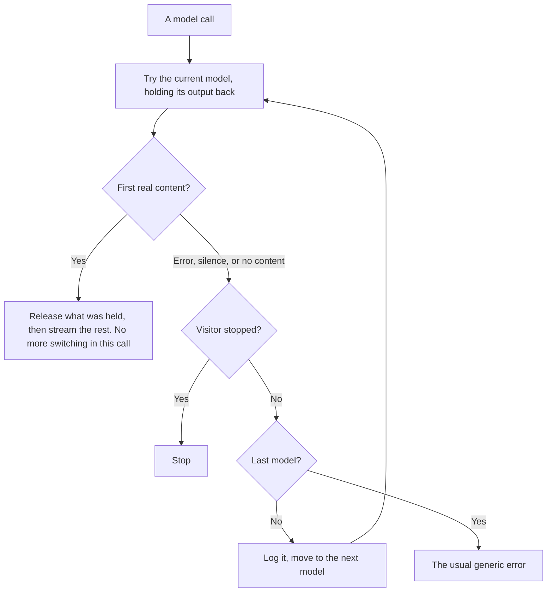

# M14 plan: provider failover

- **Status:** Done and approved (2026-11-02).
- **Date:** 2026-11-02
- **Roadmap:** [M14](../ROADMAP.md#m14--provider-failover). Why now: 11 of 95 attempts failed on the chosen model, in
  [its evaluation](../evaluation/README.md#the-run-on-gpt-4o-mini-failed-the-gate), and a visitor gets no retry.

## Objective

Configure several models in the environment, and move to the next when one fails before an answer has started.

## Scope

| Area | Change | Files |
| ---- | ------ | ----- |
| Package | `createFailoverModel`, built on the AI SDK's `wrapLanguageModel` | `packages/ai/src/chat/failover.ts`, `index.ts` |
| App | `PROMPTFOLIO_MODEL` takes a comma-separated list | `apps/portfolio/src/server/chat/model.ts`, chat route |
| Evaluation | Uses only the first model, so each report names one model | `apps/portfolio/scripts/evaluate.ts` |
| Docs | Setup, privacy, an ADR, and a learning note | `.env.example`, READMEs, `docs/` |

**Excluded:** switching mid-answer, remembering across requests which provider is down, and routing by health or cost.

## Design

- **Opt-in:** a single value works as it does today, with no wrapper. Sending a conversation to another provider is a decision.
- **Per-attempt timeout:** the SDK's `firstChunkMs` cancels the whole call, so each attempt but the last has its own shorter timer
  and its own abort signal, and the overall limit is raised to fit.
- **Sticking within a turn:** a turn makes several model calls, and once one moves on, later steps stay on the model that worked.
  So the model is created per request.
- **Retries:** a chain uses `maxRetries: 0`, or the SDK would rerun the whole chain.

## Acceptance criteria

- Tests cover: an error at the start, an error part before content, silence, thinking to the token limit with no text, failure after
  text has started (no switch), a visitor stop (no switch), every model failing, sticking across steps, and moving on mid-turn.
- A failed attempt is logged by type and status, with no conversation text.
- The tarball test covers the new export.
- A real check with two providers and a deliberately bad first key answers, including mixed tool history within a turn.

## Verification

`pnpm verify`; `pnpm test:tarballs`; the real check above, which makes a few model calls.

## Review results

- **The middleware works as designed,** and each attempt can time out without ending the call.
- **A bad key moved to a real answer,** from a bad gateway key to `gpt-4o-mini`.
- **Mixed tool history worked in both directions,** between `gpt-4o-mini` and Ling. Gemini is not covered: on 2026-11-02 it timed out
  at 55 seconds with no wrapper, and otherwise answered 503, and Gemma on OpenRouter answered 429.
- **Added during the work:** a model that takes over does not get earlier thinking, after the real check showed the AI SDK printing
  that text in a warning, where it could repeat a visitor's words.
- **Found by the developer's own test,** five questions at once: gateway rate limits used up the first two models, and
  `gemini-3.8-flash` never responded, so four failed at 55 seconds. The design had trusted the SDK's first-chunk limit for the last
  model, and that limit did not fire on a hang. So the last model now has its own timer. `gemini-3.8-flash` hung on every retest on
  2026-11-02, so the default became `gemini-3.5-flash-lite`, which answered in under 3 seconds.
