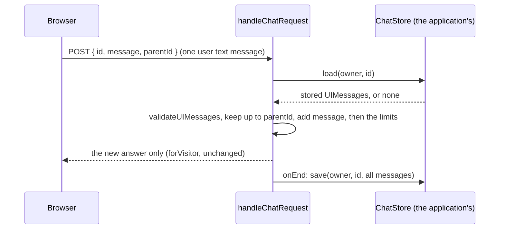

# M18.1 plan: server-side conversation history (library)

- **Status:** Plan approved (2026-11-08). Implementation starts after M17 merges, because both change
  [chat-turn.ts](../../packages/ai/src/chat/chat-turn.ts) and [chat-handler.ts](../../packages/ai/src/chat/chat-handler.ts).
- **Date:** 2026-11-08
- **Roadmap:** not listed yet. Follows the AI SDK's
  [message persistence pattern](https://ai-sdk.dev/docs/ai-sdk-ui/chatbot-message-persistence). Followed by
  [M18.2](m18-2-server-history-in-app.md) and [M19](m19-tool-calls-and-model-in-replies.md).

## Objective

The browser sends only `{ id, message, parentId }`. The server loads the conversation, runs the turn, and saves the whole result, including
the real tool calls and results. A visitor can no longer forge earlier answers, and the model keeps its earlier lookups.

**Excluded:** any store implementation, cookies, UI, and showing tool calls (M19).

## Design

- **Required option:** `handleChatRequest({ ..., history: { store: ChatStore; identifyOwner(request) } })`, like `limit`. The
  `{ messages }` request shape is removed: before 1.0 this is a breaking minor release, and the changeset says so.
  `runChatTurn` still takes a message list, so the evaluation is unaffected.
- **`ChatStore`:** `load` and `save`, each taking the owner. The application implements it, like `ChatTurnLimiter`, so the
  package names no store. Every key includes the owner, so another visitor's chat id finds nothing. Listing and deleting are
  the app's (M18.2), because the library never calls them. `createMemoryChatStore` is for tests and local development.
- **Request:** `id` is a short string of safe characters; `message` is a user message with text parts only; `parentId` is the
  message it follows, or `null`. What followed `parentId` is replaced, so Edit and Regenerate work; an unknown `parentId` is a
  409. *Added during implementation:* the AI SDK's guide only appends, and assistant-ui's Edit sends no `messageId`, so the
  request names the parent, as assistant-ui's history adapter does. The store keeps one branch.
- **Stored history is validated** with `validateUIMessages` against the server's tools. The server writes it, but it outlives
  the code: a renamed tool, a changed result, or a new AI SDK message format would otherwise fail mid-turn. A conversation
  that no longer validates is logged and the visitor starts a fresh one.
- **Limits:** `maxMessages` and `maxTotalChars` count the history plus the new message. Input tokens grow, because earlier tool
  results are sent to the model again.
- **Saving:** `createUIMessageStream({ originalMessages, generateId, onEnd })` around the filtered stream, with assistant ids
  made on the server. It sits after the raw-tool-call filter, so blocked text is not saved, which `toUIMessageStream`'s own
  option could not do. `onEnd` is awaited before the stream closes. *Changed during implementation:* no `consumeStream()`,
  because Stop cancels the model, and a stopped reply is saved as far as it got. A failed save is logged and the visitor still
  gets the answer; a failed load returns 503, like the limiter. Each store call has `historyTimeoutMs` (2 seconds).
- **`loadVisitorChat(request, id, { history })`:** the stored messages for the browser, with text parts only. M19 adds the
  tool parts it allows.
- **Consumers:** the minimal consumer gets a memory store and an `openChat` handler. The reference app breaks until M18.2,
  which is released together with it.

## Tests

- The request rejects an assistant message, tool and data parts, and a malformed id.
- Owner B loading or saving owner A's id finds nothing and overwrites nothing.
- In turn 2, the model receives turn 1's tool result.
- The saved list holds the tool parts; a stopped reply is saved partly; a failed save still answers; a failed load is a 503.
- A stored conversation that no longer validates starts a fresh one.
- `loadVisitorChat` returns no tool arguments or results (marker strings in both).
- History plus the new message over a limit is rejected.

## Documentation

- **ADR 0018:** server-side conversation history, replacing M6's "the server stores nothing"; ADR 0007 gets an "*Update (M18)*".
- **Learning:** a new `server-side-history.md` (who holds the conversation, ownership by key, retention, replayed tool results)
  and a row in the index. One sentence each in `tool-calling.md` (results persist across turns) and `browser-persistence.md`
  (replaced by server history).

## Verification

`pnpm verify`.
