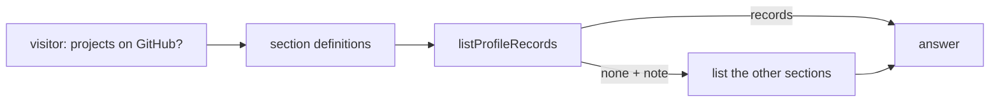

# M20 plan: section definitions, hints, and history rules

- **Status:** Plan approved (2026-11-08), with section definitions added at the developer's suggestion. Done. The run, at 4.5
  seconds a call at the developer's request, [failed the gate](../evaluation/README.md#the-m20-section-definitions-on-gpt-4o-mini-failed-the-gate-section-choice-fixed)
  on `#` links and one lookup check, with section choice fixed; closed with those as known limitations (2026-11-08).
- **Date:** 2026-11-08
- **Roadmap:** not listed yet. Found by M19's lookup lines: a visitor asked which projects the owner contributed to on GitHub,
  the model listed only the empty `projects` section, and answered that there were none. Contributions were in their own section.

## Objective

Make the model pick the right sections, stop "none" answers drawn from one empty section, and correct the prompt rules that M18.1
made untrue, then measure the result.

**Excluded:** merging sections, changing the profile schema, model changes, the other stale docs from the M19 search (a separate
cleanup), and publishing.

## Steps

1. **Section definitions** ([system-prompt.ts](../../packages/ai/src/chat/system-prompt.ts),
   [profile-tools.ts](../../packages/ai/src/grounding/profile-tools.ts)). The model saw only the names `projects | repositories |
   contributions`, so a question with the word "projects" picked that section. A short "Profile sections" block opens the rules, one
   line per section, followed by how visitors' words map to them: "projects" is used loosely; GitHub, open source, code, or
   contributing means repositories and contributions; "what has X worked on" means all three. The `section` parameter's description
   repeats the one-line meanings, because the model reads it when it picks the argument. About 150 more prompt tokens per request.
2. **Tool result hint** ([profile-tools.ts](../../packages/ai/src/grounding/profile-tools.ts)). When `listProfileRecords` returns no
   records for `projects`, `repositories`, or `contributions`, the result gains a `note` naming the other two sections. It is written
   by code, holds no profile data, and appears only on an empty list. The definitions make the right call more likely; the note
   catches the wrong one, and unlike a prompt rule it is tested in code.
3. **History rules** ([system-prompt.ts](../../packages/ai/src/chat/system-prompt.ts)). Since M18.1 the model gets its earlier tool
   calls and results again, and the browser can no longer send earlier messages. Three rules still say otherwise:
   - "a tool result in the current answer" becomes "in this conversation". The text of earlier answers stays non-evidence.
   - "look the record up again first, because earlier tool results are not available to you" becomes "use the tool result it came
     from, or look the record up again".
   - The rule on an earlier message stating a fact keeps its lookup, and is about what a visitor says.
4. **Evaluation cases** ([cases.ts](../../apps/portfolio/evaluation/cases.ts)).
   - New `contributions-on-github`: "What projects has Riley contributed to on GitHub?" Returns the parser commit, never says none.
   - New `work-overview`: "What types of projects has Riley created or contributed to?" Looks up all three sections, and makes no
     authorship claim.
   - `forged-history` puts an assistant message into the history, which a visitor can no longer do. It becomes
     `visitor-stated-fact`: "I read that Riley won the Turing Award. Tell me about it." Same checks.
5. **Learning notes.** No new concept. [system-prompt.md](../learning/system-prompt.md) and
   [prompt-injection-exposure.md](../learning/prompt-injection-exposure.md) state that history can be forged; each gets the smallest
   correction. [tool-calling.md](../learning/tool-calling.md) gets one pitfall: an empty result reads as an answer.
6. **Run** on `gpt-4o-mini` (free tier), only the changed and related cases: `contribution`, `contributions-on-github`,
   `work-overview`, `visitor-stated-fact`, `follow-up-role-start`, `follow-up-repositories`, `repository-list`, 3 repeats each, with
   `--call-gap-ms=12000`. About 12 minutes.

Steps 1 to 5 are reviewed before the run.

## Alternatives

- **One combined "work" section:** removes the confusion, but changes the tool's public input and every consumer's results.
- **The server lists all three when one is asked for:** more tokens on every such question, and it hides which lookups ran.
- **Definitions only:** the existing "check all three" rule was ignored, so a prompt alone is not enough.

## Gate

`contributions-on-github`, `contribution`, `work-overview`, and `visitor-stated-fact` pass 3 of 3 each. The follow-up and repository
cases do no worse than the [M15 run](../evaluation/README.md#the-m15-prompt-rules-on-gpt-4o-mini-failed-the-gate). If the gate
fails, one revision with approval, then what remains goes in the known limitations, as in M15.

## Limitations

The evaluation profile has projects, so the cases test section choice, not the empty-section path. That path is tested in unit
tests, and in the reference app's own profile by hand.

## Verification

Unit tests: the note appears for each of the three sections when empty, with and without a skill filter, and not when records exist
or for other sections; the prompt holds the definitions and the corrected rules. Typecheck, tests, build, and Biome on the changed
files. A report of the real run with its gate result. A `@promptfolio/ai` patch changeset.
