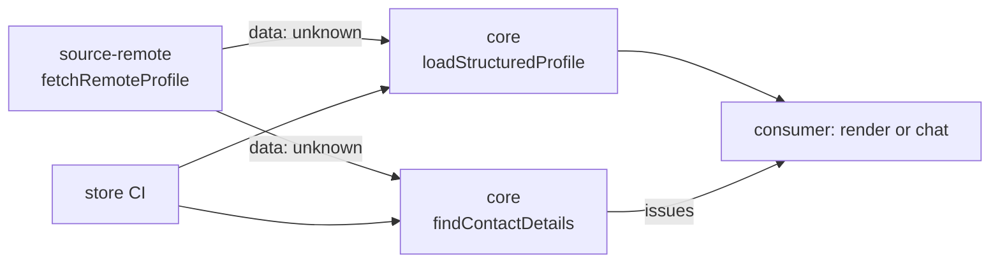

# M22 plan: remote profile helpers

- **Status:** Plan approved (2026-11-11). Done, in review. Ships in the next release with role links and the plain input
  types; Changesets would make that `0.1.0` from these minor changesets, so `0.0.4` needs patch changesets or the version set
  by hand, as `0.0.3` was.
- **Date:** 2026-11-11
- **Roadmap:** not listed before. Requested by consumers that keep the profile in a remote store and
  repeat the same fetch and private-data check.

## Objective

Add the two pieces such consumers repeat: a contact-detail check in `core`, and a hardened fetch of a
remote profile file in a new `@promptfolio/source-remote` package.

**Excluded:** caching (each app keeps its own), GitHub-specific code (a README recipe only), date
formatting helpers, `PROFILE_URL` in the reference app, and changes to consumer repositories.



## Part A: `findContactDetails` in `core`

`findContactDetails(data: unknown): ProfileIssue[]` walks every string in the raw input, including
unknown keys, and reports emails, `mailto:`/`tel:` links, and runs of 10 to 15 digits, with paths
such as `experience[0].summary`. It reports and does not block: the caller decides (store CI fails, a
chat can drop the flagged text). It is a heuristic and documented as one.

## Part B: `@promptfolio/source-remote`

```ts
fetchRemoteProfile({ url, headers?, timeoutMs = 10_000, maxBytes = 512 * 1024, userAgent?, fetch? })
  → { ok: true; data: unknown; fetchedAt: Date }
  | { ok: false; error: { kind; status?; message } }
```

- Error kinds: `invalid-url`, `network`, `timeout`, `http`, `too-large`, `not-json`.
- Only http(s) URLs; `AbortSignal.timeout`; a `Content-Length` over the limit is rejected, and the body
  is read as a stream and stopped past `maxBytes`, since the header can be absent or wrong.
- A default `User-Agent`. Messages never contain request headers, so a token cannot reach a log; an
  `http` error keeps up to 300 characters of the response body.
- Returns `data: unknown` and does not depend on `core`: the caller validates. Results, not
  exceptions, as in `source-github`; an app that caches the result throws on `ok: false`.
- No runtime dependencies (Node 22 `fetch`). Joins the `fixed` version group.

## Docs

A learning note on private-data checks, a sentence in `calling-external-apis.md`, package READMEs
(with a recipe for a private GitHub store), and changesets.

## Verification

`pnpm verify` with tests for every error kind and check, `pnpm test:tarballs` for all four packages,
and `pnpm changeset status` showing all four at 0.0.4.

After the release, consumers switch to these helpers and to `^0.0.4` in their own repositories.
