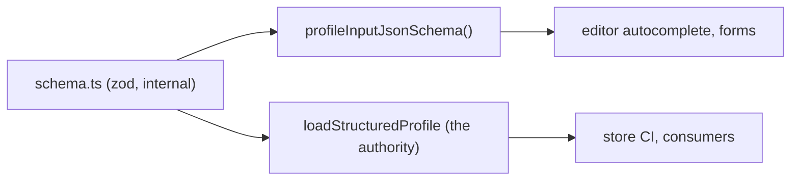

# M23 plan: JSON Schema for the profile input format

- **Status:** Plan approved (2026-11-12).
- **Date:** 2026-11-12
- **Roadmap:** not listed before. Requested by a profile editor (an app outside this repository that
  edits a profile file in a remote store), which needs autocomplete now and form generation later.

## Objective

`core` exports a JSON Schema of `ProfileInput`, so editors can offer autocomplete and hover help for a
profile file, and form generators can build forms from it.

**Excluded:** field descriptions or labels for forms (zod `.meta()`, when a form consumer needs them),
a `$schema` URL or published `.json` file, date-formatting helpers (wait for a second real user), and
changes to consumer apps.

## Design

- `profileInputJsonSchema(): { readonly [key: string]: unknown }`. A plain JSON object type, so no
  zod type is public (M13.2).
- Built once with `z.toJSONSchema(profileInputSchema, { io: "input", target: "draft-7" })` and copied
  with `structuredClone` on each call, so one caller's changes cannot affect another.
- **Draft 7**, the draft editors support most widely (including Monaco's JSON language service).
- `io: "input"`: lists the loader defaults to `[]` are optional, as in `ProfileInput`.
- **Looser than the loader, by design.** Record-id format, unique ids, end not before start, unique
  skill names, and trimming are code-only rules and are absent. The doc comment says so;
  `loadStructuredProfile` stays the authority.
- zod's default for something it cannot represent (a transform) is to throw. Kept, so a schema
  change that adds one fails the tests and forces a decision.

**Rejected:** a `./profile-input.schema.json` subpath built at build time. It would allow a `$schema`
URL in profile files, but needs build and export-map work; it can be added later without breaking
anything.

## Files

- `packages/core/src/profile/json-schema.ts`, its test, and the snapshot file
- `packages/core/src/index.ts`, `packages/core/src/index.test.ts` (runtime export list)
- `packages/core/package.json`: `files` excludes `src/**/__snapshots__` (found by
  `pnpm test:tarballs`; the first snapshot in a published package)
- `packages/core/README.md` (exports table), `docs/ROADMAP.md` (status row)
- `docs/learning/validation-at-boundaries.md` (one pitfall), a changeset

## Tests

- A snapshot of the whole schema, so a zod upgrade that changes it shows in review.
- Declares draft 7; every object has `additionalProperties: false`.
- Required: `schemaVersion` and `identity` at the root; `name`, `headline`, `summary` in identity;
  `schemaVersion` is the constant `1`; lists are not required.
- The date pattern accepts and rejects the same samples as `loadStructuredProfile`.
- A returned schema can be changed without changing the next call's result.
- The public-API test lists the new export.

Not included: validating fixtures with a JSON Schema validator (ajv), which would add a dev
dependency for little gain.

## Learning notes

No new concept. One pitfall in `validation-at-boundaries.md`: a generated JSON Schema helps editors
but is not the boundary, because code-only rules are not in it.

## Release

A patch changeset for `core`; the fixed group moves all four packages to `0.0.5` (patch keeps the
release on `0.0.x`, as in 0.0.4). Additive, no breaking change. The developer publishes.

## Verification

`pnpm verify`, `pnpm test:tarballs`, and `pnpm changeset status` showing all four packages at
`0.0.5`.
