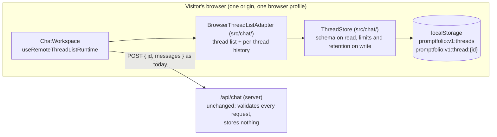
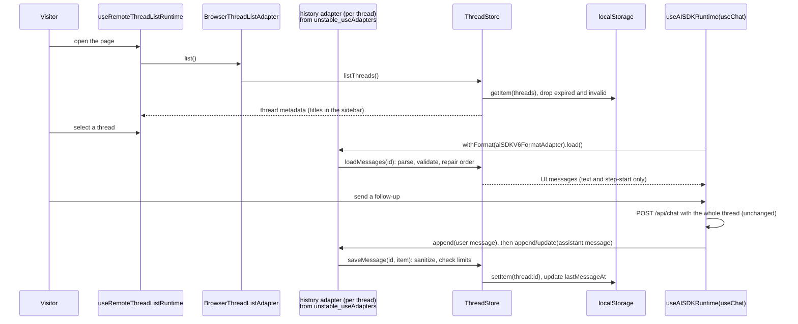
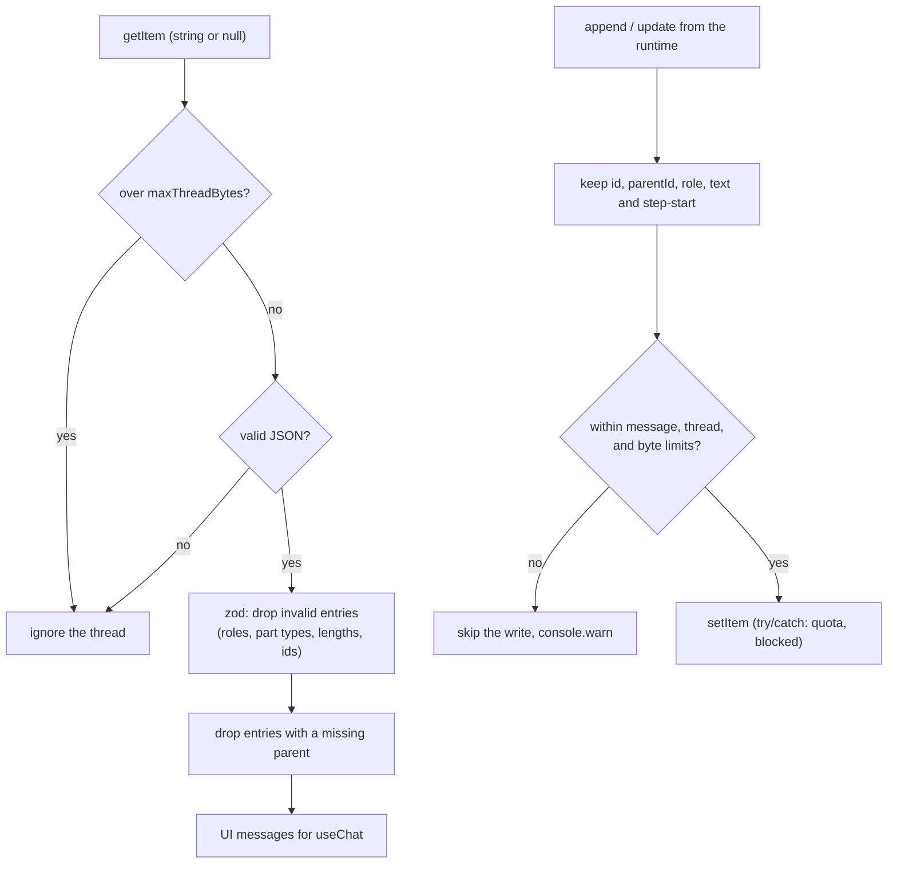

# M6 plan: Conversation persistence in the browser

- **Status:** Done (2026-10-29). Plan approved with the recommended defaults and implementation
  approved on 2026-10-29. See [Review results](#review-results).
- **Date:** 2026-10-29
- **Roadmap:** [M6 — Conversation persistence](../ROADMAP.md#m6--conversation-persistence)

This plan is self-contained so it can be discussed outside the coding session. Background:
[architecture overview](../ARCHITECTURE.md), [M5 plan](m5-tools-grounded-lookup.md) (especially
open decision 3 and its Review results), [ADR 0001](../adr/0001-reference-app-framework.md)
(serverless), [ADR 0002](../adr/0002-library-first-monorepo-boundaries.md) (package boundaries),
[ADR 0007](../adr/0007-chat-ui-assistant-ui.md) (assistant-ui), and the learning notes on
[chat runtime and threads](../learning/chat-runtime-and-threads.md),
[validation at boundaries](../learning/validation-at-boundaries.md),
[server-side secrets](../learning/server-side-secrets.md), and
[tool calling](../learning/tool-calling.md).

## Objective

A visitor who reloads the page, or comes back later in the same browser, finds their earlier
conversations in the sidebar and can continue them. Conversations are stored **only in that
browser** (`localStorage`), never on the server. What is stored is the minimum the chat needs:
thread ids, titles, timestamps, and text messages. Stored data is validated when it is read back,
bounded in size and age, and kept separate per thread. The server's trust model from M5 does not
change.

## Starting point (after M5)

- `ChatWorkspace` (`apps/portfolio/src/components/chat-workspace.tsx`) composes
  `useRemoteThreadListRuntime({ runtimeHook, adapter })` with one
  `useAISDKRuntime(useChat({ transport }))` per thread.
- The adapter is `TitledInMemoryThreadListAdapter` (`apps/portfolio/src/chat/`), which extends
  assistant-ui's `InMemoryThreadListAdapter` and titles a thread from its first user message.
  Threads and messages live in memory and are lost on reload.
- The browser receives only text and `step-start` parts (M5 output allowlist); tool calls and tool
  results never leave the server. The server accepts only text and `step-start` parts from `user`
  and `assistant` (M4 input allowlist), with at most 50 messages, 4,000 characters per message,
  and 20,000 characters per conversation (`CHAT_LIMITS` in `@promptfolio/ai`).
- Carried-forward limitations: the client controls conversation history and can forge earlier
  assistant text; follow-ups re-run lookups because earlier tool results are never sent back; no
  rate limiting before M11; no public deployment before M11.

## Concepts introduced

1. **Client-side persistence.** `localStorage` is a small (about 5 MB per origin), synchronous
   key-value store of strings in the browser. It survives reloads and restarts, is shared by all
   tabs of one origin in one browser profile, and is never sent to the server by itself (unlike
   cookies). Private windows, blocked storage, and a full quota make it unavailable or make writes
   throw, so the app must keep working without it.
2. **Visitor isolation by the browser.** The same-origin policy keeps one origin's storage away
   from other sites, and different browsers or devices have different storage. That is the whole
   isolation mechanism here: there is no server-side history to leak between visitors. People who
   share one browser profile share its history (see Scope).
3. **Stored data is untrusted on read.** Anything read back from storage may be malformed,
   truncated, written by an older version of the app, oversized, or edited by hand, a browser
   extension, or script on the same origin. It goes through a schema before it reaches the UI,
   exactly like a request body reaches the server through a schema. Invalid entries are dropped,
   never trusted or crashed on.
4. **Schema versioning.** Storage keys carry a version (`promptfolio:v1:`), so a later format
   change can ignore or migrate old data instead of misreading it.
5. **Retention and size limits in code.** Old threads are removed after a fixed age, the number of
   threads is capped, and a thread larger than the server would ever accept is not persisted.
6. **Thread-list adapter and history adapter.** assistant-ui separates *which threads exist*
   (`RemoteThreadListAdapter`: list, initialize, rename, archive, delete, title) from *what a thread
   contains* (`ThreadHistoryAdapter`: load, append, update, delete messages). M6 implements both
   for one storage.

## Design

### Where history lives (open decision 1)



The server stays stateless and unchanged. Persistence is a client feature: it changes what the
browser remembers, not what the server trusts.

### Storage layout

Two kinds of keys, both JSON strings, both prefixed `promptfolio:v1:`:

| Key | Content |
| --- | ------- |
| `promptfolio:v1:threads` | `[{ id, title?, status: "regular" \| "archived", createdAt, lastMessageAt }]`, newest first |
| `promptfolio:v1:thread:<id>` | `{ messages: [{ id, parentId, role: "user" \| "assistant", parts: [{ type: "text", text } \| { type: "step-start" }] }] }` |

- One key per thread, so a corrupt or oversized thread affects only itself, and deleting a thread
  removes exactly one key.
- Thread ids must match `^[A-Za-z0-9_-]{1,64}$` before they are used in a key; anything else is
  rejected (no key injection through odd ids).
- Messages store only `id`, `parentId`, `role`, and `text`/`step-start` parts: the same shape the
  server accepts. No `metadata`, `providerMetadata`, status, or timing is kept. `parentId` keeps the
  order (and the branch structure assistant-ui uses for edits and regenerations).

### Limits and retention (constants in `src/chat/storage-limits.ts`)

| Limit | Default | Why |
| ----- | ------- | --- |
| `maxThreads` | 20 | Oldest (by `lastMessageAt`) is removed when a 21st is created. |
| `retentionDays` | 30 | Threads not touched for 30 days are removed when the list loads. |
| `maxMessagesPerThread` | 60 | Server accepts 50 per request; a little headroom for branches. |
| `maxMessageChars` | 16,000 | Assistant answers can be longer than the 4,000-character input limit (up to 4 steps of 1,000 tokens). |
| `maxThreadBytes` | 200,000 | Serialized size of one thread key; worst case 20 × 200 KB = 4 MB, under the usual 5 MB quota. |

- **On write:** a message or thread that would exceed a limit is not written; the thread keeps
  working in memory for the rest of the visit, and a `console.warn` names the limit (no message
  content). The server already refuses to continue such a conversation ("The conversation is too
  long. Please start a new chat."), so nothing useful is lost.
- **On read:** the index and each thread are parsed with zod schemas. An invalid index becomes an
  empty list; invalid message entries are dropped; an entry whose `parentId` points to a missing
  message is dropped (and its descendants with it); a thread key over `maxThreadBytes` is ignored.
  Keys under the prefix that no index entry references are removed (orphans after a failed write).
- **Storage unavailable** (private mode, blocked, `QuotaExceededError`): every storage call is
  wrapped; failures fall back to the M5 behaviour (in-memory for this visit) and never break the
  chat.

### Wiring into assistant-ui



Checked against the installed types (see Dependencies):

- `RemoteThreadListAdapter` has an optional `unstable_useAdapters` hook that returns
  `{ history?: ThreadHistoryAdapter }` for the active thread; `useRemoteThreadListRuntime` calls it.
  `useAISDKRuntime` reads `history` from that context (`useRuntimeAdapters()`), so
  `chat-workspace.tsx` needs only the adapter swap.
- With `useAISDKRuntime`, the history adapter **must** implement `withFormat(formatAdapter)`; the
  runtime calls it with the AI SDK storage format (`format: "ai-sdk/v6"`) and then uses `load`,
  `append`, `update`, `delete`, and `pin` on the result.
- The format adapter's `decode` spreads stored content into a `UIMessage` without validation. That
  is why the store validates and sanitizes before anything is returned to `decode`, and sanitizes
  again on write (only `role` and allowed `parts` are kept from `encode`'s output).
- The history adapter resolves the thread's id lazily on each call (`useAui()` →
  `threadListItem`, calling `initialize()` on the first append), as the type docs require.
- Titles: the existing `titleFromMessages` is reused; `generateTitle` now also writes the title to
  the index.

### Why not assistant-ui's built-in `createLocalStorageAdapter`?

`@assistant-ui/core@0.3.31` ships `createLocalStorageAdapter({ storage, prefix, titleGenerator })`,
which already implements both adapters, including a per-key write queue. It is the obvious first
candidate (open decision 4). It is not recommended here because:

- It is not re-exported from `@assistant-ui/react`; the app would add `@assistant-ui/core` as a
  direct dependency, pinned to the version `@assistant-ui/react` happens to pull in.
- For the AI SDK format it checks only that each entry's `content` is an object, then `decode`
  spreads it into a `UIMessage`: any part type (tool parts, files) or size passes. There are no
  size limits, no retention, and no cap on thread count.
- Adding those by wrapping its `storage` would mean parsing its internal, undocumented key layout
  (`formatted-messages:["<id>","ai-sdk/v6"]`), which can change in any release.

Our adapter is small (estimated 150 to 250 lines plus tests), and its rules are the milestone's
learning content. It still depends on assistant-ui's `unstable_useAdapters` and `withFormat`
contracts, which are experimental; versions are pinned and the tests exercise the contract.

### Trust model (open decision 2)

M6 deliberately **keeps** the M5 trust model:

- The server still treats every incoming message as untrusted and validates it with the same
  allowlist and limits. Persisted history is just a longer-lived copy of what the browser already
  had; it gives a visitor no ability they did not have (they could always edit requests).
- Tool results still never leave the server, so nothing about lookups is stored, and follow-ups
  still re-run lookups.
- Server-owned history (the server stores each thread and ignores client-sent earlier turns) would
  make history trustworthy and would allow replaying validated tool results across turns, which
  the M5 plan lists as "possible later". It needs server storage (ADR 0001: no in-memory state on
  serverless), an anonymous visitor identity (signed cookie), retention jobs, per-visitor
  authorization, and abuse limits. That is a larger milestone than M6 and overlaps M11's rate
  limiting, so it is recorded as a follow-up, not built.

A restored thread can still be continued only within the server limits, because the store keeps
the shape the server accepts and a test checks restored threads against `parseChatRequest`.

### Where the code lives (open decision 3)

App-only, in `apps/portfolio/src/chat/`:

- It depends on assistant-ui (React) and browser storage. `@promptfolio/core` stays zod-only and
  AI-free; `@promptfolio/ai` stays server-only and provider-agnostic. Neither may depend on React
  or the DOM.
- There is one consumer and one storage. A reusable `@promptfolio/chat-*` package would be a
  package for its own sake (CLAUDE.md §3). If M12's second consumer needs it, the store's
  `StorageLike` interface makes the move mechanical.
- The store depends on a minimal synchronous `StorageLike` (`getItem`, `setItem`, `removeItem`,
  plus `key`/`length` for orphan cleanup), not on `window.localStorage` directly, so tests use an
  in-memory fake and another storage (for example `sessionStorage`) is a one-line change.
- The stored-message schema repeats the server's two-part allowlist in the app. It is not imported
  from `@promptfolio/ai`, whose entry point is server code; a test cross-checks the two instead.

### Data flow summary



## Scope

**In:**

- `BrowserThreadListAdapter` and `ThreadStore` in `apps/portfolio/src/chat/`, replacing
  `TitledInMemoryThreadListAdapter` (whose title logic is kept).
- Thread list operations: list, initialize, rename, archive, unarchive, delete, title, fetch.
- Per-thread message history through `unstable_useAdapters` and `withFormat`.
- Validation on read, sanitizing on write, limits, retention, orphan cleanup, and fallback when
  storage is unavailable.
- A one-line notice in the sidebar: "Conversations are saved in this browser only." (exact
  wording in review).
- Tests, architecture overview, ADR 0007 update note, roadmap status, learning notes.

**Out:**

- Server-side history, visitor identity, cookies, accounts, or any storage service (see Trust
  model; proposed as a later milestone).
- Sync across tabs while both are open: two open tabs can overwrite each other's changes to the
  thread list (last write wins; documented limitation). Listening to the `storage` event is a
  possible later improvement.
- Sync across devices or browsers.
- Encrypting stored data: any script on the origin can read `localStorage`, so encryption with a
  key in the same browser would protect nothing.
- A "delete all conversations" control (per-thread delete already exists in the thread list); can
  be added in review if wanted.
- Changes to `@promptfolio/ai`, `@promptfolio/core`, the route, or the input and output allowlists.
- Seeded or cached answers (M7), and marking stored answers as stale after a profile change
  (M7/M9: stored answers are shown as they were; new answers are looked up again).

## Files likely to change

```
apps/portfolio/src/chat/thread-store.ts, thread-store.test.ts          (new: schema, limits, retention)
apps/portfolio/src/chat/storage-limits.ts                              (new)
apps/portfolio/src/chat/browser-thread-list-adapter.ts,
  browser-thread-list-adapter.test.ts                                   (new: assistant-ui adapters)
apps/portfolio/src/chat/thread-list-adapter.ts, thread-list-adapter.test.ts
                                     (titleFromMessages kept; in-memory class removed)
apps/portfolio/src/components/chat-workspace.tsx                       (adapter swap, storage fallback)
apps/portfolio/src/components/assistant-ui/elements/thread-list.aui.tsx (only if the notice goes
                                     there; marked "Promptfolio change:")
apps/portfolio/package.json                                            (zod: catalog:)
docs/ARCHITECTURE.md, docs/ROADMAP.md, docs/adr/0007-chat-ui-assistant-ui.md (update note)
docs/learning/browser-persistence.md                                   (new)
docs/learning/{chat-runtime-and-threads, validation-at-boundaries}.md, docs/learning/README.md
```

No package changes are expected.

## Dependencies

No new packages. One new direct dependency entry: `zod` in `apps/portfolio/package.json`, using the
workspace catalog (`catalog:`, `^4.6.7`), which is already installed for the packages, so the
lockfile gains no new package. It is used for the stored-data schemas, the same way the server
validates requests. Alternative: hand-written type guards (no dependency entry, more code, and a
different style from the rest of the repository).

APIs relied on, checked against the installed versions (`@assistant-ui/react@0.15.31` with
`@assistant-ui/core@0.3.31`, `@assistant-ui/ai-sdk@0.0.15`, `ai@7.0.154`):

- `RemoteThreadListAdapter`: `list`, `initialize(threadId, { custom })`, `rename`, `archive`,
  `unarchive?`, `delete`, `generateTitle(remoteId, messages)`, `fetch`, and
  `unstable_useAdapters?: () => RuntimeAdapters` (experimental since 2026-08-18)
  (`core/dist/runtimes/remote-thread-list/types.d.ts`).
- `ThreadHistoryAdapter` with `withFormat?(formatAdapter)` returning a
  `GenericThreadHistoryAdapter` (`load`, `append`, `update?`, `delete?`, `pin?`); "Required when used
  with `useAISDKRuntime`" (`core/dist/adapters/thread-history.d.ts`). `useExternalHistory` in
  `@assistant-ui/ai-sdk` throws without `withFormat` and calls it with `aiSDKV6FormatAdapter`.
- `useAISDKRuntime` reads `adapters?.history ?? useRuntimeAdapters()?.history`
  (`ai-sdk/dist/runtime/useAISDKRuntime.js`).
- `useAui` (re-exported from `@assistant-ui/react`) for the current `threadListItem`, and
  `ThreadListItemRuntime.initialize()`.
- `createAssistantStream` from `assistant-stream` for titles (already used).
- Not used: `createLocalStorageAdapter` (exported only from `@assistant-ui/core/react`; see above).

## Acceptance criteria and tests

Deterministic tests, no network, no browser: the store and adapter take a fake `StorageLike` and a
fake clock (`now: () => Date`).

**Store: loading and saving** (`thread-store.test.ts`):

1. Round trip: threads and messages saved are loaded back in order with titles, status, and
   `lastMessageAt`; branches (`parentId`) are preserved.
2. Only allowed data is written: a message with `metadata`, `providerMetadata`, a tool part, a
   file part, or a `reasoning` part is stored as `id`, `parentId`, `role`, and its text and
   `step-start` parts only; a `system` message is not stored.
3. Delete removes the thread's key and its index entry; archive and unarchive change only status.

**Store: malformed and oversized data** (failure paths):

4. Not JSON, JSON of the wrong shape, `null`, and an empty string in the index each load as an
   empty list without throwing.
5. In a thread: entries with an unknown role, an unknown part type, a non-string text, an over-long
   message, an invalid id, or a duplicate id are dropped; valid neighbours load.
6. An entry whose parent is missing is dropped together with its descendants; a parent cycle does
   not loop.
7. A thread key larger than `maxThreadBytes` is ignored on read; a write that would exceed it, or
   `maxMessagesPerThread`, or `maxMessageChars`, is skipped and reported, and the stored thread is
   unchanged.
8. A thread id that does not match the id pattern is never used in a key.
9. Data under another prefix or version (`promptfolio:v0:…`, other apps' keys) is never read or
   removed; orphaned `promptfolio:v1:thread:*` keys are removed.

**Store: limits and retention:**

10. A thread untouched for more than 30 days (fake clock) is removed on `list`, with its key; one at
    29 days stays.
11. Creating a 21st thread removes the least recently used one.

**Store: storage failures:**

12. `setItem` throwing `QuotaExceededError`, and `getItem` throwing (blocked storage), never throw
    out of the store; the adapter keeps working in memory for the visit.

**Separation between threads and visitors:**

13. Two threads in one storage: appending to one never changes the other; loading one never
    returns the other's messages (including after switching back and forth through the adapter).
14. Two stores on two separate storages (two browsers or visitors) never see each other's threads.
    (The real isolation between visitors is the browser's; this test documents that the code has
    no shared or global state, such as a module-level cache.)

**Adapter contract** (`browser-thread-list-adapter.test.ts`):

15. `withFormat(aiSDKV6FormatAdapter)` returns a history whose `load` yields `{ messages: [{
    parentId, message }] }` that `decode` turns into valid `UIMessage`s; `append` and `update`
    upsert by message id; `delete` removes messages and re-links children to the nearest kept
    ancestor.
16. `generateTitle` streams `titleFromMessages(...)` and writes it to the index; the existing title
    tests still pass.

**Cross-check with the server:**

17. A restored thread ending with a user message passes `parseChatRequest` from `@promptfolio/ai`
    (test-only import), so persistence never produces a conversation the server would reject for
    its shape.

**Manual and browser checks:**

18. Start two threads, reload: both appear with titles; selecting each shows its own messages; a
    follow-up after reload is answered (with a lookup in the server log).
19. Rename, archive, delete, reload: the changes persist; a deleted thread's key is gone
    (DevTools, Application, Local Storage).
20. Edit a stored thread by hand in DevTools to invalid JSON, and to contain a `tool-` part: the page
    loads, the thread is empty or the bad part is gone, and nothing crashes.
21. A private window starts empty and does not see the normal window's threads; a second browser
    does not see them either.
22. With storage blocked (DevTools or browser setting), the chat works as in M5.
23. `pnpm verify` passes.

## Open decisions

Each has a recommended default; the plan above assumes the recommendations.

1. **Scope of persistence.**
   - **Recommended:** browser-only, `localStorage`, scoped to one origin and browser profile, with
     30-day retention and the limits above. Isolation comes from the browser; the server stores
     nothing; no new service or secret; works the same on serverless hosting.
   - Alternative: `sessionStorage` (per tab, survives reload but not closing the tab). Simpler
     privacy story, but does not meet "come back later", and a new tab starts empty.
   - Alternative: server-side storage (for example a hosted key-value store keyed by an anonymous
     signed cookie). Survives across devices only with accounts, needs a new service, secrets,
     retention jobs, and per-visitor authorization; a larger milestone (see decision 2).
2. **Trust model.**
   - **Recommended:** keep M5's model unchanged. The server validates every request as today;
     stored history is as untrusted as typed history. Server-owned history, and replaying tool
     results across turns, are proposed as a later milestone (after M11's rate limiting, or
     together with it).
   - Alternative: server-owned history in M6. Makes earlier turns trustworthy and removes forged
     assistant text, at the cost described under decision 1.
3. **Where the code lives.**
   - **Recommended:** app-only (`apps/portfolio/src/chat/`), with an injectable `StorageLike`.
   - Alternative: a new client package (for example `@promptfolio/chat-browser`). Premature with one
     consumer; revisit in M12.
4. **Build the adapter or use assistant-ui's `createLocalStorageAdapter`.**
   - **Recommended:** our own adapter (reasons above: validation, limits, retention, no dependency on
     internal key layouts).
   - Alternative: `createLocalStorageAdapter` plus a direct `@assistant-ui/core` dependency. Less
     code and a write queue for free, but no schema, size limits, or retention, and stored tool or
     file parts would be loaded as-is.
5. **Limits and retention values.**
   - **Recommended:** 20 threads, 30 days, 60 messages, 16,000 characters per message, 200 KB per
     thread.
   - Alternatives: shorter retention (7 days) for a smaller privacy footprint; no age limit (only the
     thread cap).
6. **Visitor notice.**
   - **Recommended:** one short line in the sidebar that conversations are saved in this browser
     only and can be deleted from the list. No consent banner: this is functional storage the
     visitor uses directly, nothing is sent anywhere, and there is no tracking (legal review of
     wording is out of scope for a learning project and should be revisited before public
     deployment in M11/M12).
   - Alternative: no notice.
7. **Approval** to start M6 with the recommendations above.

## Learning notes

- **New:** `docs/learning/browser-persistence.md`: what `localStorage` is and is not (synchronous
  strings, per origin and browser profile, quota, unavailable in some modes, readable by any script
  on the origin), why stored data is validated on read, schema versioning by key prefix, limits and
  retention in code, why encryption in the browser would not help, and why persisted client history
  does not make history trustworthy at the server. Written as "planned" if approved, and marked "in
  use" when M6 lands.
- **Updated:** chat runtime and threads (thread-list adapter versus history adapter,
  `unstable_useAdapters` and `withFormat`, threads no longer reset on reload), validation at
  boundaries (storage as a new boundary, on the client), and the README index.
- **Unchanged:** server-side secrets (nothing secret is stored; the note may get one line saying
  that `localStorage` must never hold secrets) and tool calling (tool results are still never
  stored).

## Review results

Recorded 2026-10-29. Approved by the developer on 2026-10-29.

**Deviations from the plan (small, explained here):**

- `thread-list-adapter.ts` was renamed to `thread-title.ts` (with its test): after the in-memory
  class was removed it held only `titleFromMessages`, and the adapter now lives in
  `browser-thread-list-adapter.ts`.
- `maxThreadBytes` is named `maxThreadChars`: it counts string length (UTF-16 code units), which is
  what browsers count against the quota, not bytes. The value is unchanged (200,000).
- `saveMessage` has a fifth refusal reason, `missing-parent`: a message whose parent was never
  saved (for example, because the parent hit a limit) is not written, because it could not be
  loaded anyway.
- The visitor notice lives in `chat-workspace.tsx`, below the vendored `ThreadList`, so no vendored
  file changed.
- `browser-storage.ts` (new) holds `openBrowserStorage()` and `createMemoryStorage()`.
- Criterion 17 calls `handleChatRequest` with a mock model instead of `parseChatRequest`, which is
  not exported from `@promptfolio/ai`; this kept the package unchanged.

**Automated:** `pnpm verify` passes: lint, typecheck in all three packages, 154 tests (`core` 35,
`ai` 64, app 55), and the build. New app tests: `thread-store.test.ts` (31),
`browser-thread-list-adapter.test.ts` (11), `restored-thread.test.ts` (1).

**Mutation check:** with the write-side part filter removed, `restored-thread.test.ts` fails (the
assistant message with a tool part is no longer restored as text and `step-start`). The read-side
schema is a second layer and still kept the tool part out of storage.

**Browser checks** (criteria 18 to 22), against the running dev server with Gemini:

| # | Check | Result |
| - | ----- | ------ |
| 18 | Ask a starter, reload, open the thread, ask a follow-up | Pass: the thread and its title came back; the follow-up "Tell me more about the first one." was answered with responsibilities and outcomes (a fresh lookup) |
| 18 | What was stored | Pass: `promptfolio:v1:threads` and one `thread:` key; only `id`, `parentId`, `role`, `text` and `step-start` parts; no tool parts, metadata, or provider fields |
| 19 | Delete through the thread menu, reload | Pass: the thread key is gone and the index is `[]` |
| 20 | Add a `tool-sendEmail` part to the stored answer and a `thread:bogus` key with invalid JSON, reload | Pass: the tampered answer was dropped, the rest of the thread loaded, the orphan key was removed, no console errors |
| 21 | Private window, second browser | Not run (not possible in the in-app browser); covered by the separate-storage unit test |
| 22 | Storage blocked | Not run in a browser; covered by the store's storage-failure tests and `openBrowserStorage()`'s fallback |

Rename and archive were checked by unit tests only.

**Observations:**

- In development, the Next.js dev badge overlaps the start of the sidebar notice; it is not shown
  in production builds.
- One stored answer contained two `step-start` parts (a lookup step and an answer step); this is
  expected and accepted by the server.
- When storage is blocked, the notice still says conversations are saved in this browser, although
  they are kept only in memory. Showing a different text would need the storage state at render
  time without a hydration mismatch; left as is.

**Known limitations:** two open tabs can overwrite each other's thread list (last write wins);
people sharing a browser profile share its saved conversations; `unstable_useAdapters` and
`withFormat` are experimental assistant-ui APIs; the M5 limitations (forgeable history, no rate
limiting before M11) are unchanged.
