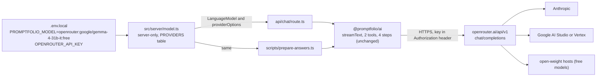
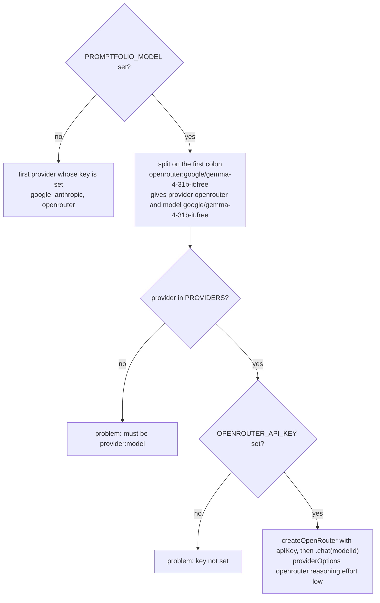

# M7.1 plan: OpenRouter as a model provider

- **Status:** Done (2026-10-29). Plan approved with a free default model and
  the recommended defaults for the other open decisions.
- **Date:** 2026-10-29
- **Roadmap:** a small step between M7 and M8, like M1.1. It unblocks M8's model-based manual
  checks; it is not a product feature.

This plan is self-contained so it can be discussed outside the coding session. Background:
[ADR 0003](../adr/0003-ai-sdk-selection.md) (AI SDK v7, direct provider packages),
[M7 plan](m7-prepared-starter-answers.md) (prepared answers and the generator script), and the
learning notes on [server-side secrets](../learning/server-side-secrets.md),
[model requests and tokens](../learning/model-requests-and-tokens.md), and
[tool calling](../learning/tool-calling.md).

## Objective

Let the owner run the chat and the `prepare-answers` script through **OpenRouter** by setting
`PROMPTFOLIO_MODEL=openrouter:<model>` and `OPENROUTER_API_KEY`, with the same tools, 4-step loop,
budgets, output allowlist, and low reasoning as the existing providers. Nothing else in the app
or in `@promptfolio/ai` changes.

## Why now

The developer's `.env.local` has only a Google key. Gemini (`gemini-3.5-flash-lite` on the free
tier) keeps answering 429 (rate limit) and 503 ("high demand"), which blocked M8's model-based
manual checks and makes `prepare-answers` unreliable. OpenRouter is one API key that reaches many
models from many upstream providers, including some free ones, so a single account can switch to
a model whose upstream is not overloaded.

## Starting point (after M7)

- `apps/portfolio/src/server/model.ts` has a `PROVIDERS` table (`google`, `anthropic`), each with
  a key variable, a default model id, a factory, and `providerOptions` for low thinking.
  `PROMPTFOLIO_MODEL=provider:model` splits on the **first** `:`. Without it, `FALLBACK_ORDER`
  picks the first provider whose key is set.
- `@promptfolio/ai` is provider-agnostic: it receives a `LanguageModel` and forwards
  `providerOptions` unchanged to `streamText`. Limits: `maxOutputTokens` 1,000,
  `maxRetries` 1, 4 steps.
- The `prepare-answers` script calls `createChatModel()` with the same environment as the app and
  runs the 5 starters one after another (2 to 4 model calls each, so about 10 to 20 requests).

## Concepts introduced

1. **Model router (aggregator).** A service with one API and one key that forwards each request to
   one of many upstream providers (Google, Anthropic, OpenAI, open-weight hosts). It adds a hop
   and its own limits and data policies, but lets you change model or upstream by changing a
   string. OpenRouter speaks an OpenAI-style chat completions API with its own extensions.
2. **Provider adapter.** The AI SDK talks to every provider through one interface
   (`LanguageModelV4`). A provider package translates that interface into one HTTP API. Two
   packages can target the same HTTP API with different fidelity, which is the main choice here.
3. **Reasoning round-trips in tool loops.** Thinking models emit reasoning (sometimes encrypted or
   signed) before a tool call. Some upstreams expect that reasoning back, unchanged, in the next
   step of the same turn, or they reject the request or lose context. Whether an adapter carries
   it back decides whether the 4-step tool loop works on those models.
4. **Free-tier quotas.** Free models trade money for tight per-minute and per-day request caps and
   weaker data guarantees. A script that makes 10 to 20 requests per run has to fit both.

## Design

### Where OpenRouter sits



`@promptfolio/ai` does not learn about OpenRouter. Only `model.ts` gets a third table entry.

### Which package (open decision 1)

Both candidates were downloaded from the registry and inspected against the installed
`ai@7.0.154` (`@ai-sdk/provider` 4.0.34, `LanguageModelV4`).

| | `@openrouter/ai-sdk-provider` 3.1.0 | `@ai-sdk/openai-compatible` 3.0.80 |
| --- | --- | --- |
| Maintainer | OpenRouter (`OpenRouterTeam/ai-sdk-provider`), listed as a community provider in the AI SDK docs | Vercel (the AI SDK monorepo) |
| AI SDK v7 | peer `ai: ^7.0.0`, models declare `specificationVersion = "v4"` | depends on `@ai-sdk/provider` 4.0.34 (same as installed), `"v4"` |
| Releases | 3.0.0 on 2026-07-06, 3.1.0 on 2026-09-19, frequent 2.x releases before | 3.0.80 on 2026-10-27, released with the SDK |
| Runtime dependencies | none (bundles its own provider utilities, 1.7 MB `dist`, server only) | `@ai-sdk/provider`, `@ai-sdk/provider-utils` (256 KB `dist`) |
| Reasoning setting | `providerOptions.openrouter.reasoning: { effort }`, which is the parameter OpenRouter documents | `reasoningEffort` sent as `reasoning_effort`, which OpenRouter's reasoning page does not list |
| Reasoning back in tool steps | yes: `reasoning_details` kept in provider metadata and sent back (34 references in `dist`) | no `reasoning_details` support (0 references); only Google's own `thought_signature` format |
| OpenRouter errors | parses OpenRouter's error body | generic OpenAI-style errors |

**Recommended: `@openrouter/ai-sdk-provider@^3.1.0`.** It is the only one of the two that sends
reasoning in the shape OpenRouter documents and carries `reasoning_details` back between tool
steps, which concept 3 says matters for thinking models in our 4-step loop. The cost is a
package maintained by OpenRouter rather than Vercel. ADR 0003's lock-in mitigation still holds:
it is imported only in `model.ts`.

Two findings from reading its code, which the plan relies on:

- It **ignores** the AI SDK v7 call-level `reasoning` option (`getArgs` does not read it). Low
  reasoning must go through `providerOptions.openrouter.reasoning`. The app does not use the
  call-level option today, so nothing changes, but the learning note should say so.
- Everything under `providerOptions.openrouter` is spread into the request body as is, so
  `{ openrouter: { reasoning: { effort: "low" } } }` becomes `"reasoning": { "effort": "low" }`.
  A test checks this (see Tests).

### The `model.ts` change



One new entry, plus the type and fallback list:

```ts
export type ChatProviderName = "google" | "anthropic" | "openrouter";

openrouter: {
  keyVar: "OPENROUTER_API_KEY",
  // A free model: no credits needed, but quotas and data policies differ (see .env.example).
  defaultModelId: "google/gemma-4-31b-it:free",
  createModel: (apiKey, modelId) => createOpenRouter({ apiKey }).chat(modelId),
  // OpenRouter ignores the parameter for models without reasoning.
  providerOptions: { openrouter: { reasoning: { effort: "low" } } },
},

const FALLBACK_ORDER: readonly ChatProviderName[] = ["google", "anthropic", "openrouter"];
```

- The existing split on the first `:` already keeps OpenRouter's `:free` suffix in the model id.
  No parsing change, but a test pins it.
- OpenRouter model ids are `vendor/model`, and they differ from the direct providers' ids (for
  example `anthropic/claude-haiku-5.5`, not `claude-haiku-5-5`). `.env.example` says so.
- `openrouter` goes **last** in the fallback order (open decision 4), so an owner who already
  has a Google or Anthropic key sees no change.
- No optional attribution headers (`HTTP-Referer`, `X-Title`) and no OpenRouter routing settings
  (`models` fallback list, `provider` preferences): not needed to unblock development.

### Default model (open decision 2)

The model list (`GET https://openrouter.ai/api/v1/models?supported_parameters=tools`, fetched
2026-10-29) reports tool support per model. Relevant entries, in US dollars per million tokens:

| Model id | Input | Output | Note |
| --- | --- | --- | --- |
| `anthropic/claude-haiku-5.5` | 0.10 | 0.50 | Upstream is Anthropic, not Google |
| `google/gemini-3.5-flash-lite` | 0.15 | 1.25 | Same model as the developer uses today |
| `google/gemini-3.8-flash` | 0.375 | 1.875 | The app's Google default |
| `google/gemma-4-31b-it:free` | 0 | 0 | Free, tools listed, open-weight |

**Default (decided by the developer, 2026-10-29): a free model, `google/gemma-4-31b-it:free`.**
It costs nothing and needs no credits on the account. Among today's 15 tool-capable `:free`
models it is the one from a mainstream vendor (Google's open-weight Gemma 4), its model list
entry includes the `tools` and `reasoning` parameters, and its 262,144-token context is far
beyond our budgets. Its upstream is an open-weight host routed by OpenRouter, not Google's
Gemini API, so Gemini's "high demand" errors do not apply. Any other id is one
`PROMPTFOLIO_MODEL` line away.

Consequences of a free default, which the implementation documents rather than hides:

- **It can go stale.** OpenRouter adds and removes `:free` variants often. If the default id
  disappears, requests fail with an OpenRouter error (logged on the server, generic message to
  the visitor) until `PROMPTFOLIO_MODEL` names another model. `.env.example` points to the
  `supported_parameters=tools` model list for picking a replacement.
- **Tool-calling quality is unverified.** Manual checks 8 and 9 become the real test of the
  default. If Gemma does not follow the tool protocol well, the review reports it and proposes
  another free model, still without changing the "free default" decision.
- **Quotas** (next section) limit how much can be run per day.
- **Privacy** (next section) applies to the default, so the warning moves into `.env.example`
  next to the setting.

Paid models stay available, for example `openrouter:anthropic/claude-haiku-5.5`. Rough cost if
used: a live turn is about 2 calls, 2,000 to 5,000 input tokens and 300 to 600 output tokens in
total (M5 review), so about US$0.001 with Haiku 5.5, and a full `prepare-answers` run is under
US$0.01. Prices are as listed today and can change. Paid models need prepaid credits (check
OpenRouter's pricing page for current fees), and the existing advice to set a spend limit
applies.

### Free models and the prepare-answers script

From OpenRouter's [limits page](https://openrouter.ai/docs/api/reference/limits), for `:free`
models:

- 20 requests per minute, for every account.
- 50 requests per day with less than 10 credits ever purchased, 1,000 per day with 10 or more.
- Over a limit: HTTP 429 (`rate_limit_exceeded`). A negative balance can block free models too.

What that means here:

- One `prepare-answers` run is 10 to 20 requests (plus up to 1 retry each). Sequential runs stay
  under 20 per minute, but 50 per day allows about 2 runs plus a little chat. With 10 credits
  purchased the daily cap stops mattering.
- Which free models exist changes often (15 tool-capable `:free` models today). Small free models
  are not verified to follow our tool protocol well. M7's gate already refuses to write an answer
  whose cited ids are not in its tool results, so a bad free answer is reported, not stored.
- **Privacy.** Free endpoints are served by upstreams with their own logging and training
  policies, and OpenRouter has separate privacy settings for paid and free models. The real
  profile (`profile.local.json`) is personal data. With a free default, `.env.example` and the
  learning note warn next to the setting: check OpenRouter's privacy settings for free models,
  and prefer a paid model when the real profile is loaded. The code does not enforce this; it is
  the owner's choice about their own data.

**Recommendation:** free model as the default (as decided), and no pacing or retry logic in the
script now. If free-model 429s become a real problem, a delay between starters is a small,
separate change.

### What stays the same

- `@promptfolio/ai`: no change. The output allowlist already drops reasoning chunks and
  `providerMetadata`, so `reasoning_details` never reach the browser. Cross-turn history from the
  browser contains only text, so no reasoning needs to survive between turns. Within a turn, the
  AI SDK keeps the step messages (with provider metadata) and the adapter sends
  `reasoning_details` back.
- The key: read only in `model.ts` (`server-only`), never `NEXT_PUBLIC_`, checked per request.
- Errors: OpenRouter errors become `APICallError`s, which the existing handler logs and turns
  into the generic visitor message.

### Keeping the M8 stash poppable

M8 is stashed as `stash@{0}` and will be restored with `git stash pop`. It changes
`apps/portfolio/.env.example` (appends a `GITHUB_TOKEN` block after `ANTHROPIC_API_KEY=`),
`apps/portfolio/package.json` (adds `@promptfolio/source-github` after `@promptfolio/core`),
`pnpm-lock.yaml`, `docs/ARCHITECTURE.md`, `docs/ROADMAP.md` (around lines 155 to 180), the
learning `README.md` table (after the M7 row), and `server-side-secrets.md` (around its lines 44
and 53). It does not change `model.ts`, `model.test.ts`, ADR 0003, or
`model-requests-and-tokens.md`.

The edits are placed to avoid those spots. Simulated with `git merge-file` against the stash:

- `.env.example` with `OPENROUTER_API_KEY=` inserted **between** the Google and Anthropic keys,
  plus the comment edit: merges cleanly. Appending it after `ANTHROPIC_API_KEY=` conflicts, so the
  plan does not do that.
- `package.json` with `@openrouter/ai-sdk-provider` inserted before `@promptfolio/ai`: merges
  cleanly.
- `pnpm-lock.yaml` **will** conflict. Resolution after the pop: keep either side, then run
  `pnpm install`, which rewrites the lock file from both `package.json` changes.
- `docs/ARCHITECTURE.md` is left alone now (open decision 5); its sequence diagram label "Gemini
  or Claude" gets updated after M8 is restored.
- No new learning note, so the learning `README.md` table is not touched.

## Scope

In scope:

- The `openrouter` entry in `model.ts`, with tests.
- The `@openrouter/ai-sdk-provider` dependency in `apps/portfolio`.
- `.env.example` documentation.
- Learning-note updates, an update section on ADR 0003, and a ROADMAP status row.

Out of scope (deferred, see below): automatic fallback between providers, OpenRouter routing
options and attribution headers, request pacing in `prepare-answers`, any change to
`@promptfolio/ai`, a fake development model, M8 work.

## Files likely to change

| File | Change |
| --- | --- |
| `apps/portfolio/src/server/model.ts` | `openrouter` entry, type, fallback order, comment |
| `apps/portfolio/src/server/model.test.ts` | new cases (see Tests) |
| `apps/portfolio/package.json`, `pnpm-lock.yaml` | add `@openrouter/ai-sdk-provider` |
| `apps/portfolio/.env.example` | `openrouter` in the model comment, `OPENROUTER_API_KEY=` between the two keys, free-model and privacy note |
| `docs/adr/0003-ai-sdk-selection.md` | "Update at M7.1" section |
| `docs/learning/model-requests-and-tokens.md` | OpenRouter paragraph: router, model ids, reasoning mapping, free quotas |
| `docs/learning/server-side-secrets.md` | add `OPENROUTER_API_KEY` to the key list and diagram (top of the note, away from M8's lines) |
| `docs/ROADMAP.md` | status row for M7.1 after the M7 row |
| `docs/plans/m7-1-openrouter-provider.md` | this plan, then review results |

## Dependencies

- **New:** `@openrouter/ai-sdk-provider@^3.1.0` (Apache-2.0, ESM, Node 22 or later, peer
  `ai ^7.0.0` and `zod ^3.25.76 || ^4.1.8`, both satisfied). Server-only use. Trade-offs above.
- **Alternative not chosen:** `@ai-sdk/openai-compatible` (official, smaller, but no
  `reasoning_details` round-trip and a reasoning parameter OpenRouter does not document).
- **No new service** beyond an OpenRouter account, which the developer creates and funds. Claude
  does not create accounts or enter keys.

## Acceptance criteria and tests

Deterministic tests in `model.test.ts`, in its current style:

1. `openrouter:anthropic/claude-haiku-5.5` selects provider `openrouter` and that model id.
2. `openrouter:google/gemma-4-31b-it:free` keeps the `:free` suffix in the model id.
3. `openrouter` alone (and `openrouter:`) uses `google/gemma-4-31b-it:free`.
4. Provider options are `{ openrouter: { reasoning: { effort: "low" } } }`.
5. A missing `OPENROUTER_API_KEY` gives
   `PROMPTFOLIO_MODEL selects openrouter, but OPENROUTER_API_KEY is not set`.
6. Without `PROMPTFOLIO_MODEL`, only an OpenRouter key selects `openrouter`, and Google still wins
   when both are set. The "no key" message lists all three variables.
7. **Request shape, no network:** with `fetch` stubbed (`vi.stubGlobal`), one `streamText` call
   with the created model, its provider options, and one tool sends a request to
   `https://openrouter.ai/api/v1/chat/completions` whose body has the model id,
   `reasoning: { effort: "low" }`, and the tool, and whose `Authorization` header is
   `Bearer <test key>`. This checks the two claims the plan takes from the package's code.

The existing "unknown provider" cases stay (`openai:gpt-5` is still unknown).

Repository checks: `pnpm verify` (lint, typecheck, tests, build).

Manual checks (need the developer's OpenRouter key, so the developer runs them or provides the
key in `.env.local`):

8. `pnpm dev` with `PROMPTFOLIO_MODEL=openrouter` (the free default) and the example profile: a
   question that needs a tool answers with record ids, and the server log shows the tool calls
   and usage. Note any 429s.
9. `pnpm --filter portfolio prepare-answers` with the same setting writes all 5 answers, or
   reports which ones the M7 gate rejected.
10. Optional: the same two checks with a paid model such as `anthropic/claude-haiku-5.5`, for
    comparison.
11. Secret check as in M4: build with a sentinel `OPENROUTER_API_KEY` and search `.next` for it,
    expecting zero matches, with a positive control.

## Open decisions

1. **Package:** `@openrouter/ai-sdk-provider` (recommended) or `@ai-sdk/openai-compatible`.
2. **Default model id: decided, a free model.** Proposed id `google/gemma-4-31b-it:free`
   (recommended), or another tool-capable `:free` model you prefer.
3. **Free models: decided, the default.** Paid models documented as the choice for the real
   profile.
4. **Fallback order:** `openrouter` last (recommended), or not in the fallback at all (only when
   `PROMPTFOLIO_MODEL` names it).
5. **`docs/ARCHITECTURE.md`:** update the "Gemini or Claude" label after the M8 pop (recommended)
   or now, at the risk of a stash conflict.
6. **ADR:** an "Update at M7.1" section on ADR 0003 (recommended) rather than a new ADR. ADR 0003
   chose direct provider packages over the AI Gateway to avoid coupling to one hosting vendor.
   OpenRouter is also a gateway, so the update records why it is acceptable here: optional, one
   entry in `model.ts`, last in the fallback order, and the direct providers stay. It also
   records the free default and its staleness risk.
7. **Milestone label:** record this as M7.1 in the ROADMAP status table (recommended), or only
   as a plan file.

## Learning notes

- `model-requests-and-tokens.md` (update): what a model router is, `openrouter:vendor/model` ids,
  low reasoning through `providerOptions.openrouter.reasoning` (and that the call-level
  `reasoning` option is ignored by this adapter), why `reasoning_details` must go back in a tool
  loop, free-tier quotas, and the privacy caveat. Further reading: OpenRouter's limits, reasoning
  tokens, and tool calling pages, and the AI SDK's OpenRouter provider page.
- `server-side-secrets.md` (update): the third key.
- No new note: the router concept fits the existing model-requests note.

## Deferred ideas

- **Development fake model.** `PROMPTFOLIO_MODEL=fake` returning a `MockLanguageModelV4` from
  `ai/test` with scripted tool calls and text, so the UI and scripts can run with no key and no
  network. Useful, but it has to stay out of production builds and its scripted answers would
  need maintaining. Propose separately if provider outages keep blocking manual checks.
- Automatic fallback to another provider or model on 429 or 503 (OpenRouter's `models` list or
  our own retry). Belongs with M11 reliability.
- Pacing and backoff in `prepare-answers` for free-model quotas.
- OpenRouter attribution headers and provider routing preferences.

## Verification plan

Run `pnpm verify` and report its actual output. Run manual checks 8 to 11 only if an OpenRouter
key is available, and report which ones ran. Re-run the stash merge simulation on the final
`.env.example` and `package.json` before reporting.

## Review results

Checks run on 2026-10-29:

- `pnpm verify` (lint, typecheck, tests, build) passed. `model.test.ts` has 5 new tests,
  including the request-shape test with a stubbed `fetch`.
- Secret check: a build with a sentinel `OPENROUTER_API_KEY` had 0 matches anywhere in `.next`.
  The default model id (positive control) was found in `.next/server` and not in `.next/static`.
- Stash merge simulation on the final files: `.env.example`, `package.json`, `ROADMAP.md`, and
  `server-side-secrets.md` merge cleanly. `pnpm-lock.yaml` will conflict as expected.
- Manual check 9, with `openrouter:recursive/flint-v1.0:free` (the developer's choice, not the
  default Gemma) and the example profile: tool calls ran (`listProfileRecords`, then
  `getProfileRecord`), and 4 of 5 answers were accepted in 34 s with cited record ids. "Summarize
  the work experience." was rejected as `not-finished (length)`: 1,219 reasoning tokens against
  the 1,000-token cap. The example answers file was restored afterwards.
- Manual check 8: a non-starter question to the developer's running dev server returned a
  grounded answer citing `[service-catalog]` in 4.7 s, with only allowlisted chunk types. That
  server was not started in this session, so its log (provider and tool calls) was not seen.
- Not run: the default `google/gemma-4-31b-it:free`, and a paid model.

Change added during review, approved by the developer: `CHAT_LIMITS.maxOutputTokens` raised from
1,000 to 2,000 per model call, for live chat and the script. Low reasoning effort is only a hint,
and some free models exceed it. This doubles the worst-case output per call on the public
endpoint. `STORAGE_LIMITS.maxMessageChars` (16,000) stays: one call's 2,000 tokens is roughly
8,000 characters.

Observed model quality issue, not addressed here: one answer used "his" for the profile owner,
which the profile does not state. The system prompt could ask for the name or "they".

Rerun of check 9 with the 2,000 cap (same model): 5 of 5 accepted, exit 0, all calls finished
with `stop`, reasoning 590 to 796 tokens per call. Reasoning length varies from run to run, so this
run alone does not prove the higher cap was needed; it shows the cap now leaves room. The example
answers file was restored again.
