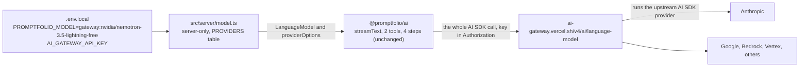

# M7.2 plan: Vercel AI Gateway as a model provider

- **Status:** Done (2026-10-29), live checks blocked by Vercel's card requirement. Approved with a `$0` default model and the
  training filter off, the recommended defaults for the other decisions, and M8 stashed again
  so M7.2 lands first.
- **Date:** 2026-10-29
- **Roadmap:** a second small development unblocker after
  [M7.1](m7-1-openrouter-provider.md), like M1.1. Not a product feature.

Background: [ADR 0003](../adr/0003-ai-sdk-selection.md) (direct provider packages, "Update at
M7.1"), the [M7.1 plan](m7-1-openrouter-provider.md) (the `PROVIDERS` table, free-model
findings, the 2,000-token output cap), and the learning notes on
[model requests and tokens](../learning/model-requests-and-tokens.md) and
[server-side secrets](../learning/server-side-secrets.md).

## Objective

Let the owner run the chat and `prepare-answers` through **Vercel AI Gateway** by setting
`PROMPTFOLIO_MODEL=gateway:<vendor/model>` and `AI_GATEWAY_API_KEY`, with the same tools, loop,
budgets, output allowlist, and low reasoning as the other providers. Nothing changes in
`@promptfolio/ai`, and Google, Anthropic, and OpenRouter stay.

## Why now

OpenRouter's free models also ran out (most likely the 50-requests-per-day cap for accounts that
never bought 10 credits). AI Gateway gives every Vercel team a **monthly included credit** that
can be spent on ordinary paid models, so a cheap, reliable model can be used at no cost while the
credit lasts, instead of small free models with daily request caps.

## What the free tier is (checked 2026-10-29)

From Vercel's [pricing](https://vercel.com/docs/ai-gateway/pricing),
[rate limits](https://vercel.com/docs/ai-gateway/rate-limits), and
[FAQ](https://vercel.com/docs/ai-gateway/faq) pages:

- **A monthly dollar credit, not a request count.** It starts with the first request and is not a
  trial. The current pages do not state the amount. Older pages and search results say US$5 every
  30 days. Not confirmed on the current docs.
- **Only a subset of models** is eligible. The public model API does not mark which ones; the
  dashboard's model list does (`?freeTier=true`), after signing in.
- **Per-model rate limits**, "lower" than the paid tier, with no published numbers. Over the
  limit: HTTP 429.
- **A payment method may be required.** The FAQ lists `403 customer_verification_required`: "the
  team must add a valid payment method before using free credits". It does not say whether every
  team is asked.
- **Buying credits ends the free tier** (the monthly credit stops). Having a card on file does not
  by itself.
- **Data:** Vercel does not retain or train on prompts. Upstream providers have their own
  policies. `disallowPromptTraining: true` (routing only to providers that do not train) is
  available to all users at no charge. Zero data retention needs Pro or Enterprise.

## Concepts introduced

1. **Gateway as a remote provider.** Unlike OpenRouter's adapter, which translates our calls into
   an OpenAI-style HTTP API, the AI Gateway adapter sends the AI SDK's own call (prompt, tools,
   `providerOptions`, limits) to Vercel, where the matching upstream AI SDK provider runs. That is
   why upstream options such as `anthropic.effort` pass through unchanged.
2. **Credit-based free tier versus request-capped free models.** A dollar credit spent on a cheap
   model can go further than a free model's daily request cap, and the model is better. The limit
   moves from "requests per day" to "dollars per month".
3. **Routing filters as data policy in code.** `disallowPromptTraining` makes "no training on the
   profile" a property of every request rather than an account setting someone has to remember.

## Design



### Package (no new dependency)

`ai@7.0.154` already depends on `@ai-sdk/gateway` 4.0.127 and re-exports `createGateway` from
`ai` (checked in the installed `ai/dist/index.d.ts`). The gateway models declare
`specificationVersion = "v4"`. So the entry imports `createGateway` from `ai`, which the app
already depends on. No `package.json` or lock-file change.

### The `model.ts` entry

```ts
export type ChatProviderName = "google" | "anthropic" | "openrouter" | "gateway";

gateway: {
  keyVar: "AI_GATEWAY_API_KEY",
  // A $0 model. Its upstreams may train on prompts (see .env.example).
  defaultModelId: "nvidia/nemotron-3.5-lightning-free",
  createModel: (apiKey, modelId) => createGateway({ apiKey })(modelId),
  // Passed through to the upstream provider that serves the model.
  providerOptions: {
    anthropic: { effort: "low" },
    google: { thinkingConfig: { thinkingLevel: "low" } },
  },
},

const FALLBACK_ORDER = ["google", "anthropic", "openrouter", "gateway"];
```

- **Provider name `gateway`**, matching the AI SDK's own name for it and the
  `providerOptions.gateway` key. Model ids are `vendor/model` like OpenRouter's, but the catalogs
  differ (for example both have `anthropic/claude-haiku-5.5`, but free models are named
  differently: `nvidia/nemotron-3.5-lightning-free` here, `:free` suffixes there).
- **`AI_GATEWAY_API_KEY`** is the variable name the AI SDK and Vercel use. The key is passed
  explicitly, so the adapter never falls back to an ambient `VERCEL_OIDC_TOKEN`.
- **Low reasoning** is set per upstream vendor, because the gateway passes upstream options
  through by vendor name. Only `anthropic` and `google` keys are set (the vendors the app already
  configures). Models from other vendors, **including the default Nemotron**, run with their
  default reasoning, under the 2,000-token output cap. Nemotron lists effort levels in the
  catalog, but the provider key its upstream reads is not documented, and the AI SDK's call-level
  `reasoning: "low"` option is not forwarded by `@promptfolio/ai` today. Adding that would change
  the package, so it is left out (open decision 7).
- **No `disallowPromptTraining`.** The default model has no upstream that agrees not to train, and
  with the filter on, the gateway refuses the request (400 `no_providers_available`). An owner
  who switches to a model like Haiku 5.5 can turn it on later; that is a one-line change, not a
  setting, in this plan.
- **Last in the fallback order**, so nothing changes for an owner who already has another key.
- Not used: model fallback lists (`models`), provider ordering (`order`, `only`), tags, BYOK.

### Default model (open decision 1)

From the public catalog (`GET https://ai-gateway.vercel.sh/v1/models`, 2026-10-29), US dollars per
million tokens:

| Model id | Input | Output | Upstreams that do not train | Note |
| --- | --- | --- | --- | --- |
| `anthropic/claude-haiku-5.5` | 0.10 | 0.50 | all | Reasoning effort supported, tools, zero retention available |
| `google/gemini-3.5-flash-lite` | 0.30 | 2.50 | all | Google upstream (Gemini capacity) |
| `nvidia/nemotron-3.5-lightning-free` | 0 | 0 | none | Free model, tools listed |
| `poolside/laguna-s-2.1-free` | 0 | 0 | none | Free model, tools listed |

**Default (decided by the developer, 2026-10-29): `nvidia/nemotron-3.5-lightning-free`**, a `$0`
model. Among the `$0` models it has the strongest catalog entry: tool use, structured output,
reasoning with effort levels, and a 1,000,000-token context. It costs nothing, so it does not use
up the monthly credit, which stays available for a paid model.

Consequences, documented rather than hidden:

- **Privacy.** No upstream for it has a no-training agreement, so prompts, which include profile
  facts from tool results, may be used for training. `.env.example` says to use it with the
  fictional example profile, and to switch to a model such as `anthropic/claude-haiku-5.5`
  (US$0.10 / 0.50 per million tokens, paid from the monthly credit) for the real profile.
- **Quality is unverified.** The manual checks are its real test. The M7 gate already refuses to
  store a prepared answer whose citations are not in its tool results.
- **Rate limits** on the free tier are per model and unpublished, and `$0` models may disappear,
  like OpenRouter's.
- **Eligibility and payment method.** A `$0` model may still need the free tier to be active,
  and the team may be asked for a payment method (403 `customer_verification_required`).

### Tests and checks

Deterministic, in `model.test.ts`:

1. `gateway:anthropic/claude-haiku-5.5` selects provider `gateway` and that model id.
2. `gateway` alone and `gateway:` use the default model.
3. Provider options equal the three keys above.
4. A missing `AI_GATEWAY_API_KEY` gives the usual "selects gateway, but ... is not set" message.
5. Fallback: only an AI Gateway key selects `gateway`, any other key wins over it, and the
   "no key" message lists all four variables.
6. Request shape with `fetch` stubbed: one `streamText` call posts to
   `https://ai-gateway.vercel.sh/v4/ai/language-model` with `Authorization: Bearer <test key>`,
   the `ai-language-model-id` header set to the model id, and a body whose `providerOptions`
   contain `anthropic.effort: "low"` and no `gateway` key, and whose `tools` contain the test
   tool. (URL and headers as read from the installed adapter; the test
   pins them.)

`pnpm verify`. Secret check as in M4 and M7.1 (sentinel key, search `.next`).

Manual, with the developer's key: a chat question that needs a tool, and `prepare-answers` with
the example profile, with notes on any 403 or 429 and the credit used (dashboard).

### Files likely to change

| File | Change |
| --- | --- |
| `apps/portfolio/src/server/model.ts` | `gateway` entry, type, fallback order |
| `apps/portfolio/src/server/model.test.ts` | cases 1 to 6 |
| `apps/portfolio/.env.example` | `gateway` in the model comment, `AI_GATEWAY_API_KEY=`, free-tier and payment-method notes |
| `docs/adr/0003-ai-sdk-selection.md` | "Update at M7.2" (see below) |
| `docs/learning/model-requests-and-tokens.md`, `server-side-secrets.md` | gateway paragraph, fourth key |
| `docs/ROADMAP.md` | M7.2 status row |
| `docs/plans/m7-2-ai-gateway-provider.md` | this plan, then review results |

### ADR (open decision 3)

ADR 0003 chose direct provider packages **instead of** AI Gateway model strings, to avoid coupling
to one hosting vendor. This plan does not reverse that: the gateway is an optional fourth entry,
used only when named or when it is the only key set, and the app still never uses plain model
strings. Recommended: an "Update at M7.2" section saying so, rather than a new ADR.

### Working tree and M8

M8 has been restored with `git stash pop` and is **uncommitted** in the working tree. It changes
`.env.example`, `ROADMAP.md`, and `server-side-secrets.md`, which this plan also edits, and not
`model.ts`, `model.test.ts`, ADR 0003, or `model-requests-and-tokens.md`.

**Recommended: commit M8 first, then implement M7.2.** Otherwise the M7.2 edits sit inside
M8's uncommitted changes to the same files, and separating them into two commits needs
interactive staging, which this session cannot do.

## Scope

In scope: the `gateway` entry and tests, `.env.example`, the ADR update, learning notes, the
ROADMAP row.

Out of scope: removing OpenRouter (it stays, open decision 4), gateway model fallbacks and
provider ordering, BYOK, spend reporting, zero data retention (paid plans), OIDC on Vercel
deployments (no deployment before M11), any change to `@promptfolio/ai`, the dev fake model
(still deferred).

## Acceptance criteria

- `PROMPTFOLIO_MODEL=gateway` with `AI_GATEWAY_API_KEY` answers a tool question with record ids,
  and `prepare-answers` accepts the starters, or the review reports exactly which error the free
  tier returned (403 payment method, 403 free-tier model, 429).
- The key appears nowhere in `.next`.
- Existing providers behave as before; all tests and `pnpm verify` pass.

## Open decisions

1. **Default model: decided,** `nvidia/nemotron-3.5-lightning-free`.
2. **`disallowPromptTraining`: decided, off** (the default model cannot be used with it).
3. **ADR:** an "Update at M7.2" section on ADR 0003 (recommended), or a new ADR.
4. **OpenRouter:** keep it (recommended: no cost, already tested), or remove it.
5. **Order of work:** commit M8 first (recommended), or implement now on top of the uncommitted M8.
6. **Milestone label:** M7.2 in the ROADMAP status table (recommended), or plan file only.
7. **Reasoning for non-Anthropic, non-Google models:** leave at the model's default under the
   2,000-token cap (recommended), or add a call-level `reasoning` option to `@promptfolio/ai` in a
   separate, approved change if Nemotron keeps hitting the cap.

## Learning notes

- `model-requests-and-tokens.md` (update): the gateway as a remote provider, credit-based free
  tier versus `$0` models, why `disallowPromptTraining` is off for the default (and what it does),
  and upstream options passing through by vendor name. Further reading: the Vercel pages above and the AI SDK's
  [AI Gateway provider](https://ai-sdk.dev/providers/ai-sdk-providers/ai-gateway) page.
- `server-side-secrets.md` (update): the fourth key, and that it is passed explicitly so an
  ambient OIDC token is never used by accident.

## Verification plan

Run `pnpm verify` and the sentinel-key build check, and report actual output. Run the manual
checks only with the developer's key, and report which ran and what the free tier answered.

## Review results

Change during review, at the developer's request: `.env.example` now lists only each provider with
one example (its default model). The OpenRouter and AI Gateway notes on quotas, free tiers,
payment methods, privacy, and paid-model suggestions were removed from it, including where the
M7.1 plan and this plan said `.env.example` would carry them. Those notes live in
[model requests and tokens](../learning/model-requests-and-tokens.md).

Checks run on 2026-10-29:

- `pnpm verify` (lint, typecheck, tests, build) passed: core 39, ai 99, portfolio 72 tests. The
  build's 2 Turbopack warnings point at the file read in `src/server/prepared-answers.ts` (M7),
  not at this change.
- Secret check: a build with a sentinel `AI_GATEWAY_API_KEY` had 0 matches anywhere in `.next`.
  The default model id (positive control) was in `.next/server` and not in `.next/static`.
- Stash merge simulation: every file this change shares with M8 merges cleanly. No lock-file
  change this time.
- Live check with the developer's key (`prepare-answers`, `PROMPTFOLIO_MODEL=gateway`, example
  profile): the key was accepted (no 401), and every request got 403
  `customer_verification_required`, "AI Gateway requires a valid credit card on file". So the
  wiring is verified up to Vercel's account check, and no model answer through the gateway has
  been seen. The script reported each starter as `error` and wrote nothing; visitors would get
  the generic error message.
- Not run: any successful gateway answer, the dev-server chat check. Both need a card on the
  Vercel team.

The developer chose to commit without a card on file. The provider stays usable once one is
added.
